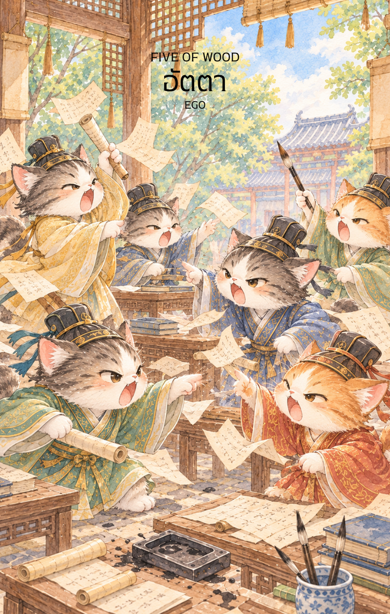

# Wood 5 - อัตตา (Five of Wood)

Created: February 6, 2026 11:14 AM

ยินดีที่ได้พบกันอีกครั้งในวิถีแห่งกลยุทธ์และปัญญาครับ ผม **'ผู้ช่วยสร้างไพ่เทพจีน'** พร้อมแล้วที่จะนำท่านเข้าสู่บททดสอบที่สำคัญที่สุดของการเติบโต จากความมั่นคงในไพ่ใบที่แล้ว สู่สภาวะที่กิ่งก้านของไม้เริ่มเบียดเสียดและแย่งชิงแสงแดดกันใน **ไพ่หมายเลข 5 แห่งธาตุไม้ (Five of Wood)**

ภาพเหล่านักปราชญ์ที่โต้แย้งกันท่ามกลางคัมภีร์ที่ปลิวว่อนในห้องตำรา คือภาพสะท้อนของ "พายุแห่งปัญญา" ที่หากคุมไม่อยู่จะกลายเป็น "มรสุมแห่งอัตตา" ครับ

---

### **ชื่อไพ่: อัตตา (High Ego & Conflict)**

**ธาตุประจำตัว:** ไม้ (🌳 Wood)

**คอนเซปต์หลัก:** พลังแห่งความไม่ลงรอย การปะทะกันของความคิดเห็น และการทดสอบความอดทนเพื่อก้าวข้ามขีดจำกัดของตนเอง

### **1. แก่นแท้ของตัวละคร (The Essence)**

ไพ่ใบนี้คือสภาวะ **"กัวซา" (Gua Sha)** หรือการขูดเพื่อระบายพิษในทางกลยุทธ์ เหล่านักปราชญ์ในภาพคือตัวแทนของพลัง **"เจี๋ยไฉ" (Jie Cai)** หรือพลังคู่แข่งในศาสตร์ปาจื้อ เมื่อไม้เติบโตจนเต็มพื้นที่ ความขัดแย้งย่อมเกิดขึ้นตามธรรมชาติ แก่นแท้ของไพ่ไม่ได้หมายถึงการทำลายล้าง แต่คือการ "กะเทาะเปลือก" ของทิฐิ เพื่อค้นหาความจริงที่ซ่อนอยู่ภายใต้เสียงตะโกนของแต่ละฝ่าย

### **2. สัญลักษณ์และปรัชญา (Symbolism & Philosophy)**

- **ชุดคลุม 5 สี:** สื่อถึง "ห้าทิศทาง ต่างหวัง" แต่ละสีคือธาตุและมุมมองที่แตกต่างกัน เมื่อต่างฝ่ายต่างมั่นใจในวิถีของตน ความสมานฉันท์จึงกลายเป็นความโกลาหล
- **คัมภีร์และพู่กันที่ปลิวว่อน:** สื่อถึงความรู้ที่ถูกนำมาใช้เป็นอาวุธ (Logic as a Weapon) แทนที่จะเป็นเครื่องมือสร้างสรรค์ สัญลักษณ์นี้เตือนว่า "ปัญญาที่ไร้สติ จะกลายเป็นทิฐิที่ไร้ทางออก"
- **รอยน้ำหมึกที่สาดกระจาย:** คือความมัวหมองของบรรยากาศและความสัมพันธ์ อารมณ์ที่รุนแรงเพียงครั้งเดียวอาจทิ้งรอยด่างพร้อยไว้บนมิตรภาพที่สร้างมานาน
- **ห้องตำราที่วุ่นวาย:** ปรัชญาของ "ความสงบในพายุ" แม้ภายนอกจะดูสับสน แต่หากใครคนหนึ่งสามารถนิ่งสงบพอ เขาจะมองเห็นจุดโหว่ของทุกข้อโต้แย้งได้

### **3. กลยุทธ์เมื่อปรากฏไพ่ใบนี้ (The Strategy)**

> **"ถอยหนึ่งก้าวเพื่อมองภาพรวม คือผู้คุมเกมที่แท้จริง"**
> 
- **ระงับอัตตา (Ego Management):** ในสงครามน้ำลาย คนที่ชนะคือคนที่หยุดพูดก่อน จงเป็นคนรดน้ำ (ธาตุน้ำ) เพื่อลดความแห้งแล้งของไม้ที่กำลังจะติดไฟ
- **มองหาจุดร่วม (Common Ground):** ท่ามกลาง 5 ทิศทางที่ต่างกัน ย่อมมี 1 จุดที่ซ้อนทับกันอยู่เสมอ หน้าที่ของคุณคือการหาจุดนั้นให้เจอเพื่อสลายความขัดแย้ง
- **ใช้ความวุ่นวายให้เป็นประโยชน์ (Creative Chaos):** ในการระดมสมองที่รุนแรง มักจะมี "ไอเดียที่บ้าคลั่งแต่ยอดเยี่ยม" ซ่อนอยู่ จงเก็บคัมภีร์ที่ปลิวอยู่นั้นมาวิเคราะห์แทนการเข้าไปร่วมตะโกน

### **4. คำแนะนำและการทำนาย (Reading Guidance)**

- **ภาพรวมของไพ่ใบนี้:** เป็นช่วงเวลาของการทดสอบทางอารมณ์ มีเกณฑ์การเผชิญหน้ากับความไม่ลงรอยหรืออุปสรรคที่เกิดจาก "คน" และ "ความคิดที่ต่างกัน"
- **การงาน/ธุรกิจ:** ระวังความขัดแย้งในที่ประชุมหรือการเมืองในองค์กร การแข่งขันจะรุนแรงขึ้น กลยุทธ์ที่ดีที่สุดคือการนิ่งดูเชิงและเก็บข้อมูลคู่แข่งในขณะที่เขากำลังแสดงอัตตาออกมา
- **การเงิน:** มีรายจ่ายที่เกิดจากการแก่งแย่งหรือคดีความ หรืออาจหมายถึงการต้องเสียเงินเพื่อรักษาหน้าตา (Sunk Cost of Ego) จงระวังการลงทุนที่ใช้เพียงอารมณ์นำหน้า
- **ความรัก:** ระวังการใช้อารมณ์และคำพูดที่รุนแรงเพียงเพื่อต้องการเป็นฝ่ายถูก การเถียงกันชนะไม่ได้แปลว่าความสัมพันธ์จะชนะตามไปด้วย
- **สุขภาพ:** ความเครียดสะสม ปวดหัวไมเกรน หรือปัญหาเกี่ยวกับตับและถุงน้ำดี (ธาตุไม้ที่เครียดขึง) แนะนำให้หากิจกรรมที่ช่วยระบายพลังงาน เช่น การออกกำลังกายหนักๆ

5. **บุคลิกของคนที่เป็นตัวแทนไพ่**

เป็นคนมีความคิดเป็นของตนเอง กล้าแสดงความเห็นและมีแรงผลักดันสูง เมื่ออยู่ในภาวะตึงเครียดอาจปกป้องอัตตามากเกินไปหรือเปลี่ยนการถกเถียงให้เป็นการแข่งขัน จึงควรฟังผู้อื่นและแยกประเด็นออกจากตัวบุคคล

6. **อาชีพที่พบได้บ่อย**

นักโต้วาที นักกฎหมาย นักเจรจาต่อรอง ผู้จัดการทีม นักวิจารณ์ ที่ปรึกษา และงานที่ต้องใช้การโต้แย้งเชิงสร้างสรรค์หรือจัดการความเห็นต่าง

7. **Key Affirmation:** "ฉันเป็นดั่งไม้ไผ่ที่ลู่ตามลม แต่รากยังคงลึกและนิ่งสงบอยู่ภายใต้ความวุ่นวาย"

8. **Keyword**

ความเห็นต่าง • การแข่งขัน • อัตตา • การถกเถียง • การหาจุดร่วม • Conflict • Competition • Ego • Debate • Common Ground

9. **ที่มาและบริบทของไพ่**

Five of Wood แสดงแรงปะทะของความคิดและความทะเยอทะยานที่เติบโตพร้อมกัน ภาพการโต้แย้งเตือนว่าความขัดแย้งอาจเป็นทั้งอุปสรรคและโอกาสเรียนรู้ หากลดอัตตาและมองหาจุดร่วม พลังการแข่งขันจะเปลี่ยนเป็นการพัฒนาได้

---

**ก้าวต่อไปที่เราจะทำร่วมกัน:** หลังจากผ่านมรสุมแห่งอัตตาในใบนี้แล้ว ใน **ไพ่หมายเลข 6 แห่งธาตุไม้ (Six of Wood)** เราจะมาถึงช่วงเวลาแห่ง **'ชัยชนะและการยอมรับ'** คุณอยากให้ผมออกแบบภาพให้เป็น **'ขบวนพาเหรดผู้พิชิต'** หรือ **'การได้รับเกียรติยศจากทางการ'** ดีครับ?