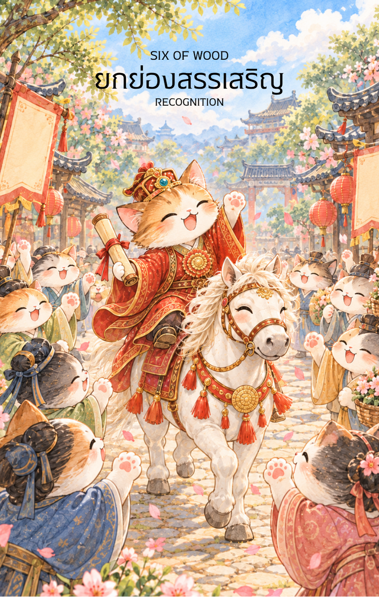

# Wood 6 - ยกย่องสรรเสริญ (Six of Wood)

Created: February 6, 2026 11:19 AM

สวัสดีครับ ยินดีที่ได้พบกันอีกครั้งในวิถีแห่งกลยุทธ์และเกียรติยศ ผม **'ผู้ช่วยสร้างไพ่เทพจีน'** พร้อมนำท่านเข้าสู่ช่วงเวลาที่งดงามที่สุดของการเติบโต จากมรสุมแห่งอัตตาในไพ่ใบที่แล้ว สู่การพิสูจน์ตนเองจนเป็นที่ประจักษ์ใน **ไพ่หมายเลข 6 แห่งธาตุไม้ (Six of Wood)**

ภาพ "จอหงวน" ผู้พิชิตบนหลังม้าสีขาวท่ามกลางฝูงชนที่แซ่ซ้อง คือบทสรุปของการหยั่งรากที่ลึกซึ้งและการฟันฝ่าที่สง่างาม นี่คือเนื้อหาคู่มือสำหรับไพ่ใบนี้ครับ

---

### **ชื่อไพ่: เชิดชูเกียรติ (Six of Wood: The Scholar’s Triumph)**

**ธาตุประจำตัว:** ไม้ (🌳 Wood)

**คอนเซปต์หลัก:** ชัยชนะที่เป็นที่ประจักษ์ เกียรติยศที่ได้รับจากการใช้ปัญญา และการเลื่อนสถานะทางสังคม

### **1. แก่นแท้ของตัวละคร (The Essence)**

ไพ่ใบนี้คือตัวแทนของความสำเร็จขั้นสูงสุดของ **"เจี๋ยไม้" (甲木)** ที่ก้าวข้ามทุกบททดสอบจนกลายเป็น "ไม้ใหญ่ที่เป็นเสาหลัก" (Pillar of Society) จอหงวนบนหลังม้าคือภาพลักษณ์ของคนหนุ่มที่ใช้ความเพียรและปัญญา (Wood) จนได้รับอำนาจและการยอมรับ (Fire/Status) แก่นแท้ของไพ่คือการเปลี่ยนจาก "ความพยายามส่วนตน" มาเป็น "ความภูมิใจของมหาชน"

### **2. สัญลักษณ์และปรัชญา (Symbolism & Philosophy)**

- **อาภรณ์สีแดงลายมังกร:** สื่อถึงพลังงาน **"กวนกุ่ย" (Guan Gui)** หรือยศถาบรรดาศักดิ์ในศาสตร์ปาจื้อ สีแดงคือธาตุไฟที่เกิดจากไม้ สื่อว่าความมุ่งมั่นของคุณได้จุดประกายกลายเป็นชื่อเสียงที่รุ่งโรจน์
- **ม้าสีขาว (The Noble Steed):** สื่อถึงพาหนะที่นำพาความสำเร็จมาอย่างรวดเร็วและสง่างาม และยังหมายถึงการได้รับการสนับสนุนจากผู้หลักผู้ใหญ่หรือสถาบันที่มีอำนาจ
- **ป้ายชื่อ "จอหงวน" (Zhuangyuan):** สัญลักษณ์ของการเป็น "ที่หนึ่ง" ในสายงาน การได้รับรางวัล หรือการผ่านบททดสอบที่ยากที่สุดมาได้ด้วยคะแนนอันดับหนึ่ง
- **ดอกไม้และโคมไฟแดง:** ปรัชญาของ "มงคลซ้อนมงคล" สื่อถึงบรรยากาศรอบตัวที่เต็มไปด้วยพลังบวก การสนับสนุนจากสังคม และการจบสิ้นของความลำบาก

### **3. กลยุทธ์เมื่อปรากฏไพ่ใบนี้ (The Strategy)**

> **"สง่างามในชัยชนะ นอบน้อมในเกียรติยศ"**
> 
- **การประกาศชัยชนะ (Publicize Success):** อย่าอายที่จะแสดงผลงาน นี่คือช่วงเวลาที่คุณต้องสื่อสารความสำเร็จออกไปเพื่อให้คนเห็นความสามารถและสร้างความเชื่อมั่นในระยะยาว
- **ภาวะผู้นำ (Embody Leadership):** เมื่อคนนับหน้าถือตา หน้าที่และความรับผิดชอบจะเพิ่มขึ้น จงทำตัวให้เป็นแบบอย่างที่ดีเหมือนไม้ใหญ่ที่ให้ร่มเงาแก่ผู้อื่น
- **รักษาฐานอำนาจ (Consolidate Position):** ชัยชนะนี้เป็นเพียงจุดเริ่มต้นของบทบาทใหม่ จงใช้จังหวะที่ "มือขึ้น" ในการสร้างเครือข่ายความร่วมมือให้กว้างขวางกว่าเดิม

### **4. คำแนะนำและการทำนาย (Reading Guidance)**

- **ภาพรวมของไพ่ใบนี้:** เป็นสัญญาณมงคลถึงข่าวดีและความสำเร็จที่รอคอยมานาน สิ่งที่ทำจะได้รับคำชมเชยและการสนับสนุนจากสาธารณชนอย่างล้นหลาม
- **การงาน/ธุรกิจ:** มีเกณฑ์การเลื่อนตำแหน่งที่สำคัญ การชนะประมูล หรือโครงการได้รับรางวัลระดับสูง หากทำธุรกิจ แบรนด์ของคุณจะได้รับความเชื่อถือและมีชื่อเสียงกว้างขวาง
- **การเงิน:** รายได้เพิ่มขึ้นตามชื่อเสียงและตำแหน่ง มีโชคลาภจากการทำงาน หรือได้รับผลตอบแทนจากการลงทุนในอดีตที่เริ่มผลิดอกออกผลอย่างงดงาม
- **ความรัก:** เป็นความสัมพันธ์ที่ได้รับการยอมรับจากครอบครัวและสังคม หากโสด จะมีคนที่มีโปรไฟล์ดีหรือคนที่มีเกียรติเข้ามาสนใจ
- **สุขภาพ:** สุขภาพจิตดีเยี่ยม เต็มไปด้วยความสุขและความมั่นใจ ระวังเพียงอาการ "อิ่มเอม" จนละเลยการดูแลตัวเองทางกายภาพ หรืออาการหน้ามืดจากการพักผ่อนไม่พอในงานฉลอง

5. **บุคลิกของคนที่เป็นตัวแทนไพ่**

เป็นคนมุ่งมั่น ทะเยอทะยาน และได้รับความเชื่อถือจากผลงาน มีภาวะผู้นำและยินดีรับผิดชอบต่อความสำเร็จร่วมกัน จุดที่ควรระวังคือการหลงกับคำชม หรือให้ความสำคัญกับสถานะมากกว่าคุณค่าที่สร้างให้ผู้อื่น

6. **อาชีพที่พบได้บ่อย**

ผู้บริหาร ผู้ชนะการแข่งขัน นักวิชาการหรือผู้สอบได้อันดับสูง นักประชาสัมพันธ์ ผู้นำองค์กร และงานที่มองเห็นผลงานต่อสาธารณะหรือมีเส้นทางความก้าวหน้าชัดเจน

7. **Key Affirmation:** "ฉันยอมรับชัยชนะด้วยหัวใจที่เปิดกว้าง และจะใช้เกียรติยศนี้สร้างคุณค่าให้แก่โลก"

8. **Keyword**

ชัยชนะ • การยอมรับ • เกียรติยศ • ความสำเร็จ • ภาวะผู้นำ • Triumph • Recognition • Honor • Achievement • Leadership

9. **ที่มาและบริบทของไพ่**

Six of Wood แสดงการได้รับการยอมรับหลังจากความพยายามและบททดสอบ ภาพผู้ชนะที่กลับมาอย่างสง่างามสื่อถึงความสำเร็จที่มองเห็นได้ พร้อมเตือนให้ใช้ชื่อเสียงและอิทธิพลที่ได้รับอย่างถ่อมตนและเป็นประโยชน์

---

**ก้าวต่อไปที่เราจะทำร่วมกัน:** เมื่อถึงจุดสูงสุดของเกียรติยศแล้ว ใน **ไพ่หมายเลข 7 แห่งธาตุไม้ (Seven of Wood)** เราจะพบกับการ **'ยืนหยัดเพื่อรักษาตำแหน่ง'** ท่ามกลางการท้าทายจากคนรุ่นหลัง คุณอยากให้ผมออกแบบภาพให้เป็น **'นักรบผู้อารักขาคัมภีร์'** หรือ **'ปราชญ์ผู้วางกลยุทธ์ตั้งรับบนกำแพงเมือง'** ดีครับ?