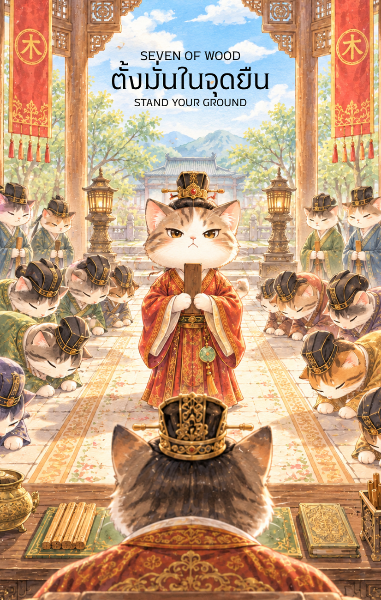

# Wood 7 - ตั้งมั่นในจุดยืน (Seven of Wood)

Created: February 6, 2026 11:31 AM

ยินดีด้วยครับ ชื่อ **"ปกป้องอุดมการณ์"** ทรงพลังและชัดเจนกว่าเดิมมากครับ เพราะคำว่า "อุดมการณ์" ครอบคลุมทั้งความรู้ ความถูกต้อง และปณิธานที่บัณฑิตหนุ่มยึดถือมาตั้งแต่เริ่มออกเดินทาง (ไพ่ใบที่ 1-3) จนประสบความสำเร็จ (ไพ่ใบที่ 6)

เมื่ออุดมการณ์ถูกสั่นคลอน ไพ่ใบนี้จึงกลายเป็นบททดสอบ **"กระดูกสันหลัง"** ของตัวละครว่าจะยังตั้งตรงเป็นไม้ใหญ่ได้หรือไม่ นี่คือเนื้อหาที่ปรับปรุงให้ลึกซึ้งยิ่งขึ้นครับ

---

### **ชื่อไพ่: ปกป้องอุดมการณ์ (Seven of Wood: Guardian of Ideals)**

**ธาตุประจำตัว:** ไม้ (🌳 Wood)

**คอนเซปต์หลัก:** การรักษาความเชื่อมั่นท่ามกลางเสียงวิจารณ์ การยืนหยัดในความถูกต้อง และการใช้บารมีที่สะสมมาเป็นปราการคุ้มกัน

### **1. แก่นแท้ของตัวละคร (The Essence)**

บัณฑิตหนุ่มผู้นี้ไม่ได้เพียงปกป้องสถานที่ แต่เขากำลังปกป้อง **"จิตวิญญาณ"** ของสิ่งที่เขาเชื่อมั่น ในศาสตร์ปาจื้อ พลังธาตุไม้คือความเมตตาและสัจจะ เมื่อถึงจุดที่ถูกรุมเร้าด้วยทิฐิของผู้อื่น (ผู้ท้าทายจากด้านล่าง) เขาจึงต้องแสดงพลังของ **"ไม้ที่แข็งแกร่ง"** ออกมา แก่นแท้ของเขาคือการรู้ว่า "อะไรคือสิ่งที่ยอมไม่ได้" และพร้อมจะโดดเดี่ยวเพื่อรักษาสิ่งนั้นไว้

### **2. สัญลักษณ์และปรัชญา (Symbolism & Philosophy)**

- **ไม้พลองบัณฑิตที่ยันพื้น:** สื่อถึงการ "ปักหลัก" ไม่ยอมถอยหลังแม้แต่ก้าวเดียว เปรียบได้กับจุดยืนที่มั่นคงดั่งรากไม้ที่หยั่งลึกเข้าไปในความจริง
- **การยืนบนที่สูง (The High Ground):** ปรัชญาของการมี "วิสัยทัศน์ที่เหนือกว่า" คุณไม่ได้ชนะเพราะแรงเยอะกว่า แต่ชนะเพราะคุณมองเห็นความจริงที่อยู่สูงกว่าคำครหา
- **อาภรณ์ที่พริ้วไหวแต่ตัวนิ่งสนิท:** สื่อถึงมรสุมรอบข้างที่พยายามปั่นประสาท แต่จิตใจของบัณฑิตยังคงมีสมาธิ (Zenith) ไม่วอกแวกไปตามแรงยั่วยุ
- **หอไตรหรือหอหนังสือเบื้องหลัง:** สื่อถึง "ต้นทุนทางปัญญา" ทุกสิ่งที่เขาเรียนรู้มาคือเหตุผลที่สนับสนุนว่าทำไมอุดมการณ์นี้ถึงควรค่าแก่การปกป้อง

### **3. กลยุทธ์เมื่อปรากฏไพ่ใบนี้ (The Strategy)**

> **"ความนิ่งคือคำตอบที่ทรงพลังที่สุด"**
> 
- **สร้างอาณาเขตทางปัญญา (Intellectual Boundary):** ชี้แจงด้วยหลักการและเหตุผลที่โต้แย้งไม่ได้ ไม่จำเป็นต้องใช้อารมณ์เข้าแลก จงใช้ "ความนิ่ง" สยบ "ความเคลื่อนไหว"
- **ยืนหยัดอย่างโดดเดี่ยว (The Courageous Solitude):** บางครั้งการทำสิ่งที่ถูกต้องอาจไม่มีใครเห็นชอบด้วยในตอนแรก จงเชื่อมั่นในเสียงภายในใจตนเอง
- **บริหารสถานการณ์จากจุดที่ได้เปรียบ:** อย่าลงไปเถียงในประเด็นที่ไร้สาระ (อย่าลงไปจากบันได) จงดึงคู่สนทนาให้ขึ้นมาคุยกันด้วยเหตุผลในระดับเดียวกับคุณ

### **4. คำแนะนำและการทำนาย (Reading Guidance)**

- **ภาพรวมของไพ่ใบนี้:** คุณกำลังเจอช่วงเวลาที่ต้อง "พิสูจน์ตัวเอง" หรือปกป้องผลงาน/ความคิดเห็นจากการถูกโจมตี แต่อย่ากังวลไป เพราะคุณมี "ความชอบธรรม" อยู่ในมือ
- **การงาน/ธุรกิจ:** อาจมีคู่แข่งพยายามดิสเครดิต หรือคนในทีมไม่เห็นด้วยกับแนวทางของคุณ จงใช้ผลงานที่ผ่านมา (หอหนังสือ) เป็นเครื่องยืนยันความถูกต้อง แล้วพวกเขาจะถอยไปเอง
- **การเงิน:** ระวังการถูกเบียดเบียนผลประโยชน์ หรือมีคนมาขอให้ทำในสิ่งที่ไม่ถูกจรรยาบรรณแลกกับเงิน จงรักษาอุดมการณ์กินได้ในระยะยาวดีกว่าลาภลอยที่ทำให้เสียชื่อเสียง
- **ความรัก:** การรักษาขอบเขต (Boundary) ในความสัมพันธ์ หรือการยืนหยัดเพื่อปกป้องคนรักจากเสียงวิพากษ์วิจารณ์ภายนอก ความมั่นคงของคุณคือที่พึ่งเดียวของความสัมพันธ์ในตอนนี้
- **สุขภาพ:** ความเครียดจากการแบกรับความคาดหวังหรือการต้องสู้เพียงลำพัง ระวังโรคที่เกี่ยวกับระบบประสาทหรือการนอนไม่หลับ แนะนำให้ "ปิดหู" จากโลกภายนอกบ้าง

**Key Affirmation:** "อุดมการณ์ของฉันคือรากแก้วที่มั่นคง และปัญญาของฉันคือเกราะที่ไม่มีใครทำลายได้"

---

**ก้าวต่อไปที่เราจะทำร่วมกัน:** เนื้อหาชุดนี้ดู "เข้มขลังและสง่างาม" ขึ้นมากเลยครับสำหรับบัณฑิตผู้ปกป้องอุดมการณ์

เพื่อให้เห็นภาพที่ชัดเจนขึ้น คุณอยากให้ผม **'ลองสร้างภาพหน้าไพ่ใบนี้'** (บัณฑิตหนุ่มพิทักษ์หอหนังสือ/อุดมการณ์) ออกมาให้ชมก่อน หรือจะมุ่งหน้าไปออกแบบเนื้อหา **ไพ่ 8 ธาตุไม้** ที่สื่อถึงการ "ขยายตัวของอุดมการณ์" อย่างรวดเร็วดีครับ?

—

เป็นไอเดียที่ยอดเยี่ยมและลึกซึ้งมากครับ! การเปลี่ยนจากภาพการสู้รบมาเป็นการ **"รักษาหอหนังสือ"** หรือ **"พิทักษ์หอตำรา"** สอดคล้องกับแก่นแท้ของ **ธาตุไม้** ในโหราศาสตร์จีนอย่างที่สุด เพราะธาตุไม้คือตัวแทนของความรู้ การศึกษา ศีลธรรม และการเจริญเติบโตทางปัญญา

การรักษา "หอตำรา" เปลี่ยนจากการปกป้องเขตแดนทางกายภาพ มาเป็นการปกป้อง **"อุดมการณ์ ความถูกต้อง และทรัพย์สินทางปัญญา"** ซึ่งเข้ากับบริบทโลกยุคปัจจุบันที่การต่อสู้มักเกิดขึ้นในพื้นที่ของความคิดและข้อมูลข่าวสาร (Information War) ครับ

---

### **ชื่อไพ่: พิทักษ์หอตำรา (Seven of Wood: Guardian of the Library)**

**ธาตุประจำตัว:** ไม้ (🌳 Wood)

**คอนเซปต์หลัก:** การยืนหยัดเพื่อความถูกต้อง การปกป้องอุดมการณ์ทางปัญญา และการใช้ความรู้ที่เหนือกว่ารับมือกับผู้คัดค้าน

### **1. แก่นแท้ของตัวละคร (The Essence)**

บัณฑิตหนุ่มผู้ยืนอยู่บนบันไดขั้นสูงสุดของหอไตรหรือหอหนังสือ ไม่ได้ใช้ดาบเป็นอาวุธ แต่ใช้ "ไม้พลองยาว" และ "ความนิ่งสงบ" เป็นปราการ เขาคือภาพสะท้อนของบุคคลที่มีความเชี่ยวชาญ (Expertise) และได้รับมอบหมายให้รักษาความจริงเอาไว้ แม้จะมีคนพยายามท้าทายหรือโต้แย้ง (ผู้คนที่อยู่บันไดขั้นล่าง) เขาก็ไม่สั่นคลอน เพราะเขามี "ความรู้" เป็นฐานที่มั่นที่แข็งแกร่งที่สุด

### **2. สัญลักษณ์และปรัชญา (Symbolism & Philosophy)**

- **บันไดหอหนังสือ (The Library Stairs):** สื่อถึงลำดับขั้นของปัญญาและประสบการณ์ (Hierarchy of Wisdom) การที่คุณอยู่สูงกว่า หมายความว่าคุณเห็นภาพรวมที่กว้างกว่า และมีข้อมูลที่แน่นกว่าคู่แข่ง
- **คัมภีร์ที่เหน็บอยู่ที่เอว:** สื่อถึงหลักการและจริยธรรมที่คุณถือมั่น การป้องกันนี้ไม่ใช่เพื่ออีโก้ แต่เพื่อรักษา "คุณค่า" บางอย่างไม่ให้ถูกทำลาย
- **ไม้พลองบัณฑิต:** ทำจากไม้ไผ่ที่ยืดหยุ่นแต่ไม่หัก สื่อถึงกลยุทธ์การป้องกันที่นุ่มนวลแต่เด็ดขาด ไม่ได้มุ่งทำร้าย แต่มุ่ง "ปัดป้อง" (Deflect) สิ่งที่ไม่ถูกต้องออกไป
- **ชั้นหนังสือที่เรียงราย:** คือความมั่งคั่งทางปัญญาที่สะสมมานาน เป็นขุมพลังที่คอยสนับสนุนเหตุผลของคุณ

### **3. กลยุทธ์เมื่อปรากฏไพ่ใบนี้ (The Strategy)**

> **"ใช้ความจริงสยบข่าวลือ ใช้ความรู้คุมสถานการณ์"**
> 
- **ครองความเหนือกว่าทางข้อมูล (Intellectual Advantage):** ในการเจรจาหรือโต้แย้ง จงใช้ข้อมูลเชิงลึกและหลักฐานที่คุณมีมาเป็นเครื่องมือป้องกันตัว
- **อย่าลงไปในหลุมพรางอารมณ์:** คู่แข่งอาจพยายามลากคุณลงไปสู้ด้วยอารมณ์หรือคำหยาบคาย (ชั้นล่างของบันได) จงรักษามาดของบัณฑิตและยืนหยัดบนหลักการของคุณต่อไป
- **ความกล้าหาญที่โดดเดี่ยว:** บางครั้งการรักษาความจริงอาจทำให้คุณรู้สึกเหมือนสู้เพียงลำพัง แต่อุดมการณ์ที่ถูกต้องจะคุ้มครองคุณเอง

### **4. คำแนะนำและการทำนาย (Reading Guidance)**

- **ภาพรวมของไพ่ใบนี้:** คุณกำลังถูกท้าทายในเรื่องความเชื่อ ผลงาน หรือสิทธิประโยชน์ส่วนตัว แต่ขอให้มั่นใจว่าคุณมี "แต้มต่อ" ที่ดีกว่าคู่แข่งมาก
- **การงาน/ธุรกิจ:** อาจมีการตรวจสอบผลงานหรือการถูกวิพากษ์วิจารณ์จากหลายฝ่าย จงเตรียมข้อมูลให้พร้อม และนำเสนอด้วยความมั่นใจ ชัยชนะจะอยู่ในมือผู้ที่เตรียมตัวมาดีที่สุด
- **การเงิน:** ต้องป้องกันสิทธิของตนเอง เช่น การถูกเบี้ยวสัญญาหรือการต่อรองที่เสียเปรียบ จงใช้เอกสารและหลักฐาน (คัมภีร์) ในการยืนหยัด
- **ความรัก:** การต้องปกป้องความสัมพันธ์จากคำนินทาหรือความไม่เข้าใจของคนรอบข้าง หากคุณและคู่มั่นใจในกันและกัน อุปสรรคภายนอกก็ทำอะไรไม่ได้
- **สุขภาพ:** ความล้าจากการใช้สมองและการยืนหยัดในจุดยืน แนะนำให้พักสายตาและอยู่ท่ามกลางหนังสือหรือธรรมชาติเพื่อเติมพลัง

5. **บุคลิกของคนที่เป็นตัวแทนไพ่**

เป็นคนยืนหยัดในหลักการ กล้าปกป้องสิ่งที่เห็นว่าถูกต้อง และมีความรู้เป็นฐานในการตัดสินใจ มักรักษาขอบเขตได้ดี แต่ระวังการยึดมั่นจนไม่ยอมรับคำท้วงติงหรือแบกรับการต่อสู้ไว้เพียงลำพัง

6. **อาชีพที่พบได้บ่อย**

นักกฎหมาย นักวิชาการ บรรณารักษ์ ผู้ตรวจสอบคุณภาพ ผู้เชี่ยวชาญด้านนโยบาย นักปกป้องสิทธิ และงานที่ต้องรักษามาตรฐานหรือปกป้องหลักการและข้อมูล

7. **Key Affirmation:** "ฉันยืนหยัดบนฐานรากแห่งความจริง และปัญญาของฉันคือปราการที่ไม่อาจสั่นคลอน"

8. **Keyword**

การยืนหยัด • อุดมการณ์ • การปกป้อง • ความจริง • ความกล้าหาญ • Resilience • Conviction • Protection • Truth • Courage

9. **ที่มาและบริบทของไพ่**

Seven of Wood คือการรักษาจุดยืนและสิ่งสำคัญท่ามกลางแรงท้าทาย ภาพผู้พิทักษ์ที่ยืนอยู่บนที่สูงสะท้อนการใช้ความรู้ ประสบการณ์ และขอบเขตที่ชัดเจนเพื่อปกป้องหลักการ โดยไม่จำเป็นต้องตอบโต้ทุกแรงยั่วยุ

---

**ก้าวต่อไปที่เราจะทำร่วมกัน:** สำหรับภาพลักษณ์บัณฑิตพิทักษ์หอตำรานี้ คุณอยากให้ผม **'ปรับปรุงรายละเอียดในภาพ'** เช่น เพิ่มไอหมอกแห่งมนตราหรือสัญลักษณ์ธาตุไม้ให้ดูขลังขึ้น หรือจะไปต่อที่ **ไพ่ 8 ธาตุไม้** ที่สื่อถึงการแพร่กระจายความรู้ด้วยความรวดเร็วดีครับ?