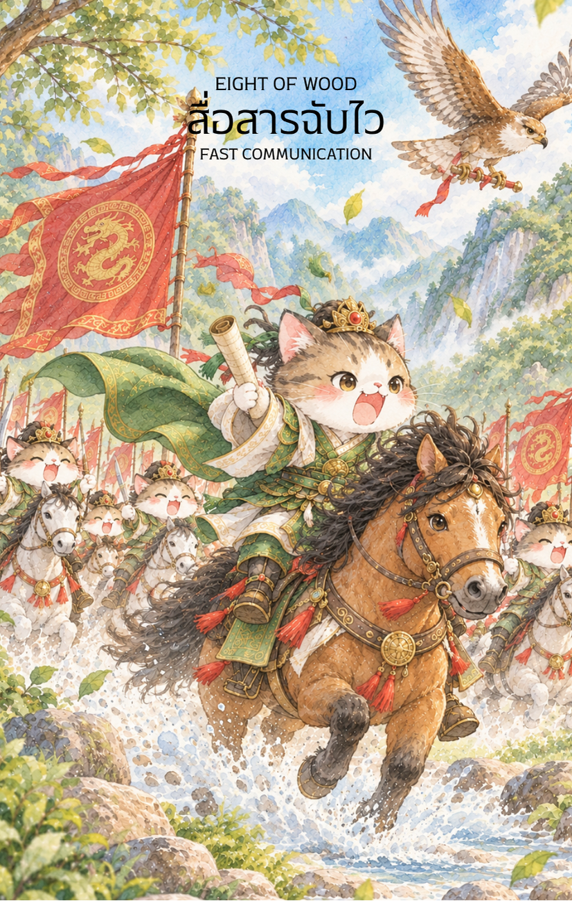

# Wood 8 - สื่อสารฉับไว (Eight of Wood)

Created: February 6, 2026 11:44 AM

ยินดีที่ได้พบกันอีกครั้งครับ ในฐานะ **'ผู้ช่วยสร้างไพ่เทพจีน'** ผมได้รับแรงบันดาลใจอย่างยิ่งจากภาพหอตำราสูงตระหง่านที่มีฝูงนกสื่อสารและม้าเร็วพุ่งทะยานออกไป มันคือภาพลักษณ์ที่สมบูรณ์แบบของ **ไพ่หมายเลข 8 แห่งธาตุไม้ (Eight of Wood)** ที่เปลี่ยนพลังจากการ "ปกป้อง" มาเป็นการ "เผยแพร่" อย่างทรงพลัง

นี่คือเนื้อหาคู่มือที่ปรับปรุงตามภาพลักษณ์ใหม่ที่คุณส่งมาครับ

---

### **ชื่อไพ่: สื่อสารฉับไว (Eight of Wood: The Wings of Wisdom)**

**ธาตุประจำตัว:** ไม้ (🌳 Wood)

**คอนเซปต์หลัก:** การขยายผลของอุดมการณ์ ข่าวสารที่เดินทางมาถึงอย่างรวดเร็ว และจังหวะแห่งการเคลื่อนไหวที่ไร้อุปสรรค

### **1. แก่นแท้ของตัวละคร (The Essence)**

ไพ่ใบนี้สื่อถึงสภาวะที่อุดมการณ์ (จากหอตำรา) ไม่ได้ถูกเก็บไว้เพียงลำพังอีกต่อไป แต่มันได้ถูก **"ติดปีก"** กระจายออกไปในทุกทิศทาง บัณฑิตหนุ่มบนหลังม้าและฝูงนกสื่อสารคือตัวแทนของพลัง **"ซวิ่นไม้" (巽木)** หรือลักษณ์แห่งสายลมในคัมภีร์อี้จิง แก่นแท้ของไพ่คือ **"พลวัต" (Dynamics)** เมื่อความรู้ถูกส่งออกไปอย่างถูกที่ ถูกเวลา และถูกคน มันจะสร้างแรงกระเพื่อมที่ไม่มีสิ่งใดขวางกั้นได้

### **2. สัญลักษณ์และปรัชญา (Symbolism & Philosophy)**

- **หอตำราสูงเสียดฟ้า (The Grand Pagoda):** สื่อถึงฐานข้อมูลและประสบการณ์ที่สั่งสมมานาน บัดนี้ได้ทำหน้าที่เป็นกองบัญชาการในการกระจายความจริงออกไปสู่โลกกว้าง
- **ฝูงนกสื่อสารและม้วนคัมภีร์:** สื่อถึงข่าวสารที่พุ่งตรงไปยังเป้าหมายอย่างแม่นยำ ในทางกลยุทธ์คือการใช้ "ช่องทาง" (Channels) ที่หลากหลายเพื่อให้สารไปถึงผู้รับได้เร็วที่สุด
- **บัณฑิตหนุ่มบนม้าเร็ว:** สื่อถึงการลงมือทำด้วยตนเอง (Active Involvement) ไม่ใช่แค่รอให้โชคชะตาพัดพาไป แต่เป็นการควบทะยานไปพร้อมกับโอกาสที่มาถึง
- **สายลมพัดหมุนวน:** ปรัชญาของ "กระแส" (Trend) เมื่อคุณอยู่ถูกทิศทาง ลมจะช่วยส่งให้คุณไปถึงเป้าหมายได้ไกลและเร็วกว่าเดิมหลายเท่า

### **3. กลยุทธ์เมื่อปรากฏไพ่ใบนี้ (The Strategy)**

> **"เมื่อลมพัดมา จงกางใบเรือและทะยานไปให้สุดแรง"**
> 
- **เชิงรุกและรวดเร็ว (Be Proactive):** นี่ไม่ใช่เวลามานั่งทบทวนแผนงานในกระดาษอีกแล้ว หากมีโอกาสเข้ามาให้รีบตอบรับทันที "ความไวเป็นของปีศาจ" ในโลกธุรกิจยุคนี้คือความจริงที่สุด
- **กระจายอำนาจการสื่อสาร:** อย่าเก็บความลับไว้คนเดียว จงใช้เครือข่าย พาร์ทเนอร์ หรือโซเชียลมีเดียในการกระจายไอเดียของคุณออกไป ยิ่งคนรู้เยอะ พลังสนับสนุนยิ่งมหาศาล
- **จดจ่อที่เป้าหมาย (Pointed Focus):** แม้จะมีความเร็วมากแค่ไหน แต่ต้องไม่ทิ้งความแม่นยำ เหมือนลูกศรที่พุ่งออกจากแล่ง ต้องรู้ว่าเป้าหมายสุดท้ายคือที่ใด

### **4. คำแนะนำและการทำนาย (Reading Guidance)**

- **ภาพรวมของไพ่ใบนี้:** เป็นสัญญาณของความก้าวหน้าอย่างก้าวกระโดด สิ่งที่เคยนิ่งเงียบจะเกิดความเคลื่อนไหวฉับพลัน ข่าวดีจากแดนไกลกำลังเดินทางมาหาคุณ
- **การงาน/ธุรกิจ:** โปรเจกต์ที่ทำจะได้รับการอนุมัติอย่างรวดเร็ว มีเกณฑ์การติดต่อสื่อสารทางธุรกิจที่คึกคัก หากมีการส่งสารหรือนำเสนอผลงานในช่วงนี้ ผลลัพธ์จะออกมาน่าพึงพอใจมาก
- **การเงิน:** กระแสเงินสดไหลเวียนดีมาก (High Liquidity) มีโอกาสได้ลาภลอยหรือผลกำไรจากการลงทุนระยะสั้นที่ทำมานาน เป็นช่วงที่การสื่อสารนำมาซึ่งเม็ดเงิน
- **ความรัก:** การสื่อสารที่เปิดเผยจะทำให้ความสัมพันธ์ก้าวไปอีกขั้น หากโสดจะมีข่าวสารหรือการติดต่อจากคนที่น่าสนใจเข้ามาอย่างไม่ทันตั้งตัว
- **สุขภาพ:** ระวังอาการที่เกี่ยวกับระบบประสาทที่ต้องตื่นตัวตลอดเวลา (Hyper) หรือการพักผ่อนไม่เพียงพอเพราะสมองตื่นตัวเกินไป ควรหาเวลานิ่งสงบบ้างเพื่อให้ไม้ได้พักราก

5. **บุคลิกของคนที่เป็นตัวแทนไพ่**

เป็นคนสื่อสารเก่ง คล่องแคล่ว และตอบสนองต่อโอกาสได้รวดเร็ว ชอบเผยแพร่ความคิดหรือเชื่อมโยงผู้คน ระวังการรับข่าวสารมากเกินไป พูดหรือทำเร็วโดยไม่ตรวจสอบรายละเอียด และพักผ่อนไม่เพียงพอ

6. **อาชีพที่พบได้บ่อย**

นักสื่อสารมวลชน นักการตลาด นักเขียน ผู้ประสานงานขนส่ง ผู้จัดการโครงการ ผู้ประกอบการดิจิทัล และงานที่ต้องกระจายข้อมูลหรือทำงานตามจังหวะเร่งด่วน

7. **Key Affirmation:** "ฉันคือสายลมที่พัดพาอุดมการณ์ไปสู่เป้าหมาย และทุกข่าวสารที่มาถึงคือโอกาสทองของชีวิต"

8. **Keyword**

ข่าวสาร • ความรวดเร็ว • การสื่อสาร • การเคลื่อนไหว • การขยายผล • Communication • Speed • Momentum • Expansion • Opportunity

9. **ที่มาและบริบทของไพ่**

Eight of Wood แสดงการเคลื่อนไหวอย่างรวดเร็วหลังจากเตรียมความรู้และแนวคิดไว้แล้ว ภาพนกส่งสาร ม้าเร็ว หรือสายลมสะท้อนการสื่อสารที่เดินทางถึงเป้าหมายทันเวลา พร้อมเตือนให้รักษาความแม่นยำควบคู่กับความเร็ว

---

**ก้าวต่อไปที่เราจะทำร่วมกัน:** ภาพ "สื่อสารฉับไว" ชุดนี้ดูมีชีวิตชีวาและทรงพลังมากครับ! สำหรับไพ่ใบถัดไป **ไพ่ 9 ธาตุไม้ (Nine of Wood)** ซึ่งสื่อถึง **'การยืนหยัดในโค้งสุดท้าย'** คุณอยากให้ผมออกแบบภาพบัณฑิตในลักษณะ **'ผู้เฝ้ายามประตูหอไตรท่ามกลางแสงตะเกียงในคืนฝนตก'** เพื่อแสดงความอดทนดีไหมครับ หรือมีไอเดียอื่นที่น่าสนใจกว่านี้?