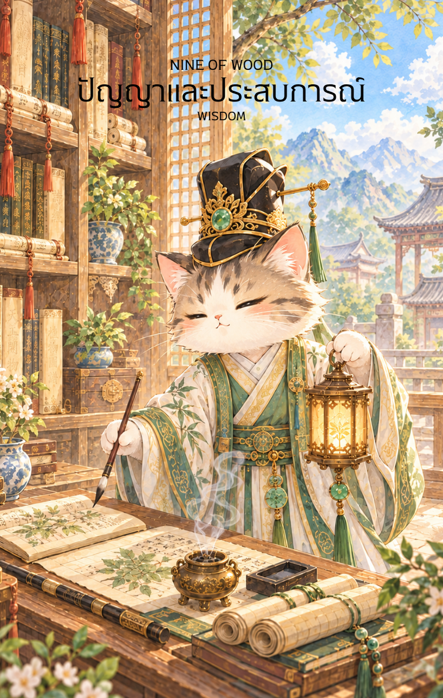

# Wood 9 - ปัญญาและประสบการณ์ (Nine of Wood)

Created: February 6, 2026 12:10 PM

สวัสดีครับผม! ยินดีที่ได้พบกันอีกครั้งในวิถีแห่งกลยุทธ์และภูมิปัญญา ผมคือ **'ผู้ช่วยสร้างไพ่เทพจีน'** พร้อมแล้วที่จะนำท่านเข้าสู่บททดสอบสุดท้ายของพละกำลังและหัวใจ หลังจากที่ข่าวสารได้กระจายออกไปอย่างรวดเร็วในไพ่ใบที่ 8 บัดนี้เราเดินทางมาถึงจุดที่ต้อง **"ยืนหยัด"** เพื่อรักษาทุกสิ่งที่สร้างมาใน **ไพ่หมายเลข 9 แห่งธาตุไม้ (Nine of Wood)** ครับ

ภาพบัณฑิตเฒ่าผู้น่าเกรงขามท่ามกลางหอสมุดที่ไร้ก้นบึ้งนี้ คือภาพสะท้อนของความเหนื่อยล้าที่เปี่ยมไปด้วยพลังอำนาจ นี่คือเนื้อหาคู่มือที่กลั่นกรองมาจากภาพและจิตวิญญาณแห่งธาตุไม้ครับ

---

## **ปัญญาและประสบการณ์ (Nine of Wood: Wisdom and Experience)**

**ธาตุประจำตัว:** ไม้ (🌳 Wood)

**คอนเซปต์หลัก:** ความอดทนในเฮือกสุดท้าย รากฐานปัญญาที่สั่งสม และการยืนหยัดอย่างมั่นคงท่ามกลางแรงกดดัน

### **1. แก่นแท้ของตัวละคร (The Essence)**

บัณฑิตชราในภาพคือร่างจำแลงของ **"ไม้ที่ผ่านร้อนผ่านหนาว"** จนเนื้อไม้แกร่งดั่งเหล็ก เขาคือตัวแทนของความสำเร็จที่ไม่ได้มาด้วยโชคช่วย แต่มาจากการสะสม (Cumulative Success) แม้ร่างกายจะแสดงความเหนื่อยล้า และต้องแบกรับภาระหนัก (ความรับผิดชอบในหอตำรา) แต่แววตาของเขายังคงสว่างไสวด้วยไฟแห่งปัญญา เขาคือผู้ที่ "รู้แจ้ง" ว่าชัยชนะที่แท้จริงไม่ใช่การทำลายผู้อื่น แต่คือการไม่ยอมให้ตนเองล้มลงในก้าวสุดท้าย

### **2. สัญลักษณ์และปรัชญา (Symbolism & Philosophy)**

- **หอตำราที่สูงเสียดฟ้า:** คือคลังความรู้อันมหาศาลที่สั่งสมมาตั้งแต่ไพ่ใบที่ 1-8 เปรียบเสมือน "แต้มบุญ" และ "ประสบการณ์" ที่จะกลายเป็นเกราะป้องกันคุณในยามวิกฤต
- **ไม้เท้าหัวมังกร:** ในทางโหราศาสตร์จีน มังกร (ปีมะโรง) คือคลังธาตุน้ำที่คอยหล่อเลี้ยงไม้ ไม้เท้านี้จึงไม่ใช่เครื่องหมายของความอ่อนแอ แต่คือ "อำนาจและการสนับสนุน" จากเบื้องหลังที่คอยค้ำยันคุณไว้ไม่ให้ล้ม
- **โคมไฟในมือ:** สื่อถึง **"สติปัญญา (Intuition)"** ที่ยังคงส่องสว่างแม้ในยามมืดมิดหรือสับสนที่สุด ความรู้ที่คุณมีจะบอกเองว่าควรจะเดินต่อหรือหยุดนิ่งเพื่อรอจังหวะ
- **อาภรณ์สีน้ำเงินปักทอง:** สีน้ำเงิน (ธาตุน้ำ) ส่งเสริมไม้ และสีทองสื่อถึงความสูงส่งทางจิตวิญญาณ บ่งบอกว่าความเหนื่อยล้าของคุณนั้น "มีค่า" และมีเกียรติ

### **3. กลยุทธ์เมื่อปรากฏไพ่ใบนี้ (The Strategy)**

> **"ใช้ความนิ่งสยบความเคลื่อนไหว ใช้ความเก๋าปิดเกม"**
> 
- **การยืนหยัด (Perseverance):** คุณมาไกลถึง 90% ของทางแล้ว แม้จะเหนื่อยจนอยากวางมือ แต่กลยุทธ์ที่ดีที่สุดตอนนี้คือ "การรักษาที่มั่น" อย่าเพิ่งเริ่มโปรเจกต์ใหม่ แต่จงประคองสิ่งที่ทำอยู่ให้รอดพ้นจากพายุลูกสุดท้าย
- **ใช้ประสบการณ์เป็นเกราะ (Experience as Defense):** เมื่อเจอปัญหา อย่าใช้แรงปะทะ แต่ให้ย้อนกลับไปดูบทเรียนเก่าๆ ใน "หอตำรา" ของคุณ คุณเคยผ่านเรื่องแบบนี้มาแล้ว และคุณรู้คำตอบอยู่แล้ว
- **ระวังหลัง (Precaution):** ความเหนื่อยล้าอาจทำให้คุณเผลอเรอ จงมีสติเหมือนบัณฑิตที่ถือโคมไฟ ตรวจตราความเรียบร้อยรอบตัวให้ดีก่อนจะปิดจ๊อบ

### **4. คำแนะนำและการทำนาย (Reading Guidance)**

- **ภาพรวมของไพ่ใบนี้:** เป็นช่วงเวลาแห่งการทดสอบความอึด คุณอาจจะรู้สึกว่าปัญหาเดิมๆ กลับมารบกวน หรือต้องแบกรับภาระแทนคนอื่น แต่รากฐานที่คุณสร้างมาแข็งแกร่งพอที่จะผ่านมันไปได้แน่นอน
- **การงาน/ธุรกิจ:** ภาระงานหนักหน่วงและกดดันสูง อาจมีการถูกตรวจสอบหรือท้าทายจากคู่แข่งที่จ้องจะเลื่อยขาเก้าอี้ จงใช้ผลงานและหลักฐานเชิงประจักษ์เป็นเครื่องยืนยันความถูกต้อง
- **การเงิน:** เป็นช่วงของการ "เฝ้าระวัง" มากกว่าการลงทุนเพิ่ม รักษาทรัพย์สินที่มีไว้ให้ดี ระวังรายจ่ายจิปาถะที่มาจากการต้องคอยแก้ไขปัญหาเก่าๆ
- **ความรัก:** ความสัมพันธ์ที่เดินมานานจนอาจถึงจุดที่ "อิ่มตัว" หรือเหนื่อยล้าจากการปรับตัวเข้าหากัน ไพ่ใบนี้บอกให้คุณนึกถึงวันแรกๆ และคุณค่าที่ร่วมสร้างกันมา อย่าปล่อยมือเพียงเพราะความเหนื่อยชั่วคราว
- **สุขภาพ:** ระวังอาการปวดหลัง บ่า ไหล่ (จากการแบกภาระ) และสายตาที่ล้าจากการทำงานหนัก ควรหาเวลาสงบนิ่งสมาธิเพื่อฟื้นฟูพลังธาตุไม้ในตัว

5. **บุคลิกของคนที่เป็นตัวแทนไพ่**

เป็นคนมีประสบการณ์ อดทน และรู้จักรับมือกับแรงกดดันจากบทเรียนที่ผ่านมา มักเป็นที่พึ่งของผู้อื่นและไม่ยอมแพ้ง่าย ๆ ระวังการแบกทุกอย่างไว้คนเดียวหรือยึดติดกับความระแวดระวังจนไม่ยอมพัก

6. **อาชีพที่พบได้บ่อย**

ผู้เชี่ยวชาญอาวุโส ครูหรือที่ปรึกษา นักวิจัย ผู้ดูแลหอจดหมายเหตุ ผู้บริหารความเสี่ยง และงานที่ใช้ประสบการณ์แก้ปัญหาหรือดูแลความต่อเนื่อง

7. **Key Affirmation:** "ประสบการณ์ของฉันคือปราการที่แข็งแกร่งที่สุด และความอดทนของฉันจะนำไปสู่ชัยชนะที่ยั่งยืน"

8. **Keyword**

ประสบการณ์ • ความอดทน • การยืนหยัด • ความระมัดระวัง • การปกป้อง • Experience • Resilience • Perseverance • Boundaries • Wisdom

9. **ที่มาและบริบทของไพ่**

Nine of Wood สะท้อนช่วงท้ายของการต่อสู้ที่ต้องอาศัยความอดทนและบทเรียนที่สั่งสม ภาพบัณฑิตผู้ผ่านเหตุการณ์มากมายเตือนให้ปกป้องสิ่งสำคัญอย่างมีสติ พร้อมตระหนักถึงขีดจำกัดและพักฟื้นก่อนเริ่มก้าวต่อไป

---

เราเดินทางมาเกือบจะถึงบทสรุปของตำนานธาตุไม้แล้วนะครับ เหลือเพียงใบสุดท้ายคือ **ไพ่ 10 ธาตุไม้ (Ten of Wood)** ซึ่งเป็นสภาวะของ "ภาระที่ยิ่งใหญ่หรือการสิ้นสุดเพื่อเริ่มใหม่"

**ท่านอยากให้ผมออกแบบภาพไพ่ใบที่ 10 ให้เป็นลักษณะของ 'บัณฑิตที่แบกม้วนคัมภีร์มหาศาลจนแทบก้าวไม่ออก' เพื่อสื่อถึงภาระ หรือจะเป็น 'ต้นไม้ใหญ่ที่แผ่กิ่งก้านปกคลุมทั้งเมือง' เพื่อสื่อถึงความสำเร็จที่มาพร้อมความรับผิดชอบดีครับ?**