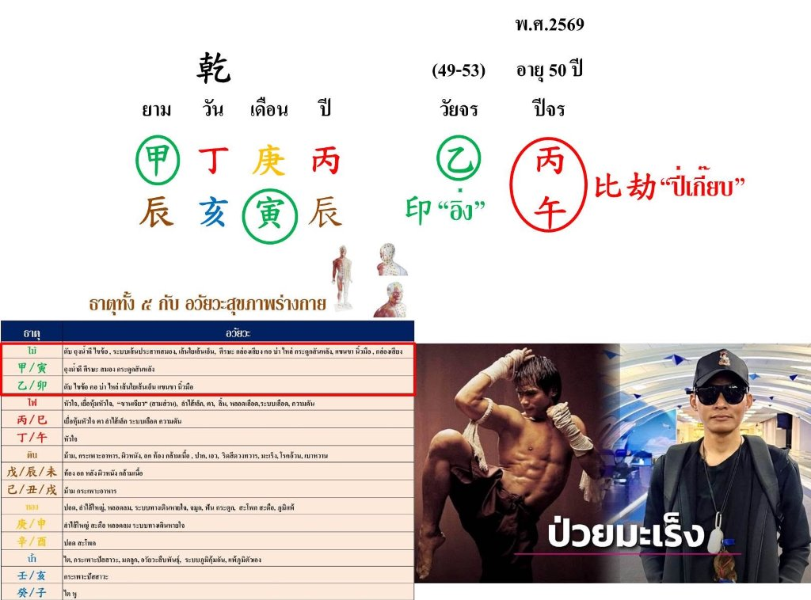
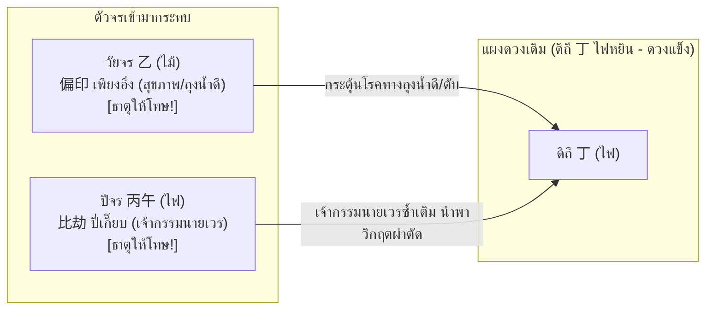

# กรณีศึกษาที่ 02: ดวงจา พนม (Tony Jaa) — ดวงแข็งไม่เอา 印 และ 比劫 กับวิกฤตมะเร็งถุงน้ำดี

> **แหล่งที่มา:** เพจ *แม่ไม้ดวงจีน 八字 : Destiny Detective* (#ขออนุญาตครูดวงจาพนมเพื่อกรณีศึกษาและเพื่อเป็นวิทยาทาน)  
> **หมวดหมู่:** กรณีศึกษาบุคคลมีชื่อเสียง / สุขภาพและโรคร้ายแรง / กฎดวงแข็งไม่เอาอิ่งและปี่เกี๊ยบ  
> **ภาพประกอบ:** [docs/bazi/images/case_02_tony_jaa.jpg](docs/bazi/images/case_02_tony_jaa.jpg)



---

## 1. ข้อมูลแผงดวงชะตา (Natal Chart)

```
[แผงดวง ๔ เสา — จา พนม (乾 เพศชาย)]
ยาม       วัน      เดือน     ปี
甲       丁       庚       丙
辰       亥       寅       辰
```

* **ดิถีวัน (Day Master):** **`丁` (ไฟหยิน)**
* **ช่วงเวลาเกิดเหตุการณ์:** 
  * **ปีเกิดเหตุ:** พ.ศ. 2569 (ค.ศ. 2026) อายุ 50 ปี
  * **วัยจร (Da Yun):** เสวยอายุช่วง 49–53 ปี เข้าเสา **`乙`**
  * **ปีจร (Liu Nian):** ปี **`丙午`**

---

## 2. การวิเคราะห์ความแข็งแกร่งของดวง (Chart Strength Analysis)

* **สถานะดวง:** **“ดวงแข็ง”** (พื้นฐานดวงมีกำลังไฟและไม้หนุนเนื่อง)
* **กฎเหล็กของสายวิชา:**
  > **“#ดวงแข็งไม่เอา印อิ่งและ比劫ปี่เกี๊ยบ”**
  * เมื่อเป็นดวงแข็ง ธาตุที่ให้โทษเด็ดขาด (忌神 “กี่ซิ้ง”) คือ:
    1. **ธาตุไม้ (木):** คือ **印 “อิ่ง”** (ตัวกำเนิดดวง ซึ่งทำให้ไฟยิ่งล้นเกินจนวิปริต)
    2. **ธาตุไฟ (火):** คือ **比劫 “ปี่เกี๊ยบ”** (พวกพ้อง/ธาตุเสมอดิถี ซึ่งกลายเป็นตัวแย่งลาภและเป็นตัวพิฆาต)

---

## 3. กลไกการเกิดโรคภัย: วัยจร `乙` และ ปีจร `丙午`



### 1. วัยจร `乙` (ไม้หยิน):
* **ความหมายทางสิบเทพ:** คือ **偏印 “เพียงอิ่ง”** $\rightarrow$ หมายถึง **สุขภาพ, ร่างกาย, โรคภัย**
* **ความหมายทางกายวิภาค (Anatomy):**
  * ธาตุไม้ (木) ควบคุม: **ตับ และ ถุงน้ำดี**
  * ในระดับเฉพาะเจาะจง: ไม้หยาง `甲/寅` คือ ถุงน้ำดี ส่วนไม้หยิน `乙/卯` คือ ตับ/ท่อน้ำดี
  * เมื่อ `乙` จรเข้ามาในฐานะ **忌神 (ธาตุให้โทษ)** จึงเกิดความผิดปกติในระบบ **“ถุงน้ำดีและตับ”** โดยตรง

### 2. ปีจร `丙午` (ไฟหยาง มะเมีย):
* **ความหมายทางสิบเทพ:** คือ **比劫 “ปี่เกี๊ยบ”**
* **นัยยะของปี่เกี๊ยบที่เป็นธาตุให้โทษ:**
  * เปรียบเสมือน **“เจ้ากรรมนายเวร”** ที่เดินทางมาทวงหนี้เคราะห์กรรม
  * กระตุ้นให้ไฟในร่างกายเผาไหม้ร้อนจัด โหมกระพือให้เซลล์เนื้อร้ายเติบโตอย่างรวดเร็ว เกิดการผ่าตัดเสียเลือดเนื้อครั้งใหญ่

---

## 4. ผลลัพธ์และเหตุการณ์จริงตามประวัติศาสตร์

* **อาการป่วย:** จา พนม ตรวจพบว่าเป็น **มะเร็งถุงน้ำดีระยะที่ 3** (Gallbladder Cancer Stage 3)
* **การรักษา:** ได้เข้ารับการผ่าตัดใหญ่อย่างเร่งด่วนและทำเคมีบำบัด (คีโม)
* **สภาพปัจจุบัน:** การผ่าตัดประสบความสำเร็จและมีอาการแข็งแรงขึ้นมาก ซึ่งสะท้อนถึงพื้นฐานดวงที่แข็งแรงและการแพทย์สมัยใหม่

---

## 5. บทเรียนสำคัญสำหรับคลังความรู้แม่หมอติ๊ดติ๊ด

1. **การจำแนกโรคจากสิบเทพ:**  
   * **印 “อิ่ง” (ให้โทษ):** ต้องตรวจเช็คสุขภาพและอวัยวะประจำธาตุนั้นทันที
   * **比劫 “ปี่เกี๊ยบ” (ให้โทษ):** มักส่งผลให้เกิดการผ่าตัด อุบัติเหตุ หรือวิกฤตเจ้ากรรมนายเวร
2. **การผูกโยง 5 ธาตุกับอวัยวะ:**  
   ระบบพยากรณ์ AI สามารถใช้โมเดล [07_san_hui_seasonal_combinations.md](file:///c:/BumjiJob/MaeMorTidTid/docs/bazi/theory/14_five_elements_health_and_anatomy.md) ในการแจ้งเตือนจุดเสี่ยงทางสุขภาพของผู้ใช้งานเมื่อมีปีจรหรือวัยจรที่เป็นธาตุให้โทษเข้ามากระทบ

