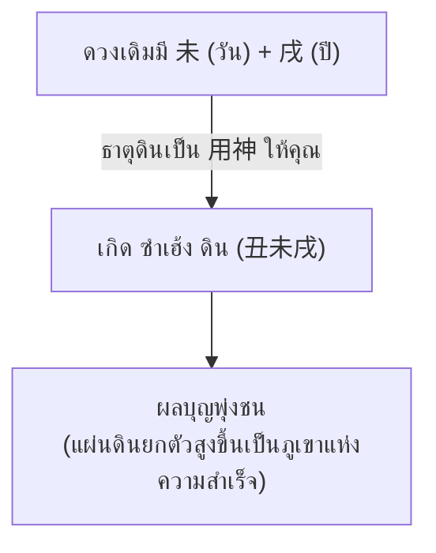

# กรณีศึกษาที่ 03: ครูดวงโดนัลด์ ทรัมป์ (Donald Trump) — 三刑 “ซำเฮ้ง” ดินให้คุณ พลิกสู่มหาเศรษฐีและประธานาธิบดี

> **แหล่งที่มา:** เพจ *แม่ไม้ดวงจีน 八字 : Destiny Detective* (โพสต์ครูดวงโดนัลด์ ทรัมป์)  
> **หมวดหมู่:** กรณีศึกษาผู้นำระดับโลก / ซำเฮ้งธาตุดินให้คุณ (ผลบุญพุ่งชน) / ความสำเร็จในอสังหาริมทรัพย์  
> **ภาพประกอบ:** [docs/bazi/images/theory_16_san_xing_earth.jpg](docs/bazi/images/theory_16_san_xing_earth.jpg)

---

## 1. ข้อมูลแผงดวงชะตา (Natal Chart)

```
[แผงดวง ๔ เสา — โดนัลด์ ทรัมป์ (อดีต ปธน. สหรัฐฯ คนที่ 45)]
ยาม       วัน      เดือน     ปี
己       己       甲       丙
巳       未       午       戌
```

* **ดิถีวัน (Day Master):** **`己` (ดินหยิน)**
  * **ลักษณะเฉพาะของดิถี `己`:** ดินปนน้ำ ดินเหนียว เป็นคนมีหัวการค้า หาเงินเก่ง สติปัญญาดี มีความยืดหยุ่น ปรับตัวเก่ง ชอบการเปลี่ยนแปลง เจ้าชู้ และชอบแสวงหาผลประโยชน์ทางธุรกิจ

---

## 2. การวิเคราะห์ความแข็งแกร่งของดวง (Strength Analysis)

* **สถานะดวง:** **“ดวงอ่อน”** (ดิถีดิน 己 เป็นดวงอ่อน)
* **การคัดเลือกธาตุให้คุณ vs ให้โทษ:**
  * **ธาตุที่ให้คุณ (用神 “เอ่งซิ้ง”):** **ธาตุไม้ (木)**, **ธาตุไฟ (火)**, และ **ธาตุดิน (土)**
  * **ธาตุที่ให้โทษ (忌神 “กี่ซิ้ง”):** **ธาตุทอง (金)** และ **ธาตุน้ำ (水)**
* **จุดเด่นพิเศษในแผงดวงเดิม:**
  * ในแผงดวงมีแต่ธาตุ **ไฟ (`丙`, `巳`, `午`)**, **ดิน (`己`, `未`, `戌`)**, และ **ไม้ (`甲`)** 
  * **ไม่มีธาตุที่ให้โทษ (ทอง และ น้ำ) ปรากฏอยู่ในแผงดวงเดิมเลยแม้แต่ตัวเดียว!**

---

## 3. มิติของ 三刑 “ซำเฮ้ง” (丑 未 戌) ในดวงทรัมป์

ในแผงดวงเดิมของทรัมป์ มีราศีล่างของธาตุดินอยู่แล้ว 2 ตัว คือ:
* เสาวันมี **`未`**
* เสาปีมี **`戌`**

ขาดเพียง **`丑`** ตัวเดียวก็จะครบลูป **三刑 “ซำเฮ้ง” (丑-未-戌)**  
เนื่องจากธาตุดินเป็น **ธาตุให้คุณสูงสุด (用神)** เมื่อปีจรหรือวัยจรที่เป็นธาตุดินเข้ามาชน จึงกลายเป็น **“ผลบุญพุ่งชน”** สร้างความมั่งคั่งและชื่อเสียงอย่างก้าวกระโดด:



---

## 4. ไทม์ไลน์พิสูจน์ประวัติศาสตร์ความสำเร็จ

### 1. อายุ 27 ปี (พ.ศ. 2516 — ปีจร `癸丑`):
* ปีจรนำ **`丑`** เข้ามาบรรจบกับ `未` และ `戌` ในดวงเดิม $\rightarrow$ **ครบลูป 三刑 “ซำเฮ้ง” ธาตุดินทันที!**
* **ผลลัพธ์จริง:** ประสบความสำเร็จอย่างยิ่งใหญ่ในธุรกิจอสังหาริมทรัพย์ ก่อตั้งและขยายอาณาจักร **The Trump Organization** จนกลายเป็นมหาเศรษฐีหนุ่มชื่อดัง

### 2. อายุ 36 ปี (พ.ศ. 2525 — ปีจร `壬戌`):
* ปีจรนำ **`戌`** (ธาตุดิน) เข้ามาซ้ำเติมพลังดินให้คุณ
* **ผลลัพธ์จริง:** เปิดตัวตึกระฟ้าแลนด์มาร์กระดับโลก **Trump Tower** ใจกลางมหานครนิวยอร์ก ขยายอาณาจักรธุรกิจอสังหาฯ สู่จุดสูงสุด

### 3. อายุ 57 ปี (พ.ศ. 2546/2556 — ปีจร `癸未`):
* ปีจรนำ **`未`** (ธาตุดิน) เข้ามาหนุนพลังดิน
* **ผลลัพธ์จริง:** ประสบความสำเร็จในการขยายธุรกิจสื่อและบันเทิงระดับโลก ผ่านรายการเรียลลิตี้ทีวีโชว์ **The Apprentice** โด่งดังไปทั่วโลก

### 4. พ.ศ. 2567 (ปีจร `甲辰`):
* ปีจรนำ **`辰`** (ธาตุดิน) และ **`甲`** (ธาตุไม้ให้คุณ) เข้ามา
* **ผลลัพธ์จริง:** ความมีชื่อเสียงและกระแสความนิยมหวนกลับมาอย่างยิ่งใหญ่ จนชนะการเลือกตั้งประธานาธิบดีสหรัฐฯ อีกครั้ง

---

## 5. บทสรุปทางวิชาการ

> **“อย่ากลัว ซำเฮ้ง (三刑) หากวิเคราะห์ดวงอ่อน-ดวงแข็งได้อย่างถูกต้อง”**  
> ซำเฮ้งธาตุดินเปรียบเหมือนการเคลื่อนตัวของแผ่นเปลือกโลก สำหรับดวงที่ธาตุดินให้โทษ มันคือแผ่นดินไหวทำลายล้าง แต่สำหรับดวงที่ธาตุดินให้คุณอย่างโดนัลด์ ทรัมป์ มันคือการยกแผ่นดินขึ้นเป็นยอดเขาสูงส่งเทียมฟ้า!

