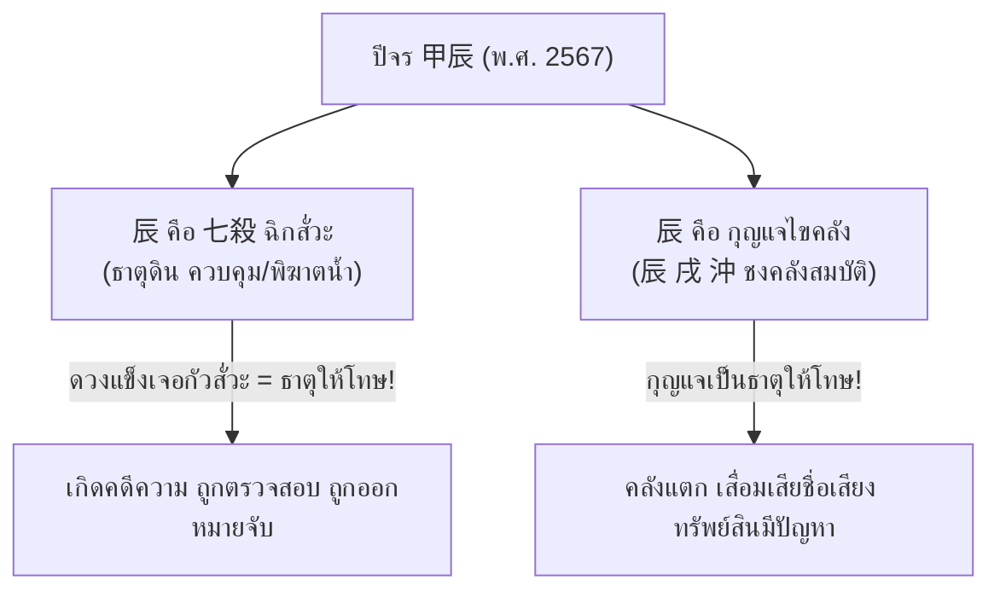

# กรณีศึกษาที่ 04: ครูดวงบิ๊กโจ๊ก (พล.ต.อ. สุรเชษฐ์ หักพาล) — ดวงแข็งเจอกัวสั่วะ (七殺) กับวิกฤตคดีความปี 甲辰

> **แหล่งที่มา:** เพจ *แม่ไม้ดวงจีน 八字 : Destiny Detective* (โพสต์ครูดวงบิ๊กโจ๊ก เปรียบเทียบกับดวงโดนัลด์ ทรัมป์)  
> **หมวดหมู่:** กรณีศึกษาบุคคลในเครื่องแบบ / คดีความและการถูกดำเนินคดี / กฎดวงแข็งเจอกัวสั่วะเป็นโทษ  

---

## 1. ข้อมูลแผงดวงชะตา (Natal Chart)

```
[แผงดวง ๔ เสา — บิ๊กโจ๊ก (乾 เพศชาย)]
ยาม       วัน      เดือน     ปี
(乙)      壬       丙       庚
(巳)      午       戌       戌
```

* **ดิถีวัน (Day Master):** **`壬` (น้ำหยาง)**
* **สถานะความแข็งแกร่งของดวง:** **“ดวงหยางในหยิน (ดวงแข็ง)”**
* **ธาตุสำคัญในดวง:**
  * ฐานดวงมี `戌` ถึง 2 เสา (เดือนและปี)
  * สำหรับดิถีน้ำ `壬` $\rightarrow$ **`戌` คือ 財庫 “ไฉ่โข่ว” (คลังสมบัติธาตุไฟ)**

---

## 2. การวิเคราะห์จังหวะเคราะห์ปีจร พ.ศ. 2567 (ปี `甲辰`)



### 1. `辰` คือ 七殺 “ฉิกสั่วะ” (๗ อสูร / อำนาจพิฆาต):
* **กฎเหล็กของดวงแข็ง:** **คนดวงหยาง (ดวงแข็ง) เมื่อเจอ 官殺 “กัวสั่วะ” จะให้โทษอย่างรุนแรง!**
* **ผลลัพธ์:** 七殺 “ฉิกสั่วะ” จึงแผลงฤทธิ์ในด้านมืด หมายถึง **“คดีความ, การถูกออกหมายจับ, การถูกฟ้องร้องดำเนินคดี, การถูกตั้งกรรมการสอบสวน, และการถูกลิดรอนอำนาจหน้าที่”**

### 2. `辰` คือ “กุญแจ” ที่เข้ามาปะทะคลัง `戌` (ไฉ่โข่วให้โทษ):
* ในดวงเดิมมี `戌` (คลังสมบัติ)
* ปีจร `辰` เข้ามาทำปฏิกิริยาปะทะ `辰 - 戌 沖` เปิดคลังสมบัติ
* **แต่เนื่องจากธาตุดินเป็น “ธาตุให้โทษ”:** การเปิดคลังครั้งนี้จึงไม่ได้เปิดเพื่อรับทรัพย์ แต่เป็นการ **“เปิดคลังเพื่อนำความลับ การตรวจสอบทางการเงิน และเส้นทางการเงินมาเป็นคดีความทำลายตนเอง!”**

---

## 3. ตารางเปรียบเทียบมหากาพย์ปี `甲辰` (2567): ทรัมป์ vs บิ๊กโจ๊ก

| ประเด็นเปรียบเทียบ | โดนัลด์ ทรัมป์ (Donald Trump) | บิ๊กโจ๊ก (พล.ต.อ. สุรเชษฐ์ หักพาล) |
| :--- | :--- | :--- |
| **ดิถีวัน (Day Master)** | `己` (ดินหยิน) | `壬` (น้ำหยาง) |
| **สภาพความแข็งแกร่ง** | **ดวงหยินในหยาง (ดวงอ่อน)** | **ดวงหยางในหยิน (ดวงแข็ง)** |
| **ปีจรที่เข้ามา (2567)** | **`甲辰`** | **`甲辰`** |
| **ความสัมพันธ์กัวสั่วะ** | `甲` คือ **正官 เจี่ยกัว** | `辰` คือ **七殺 ฉิกสั่วะ** |
| **ผลของกัวสั่วะต่อดวง** | **ให้คุณ (用神)** $\rightarrow$ ต้นไม้อ่อนชอบการฝึกฝน | **ให้โทษ (忌神)** $\rightarrow$ ต้นไม้ใหญ่ไม่ชอบการกดดัน |
| **บทบาทของ 辰 / 戌** | `辰` เป็นคลัง, `戌` เป็นกุญแจ **(ให้คุณ)** | `戌` เป็นคลัง, `辰` เป็นกุญแจ **(ให้โทษ)** |
| **ผลลัพธ์ในประวัติศาสตร์จริง** | **ชนะการเลือกตั้ง ปธน. คนที่ 47 ก้าวขึ้นสู่อำนาจสูงสุด** | **ถูกออกหมายจับ ดำเนินคดีความ และถูกปลดจากตำแหน่ง** |

---

## 4. บทสรุปทางวิชาการ

> **“กัวสั่วะ (官殺) มิได้หมายถึงเรื่องร้ายเสมอไป และมิได้หมายถึงยศตำแหน่งเสมอไป”**  
> ความลับอยู่ที่ **“ความอ่อนหรือแข็งของดวงชะตา”**  
> * ดวงอ่อนเจอกัวสั่วะ $\rightarrow$ กลายเป็นผู้มีเกียรติยศชื่อเสียง ได้รับการเลื่อนยศ  
> * ดวงแข็งเจอกัวสั่วะ $\rightarrow$ กลายเป็นคดีความ ถูกตรวจสอบ และถูกจองจำ
