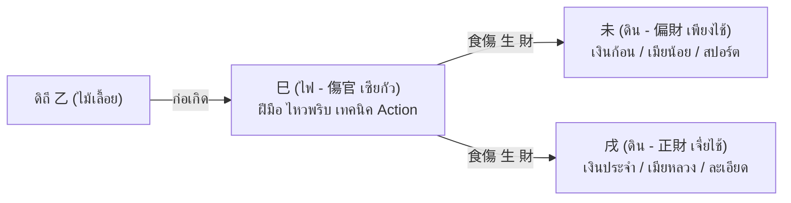

# กรณีศึกษาที่ 05: ครูดวงเป๊ก สัณณ์ชัย — ดิถี 乙 ไม้เลื้อยมือปลาหมึก, 食傷生財 และ ดินยิ่งชงยิ่งรวยทรัพย์รวยผู้หญิง

> **แหล่งที่มา:** เพจ *แม่ไม้ดวงจีน 八字 : Destiny Detective* (โพสต์ครูดวงเป๊ก สัณณ์ชัย)  
> **หมวดหมู่:** กรณีศึกษาบุคคลผู้มีชื่อเสียง / ดิถี 乙 ไม้เลื้อย / การเกิดโชคลาภ 食傷生財 / ดินยิ่งชงยิ่งรวยทรัพย์  

---

## 1. ข้อมูลแผงดวงชะตา (Natal Chart)

```
[แผงดวง ๔ เสา — เป๊ก สัณณ์ชัย เองตระกูล (乾 เพศชาย)]
ยาม       วัน      เดือน     ปี
癸       乙       甲       甲
未       巳       戌       寅
```

* **ดิถีวัน (Day Master):** **`乙` (ไม้หยิน)**
  * เปรียบประดุจ **ไม้เลื้อย / เถาวัลย์** ชอบแผ่ขยาย เกาะเกี่ยว เลื้อยฉวยโอกาสไว (มือปลาหมึก)
* **สถานะความแข็งแกร่ง:** **“ดวงหยาง (ดวงแข็ง)”**
* **ธาตุที่ให้คุณ (用神 “เอ่งซิ้ง”):**
  * **ธาตุไฟ (火):** คือ **食傷 “เจี้ยะเซีย”** หมายถึง การแสดงออก, ความสามารถ, ฝีมือ, เสน่ห์
  * **ธาตุดิน (土):** คือ **財 “ไช้”** หมายถึง เงินทอง, พ่อ, ภรรยา, ผู้หญิง

---

## 2. โครงสร้างสิบเทพและบทบาทของสตรีในดวง



1. **`巳` (เสาวัน):** คือ **傷官 “เซียกัว”**
   * Action, การลงมือทำจริง, เทคนิค, ชั้นเชิง, ไหวพริบปฏิภาณ, เสน่ห์ดึงดูด
2. **`未` (เสายาม):** คือ **偏財 “เพียงไช้” (โชคลาภก้อนโต, เงินเสี่ยงโชค, เมียน้อย)**
   * ใจดี, ใจกว้าง, ใจสปอร์ต, กล้าได้กล้าเสีย, เจ้าชู้, เจ้าสำราญ, นักลงทุน
3. **`戌` (เสาเดือน):** คือ **正財 “เจี่ยไช้” (เงินทองรายได้มั่นคง, ทรัพย์สินหลัก, เมียหลวง)**
   * ขยันขันแข็ง, ละเอียดรอบคอบ, เป็นหลักยึดของครอบครัว
4. **วงจร 食傷 生 財 (เจี้ยะเซีย ก่อเกิด ไช้):**
   * `巳` (ไฟ) ถ่ายเทไปก่อเกิด `未` (ดิน) และ `戌` (ดิน) ส่งผลให้ **ใช้เสน่ห์ ไหวพริบ และชั้นเชิง ผลิตเงินทองและดึงดูดผู้หญิงเข้ามาในชีวิตอย่างต่อเนื่อง!**

---

## 3. มิติพิเศษ: “ธาตุดิน ยิ่งชง ยิ่งดี!”

* **การเฮ้งชงระหว่างเสายามและเสาเดือน:**
  * ราศีล่างในดวงมี **`未` (ดิน)** ทำปฏิกิริยา **刑沖 “เฮ้งชง”** กับ **`戌` (ดิน)**
* **กฎฟิสิกส์แห่งธาตุดิน:**
  > **“ธาตุดิน (土) ยิ่ง 沖 ‘ชง’ ยิ่งแตกตัว ยิ่งเกิดความมั่งคั่ง!”**
* **ผลลัพธ์ในชีวิตจริง:**
  * เมื่อใดก็ตามที่มี **วัยจร หรือ ปีจร ที่เป็นธาตุดิน (土)** โคจรเข้ามากระทบชง
  * ทรัพย์สิน เงินทอง ผลกำไร และความมั่งคั่งจะยิ่งทวีคูณพุ่งทะยานขึ้น
  * และในขณะเดียวกัน **จะมีผู้หญิงและคนรักเข้ามาพัวพันในชีวิตมากยิ่งขึ้นเป็นเงาตามตัว**

---

## 4. ราศีแฝง (暗藏) มหาขุมทรัพย์

* ใน **`巳` (เสาวันเกิด):** มีราศีแฝงคือ ดิน **`戊` (财)** = เงิน, พ่อ, เมีย ฝังแน่นอยู่ใต้ตัวดิถี
* ใน **`寅` (เสาปีเกิด):** มีราศีแฝงคือ ดิน **`戊` (财)** = เงิน, พ่อ, เมีย ฝังลึกอยู่ในรากเหง้าตระกูล

> **บทสรุปครูดวง:**  
> เจ้าชะตาเป็นคนฉลาดหลักแหลม มีชั้นเชิงฝีมือแพรวพราว มือไวฉวยโอกาสเก่งแบบไม้เลื้อยมือปลาหมึก **เป็นบุคคลที่รวยทั้งทรัพย์สินเงินทอง และรวยทั้งเสน่ห์/ผู้หญิงในชีวิต!**

