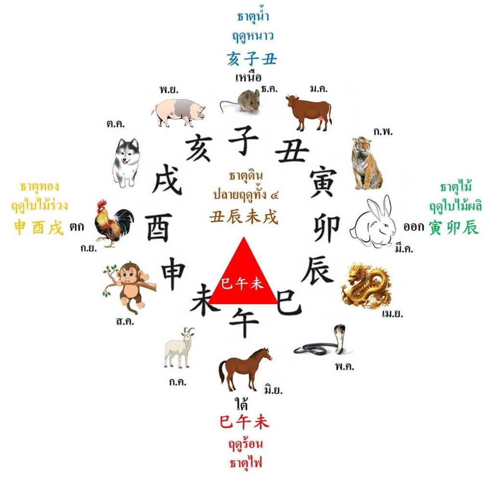
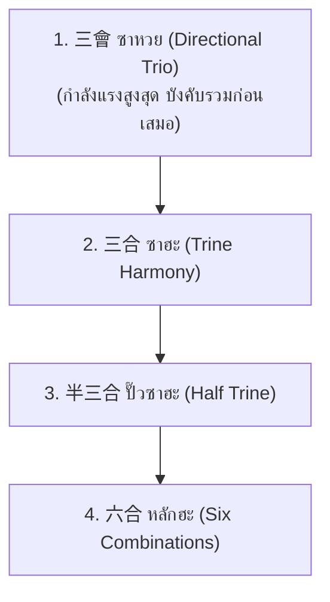

# ทฤษฎีที่ 07: 三會 “ซาหวย” กระแสแห่งฤดูกาล (Directional Seasonal Trio)

> **แหล่งที่มา:** เพจ *แม่ไม้ดวงจีน 八字 : Destiny Detective* (โพสต์ทฤษฎี “ซาหวย”)  
> **หมวดหมู่:** ทฤษฎีราศีล่าง / ปฏิสัมพันธ์ธาตุ / ลำดับความสำคัญของปฏิกิริยาดวงจีน  
> **ภาพประกอบ:** [docs/bazi/images/theory_07_san_hui_seasonal_flow.jpg](docs/bazi/images/theory_07_san_hui_seasonal_flow.jpg)



---

## 1. ปรัชญาและแก่นแท้ของ 三會 “ซาหวย”

* **สรรพสิ่งล้วนเกิดจากเหตุปัจจัย:** เมื่อหมดเหตุปัจจัยสรรพสิ่งย่อมดับไป ก่อเกิด แข็งแรง เสื่อมสลาย ผลัดเปลี่ยนหมุนเวียนเช่นนี้ในฤดูกาลทั้ง ๔ ตามหลักหยิน-หยาง
* **ความหมายของ ซาหวย:** คือ **“กระแสแห่งฤดูกาล”** (Seasonal Directional Flow) หมายถึง ความเป็นน้ำหนึ่งใจเดียวกัน ความกลมเกลียว ประสานร่วมมือ และช่วยเหลือเกื้อกูลกัน
* **พลังอำนาจ:** **三會 “ซาหวย” เป็นกระแสธาตุที่มีกำลังรุนแรงและยิ่งใหญ่ที่สุดในบรรดาปฏิกิริยาราศีล่างทั้งหมด**

---

## 2. กลุ่มฤดูกาลทั้ง ๔ และแม่ธาตุประจำฤดู

| ฤดูกาล | ทิศ | กลุ่มราศีล่าง (ซาหวย) | ช่วงเดือน (สุริยคติ) | ธาตุประจำฤดู | แม่ธาตุ (แกนกลาง) |
| :--- | :--- | :--- | :--- | :--- | :--- |
| **ฤดูใบไม้ผลิ** | ตะวันออก (ออก) | **寅 卯 辰** (ขาล, เถาะ, มะโรง) | ก.พ. - มี.ค. - เม.ย. | **ธาตุไม้ (木)** | **卯** (เถาะ) |
| **ฤดูร้อน** | ใต้ | **巳 午 未** (มะเส็ง, มะเมีย, มะแม) | พ.ค. - มิ.ย. - ก.ค. | **ธาตุไฟ (火)** | **午** (มะเมีย) |
| **ฤดูใบไม้ร่วง** | ตะวันตก (ตก) | **申 酉 戌** (วอก, ระกา, จอ) | ส.ค. - ก.ย. - ต.ค. | **ธาตุทอง (金)** | **酉** (ระกา) |
| **ฤดูหนาว** | เหนือ | **亥 子 丑** (กุน, ชวด, ฉลู) | พ.ย. - ธ.ค. - ม.ค. | **ธาตุน้ำ (水)** | **子** (ชวด) |
| **ปลายฤดูทั้ง ๔** | จุดเปลี่ยน | **辰 未 戌 丑** | เม.ย., ก.ค., ต.ค., ม.ค. | **ธาตุดิน (土)** | คลังธาตุทั้ง 4 |

---

## 3. ธรรมชาติ 3 ระยะของฤดูกาล (ต้น - กลาง - ปลาย)

ในแต่ละฤดูกาล มีการผลัดเปลี่ยน 3 ขั้นตอน ซึ่งสะท้อนบุคลิกภาพและพลังงาน:

1. **四馬 “ซี่แบ้” (๔ ม้าอาชา - ต้นฤดู):** `寅`, `巳`, `申`, `亥`
   * **สภาวะ:** การก่อเกิด, การริเริ่ม, เริ่มต้นสิ่งใหม่ๆ
   * **ลักษณะนิสัย/พลังงาน:** ร่าเริง แจ่มใส สนุกสนาน คล่องแคล่ว ว่องไว
2. **四正 “ซี่เจี่ย” (๔ ยอดขุนพล / สี่สารทิศ - กลางฤดู):** `卯`, `午`, `酉`, `子`
   * **สภาวะ:** แข็งแรง, เติบโตเต็มที่, บริสุทธิ์ทรงพลัง (แม่ธาตุ)
   * **ลักษณะนิสัย/พลังงาน:** มั่นคง, มั่นใจในตัวเองสูง, เชื่อมั่น, ดื้อรั้น เด็ดเดี่ยว
3. **四庫 “ซี่โข่ว” (๔ ขุมคลัง - ปลายฤดู):** `辰`, `未`, `戌`, `丑`
   * **สภาวะ:** เสื่อมโทรม, สุกงอม, เก็บเกี่ยวผลผลิตเข้าคลัง, รอการเปลี่ยนผ่านเข้าสู่ฤดูใหม่
   * **ลักษณะนิสัย/พลังงาน:** นิ่งสงบ, สุขุม, รอดูท่าที, สะสมซ่อนเร้น

---

## 4. กำลังธาตุทั้ง ๕ ใน ๔ ฤดู (Elemental Seasonal Strength)

| ธาตุ | เดือนต้น/กลางฤดู | กำลังธาตุ | เดือนปลายฤดู (ดิน) | กำลังธาตุ |
| :--- | :--- | :--- | :--- | :--- |
| **ไม้ (甲乙)** | 寅 卯 (ใบไม้ผลิ) | **เข้มแข็ง** | 辰 | **อ่อนแอ** |
| | 巳 午 (ฤดูร้อน) | **เสื่อมโทรม** | 未 | อ่อนแอ |
| | 申 酉 (ใบไม้ร่วง) | **เสื่อมหมด** | 戌 | อ่อนแอ |
| | 亥 子 (ฤดูหนาว) | **แข็งแรง** | 丑 | อ่อนแอ |
| **ไฟ (丙丁)** | 寅 卯 (ใบไม้ผลิ) | **แข็งแรง** | 辰 | **เสื่อมโทรม** |
| | 巳 午 (ฤดูร้อน) | **เข้มแข็ง** | 未 | เสื่อมโทรม |
| | 申 酉 (ใบไม้ร่วง) | **อ่อนแอ** | 戌 | เสื่อมโทรม |
| | 亥 子 (ฤดูหนาว) | **เสื่อมหมด** | 丑 | เสื่อมโทรม |
| **ดิน (戊己)** | 寅 卯 (ใบไม้ผลิ) | **เสื่อมหมด** | 辰 | **เข้มแข็ง** |
| | 巳 午 (ฤดูร้อน) | **แข็งแรง** | 未 | เข้มแข็ง |
| | 申 酉 (ใบไม้ร่วง) | **เสื่อมโทรม** | 戌 | เข้มแข็ง |
| | 亥 子 (ฤดูหนาว) | **อ่อนแอ** | 丑 | เข้มแข็ง |
| **ทอง (庚辛)**| 寅 卯 (ใบไม้ผลิ) | **อ่อนแอ** | 辰 | **แข็งแรง** |
| | 巳 午 (ฤดูร้อน) | **เสื่อมหมด** | 未 | แข็งแรง |
| | 申 酉 (ใบไม้ร่วง) | **เข้มแข็ง** | 戌 | แข็งแรง |
| | 亥 子 (ฤดูหนาว) | **เสื่อมโทรม** | 丑 | แข็งแรง |
| **น้ำ (壬癸)** | 寅 卯 (ใบไม้ผลิ) | **เสื่อมโทรม** | 辰 | **เสื่อมหมด** |
| | 巳 午 (ฤดูร้อน) | **อ่อนแอ** | 未 | เสื่อมหมด |
| | 申 酉 (ใบไม้ร่วง) | **แข็งแรง** | 戌 | เสื่อมหมด |
| | 亥 子 (ฤดูหนาว) | **เข้มแข็ง** | 丑 | เสื่อมหมด |

---

## 5. กฎเหล็กลำดับความสำคัญในการรวมธาตุ (Priority Hierarchy)

เมื่อราศีล่างในดวง หรือระหว่างดวงกับวัยจร/ปีจร เกิดปฏิกิริยาพร้อมๆ กัน **ให้พิจารณาตามลำดับศักดิ์ดังนี้**:



### ⚡ กฎการไม่ถูกขัดขวาง (Immunity Rule of San Hui):
> **三會 “ซาหวย” จะร่วมธาตุก่อนเป็นอันดับแรกเสมอ!**  
> ปฏิกิริยาขัดขวางอันได้แก่ **沖 “ชง”, 刑 “เฮ้ง”, 破 “ผั่ว”, 害 “ไห่” จะไม่สามารถขัดขวางการร่วมธาตุของ 三會 “ซาหวย” ได้เลย!**

#### ตัวอย่างพิสูจน์กฎ:
1. **ซาหวยชนะการชง:**
   * แผงดวงมีราศีล่าง: `巳` `亥` `午` `未`
   * แม้ `巳` จะชงกับ `亥` (巳亥沖) แต่ `巳`, `午`, `未` อยู่ด้วยกันครบ จึงจับคู่รวมเป็น **三會 “ซาหวย” ธาตุไฟ** ก่อนทันที ส่งผลให้ `巳` ไม่ชงกับ `亥`
2. **ซาหวยชนะหลักฮะ:**
   * แผงดวงมีราศีล่าง: `申` `卯` `戌` `酉`
   * แม้ `卯` กับ `戌` จะเป็นคู่ภาคี 六合 (卯戌合) แต่มี `申`, `酉`, `戌` ครบสามตัว จึงจับรวมเป็น **三會 “ซาหวย” ธาตุทอง** ก่อนทันที ทำให้ `戌` ไม่ไปร่วมภาคีกับ `卯`
3. **ซาหวยชนะปั๊วซาฮะ:**
   * แผงดวงมีราศีล่าง: `申` `午` `戌` `酉`
   * แม้ `午` กับ `戌` จะเป็นคู่ครึ่งไตรภาคี 半三合 ธาตุไฟ แต่เพราะมี `申`, `酉`, `戌` จึงจับรวมเป็น **三會 “ซาหวย” ธาตุทอง** ก่อนทันที ทำให้ `戌` ไม่ไปร่วมครึ่งไตรภาคีกับ `午`

---

## 6. หลักการพยากรณ์: ให้คุณ (用神) vs ให้โทษ (忌神)

> **เงื่อนไขบังคับ:** การเกิด ซาหวย ต้องมีตัวอักษร **ครบทั้ง ๓ ตัว** (อาจอยู่ในดวงเดิม หรือดวงเดิมมี 2 ตัวแล้วปีจร/วัยจรพามาเติมเต็มอีก 1 ตัว)

### ตัวอย่างกรณีศึกษาปีจร พ.ศ. 2569 (丙午):
สมมุติตั้งดวง:
* เสาเดือนมี `巳`, เสาวันมี `未`
* ดิถีวันเป็นธาตุไฟ `丁`
* ในปี 2569 ปีจรคือ `丙午` นำพา `午` เข้ามาเติมเต็ม กลายเป็น **三會 巳午未 ธาตุไฟ** สมบูรณ์แบบ

1. **กรณีธาตุไฟเป็น 用神 “เอ่งซิ้ง” (ธาตุให้คุณ/ธาตุส่งเสริมดวง):**
   * **ผลพยากรณ์:** ธาตุไฟมีกำลังมหาศาล ส่งผลดีเลิศต่อเจ้าชะตา
   * **เรื่องราว:** พี่น้อง, เพื่อนฝูง, หุ้นส่วนเกิดความสมานฉันท์ มีน้ำหนึ่งใจเดียวกัน ความคิดเห็นสอดคล้อง ร่วมแรงร่วมใจ ช่วยเหลือสนับสนุนซึ่งกันและกันจนประสบความสำเร็จ
2. **กรณีธาตุไฟเป็น 忌神 “กี่ซิ้ง” (ธาตุให้โทษ/ธาตุอริ):**
   * **ผลพยากรณ์:** ธาตุไฟมีกำลังมากเกินไป กลายเป็น的比劫 (ปี่เกี๊ยบ - ตัวแย่งลาภ) ที่ให้โทษอย่างรุนแรง
   * **เรื่องราว:** เกิดการขัดแย้งกับพี่น้อง หุ้นส่วน เพื่อนฝูง แย่งชิงผลประโยชน์ หักหลัง ทะเลาะเบาะแว้ง แย่งลาภ เจอศัตรูคู่แข่งและอุปสรรคถาโถม

> [!IMPORTANT]
> **“ดิถีมีกำลังเข้มแข็ง มิได้หมายความว่า กำลังดวงจะแข็งเสมอไป”**  
> ซาหวยเป็นตัวกำหนดปริมาณกระแสธาตุตามฤดูกาล แต่การชี้ชัดว่าให้คุณหรือให้โทษ ต้องกลับไปพิจารณา **กำลังดวงรวม 8 ตัวอักษร** เสมอ!

---

## 7. แนวทางการเขียนโค้ดสำหรับระบบพยากรณ์ (`bazi.js`)

```javascript
// นิยามกลุ่มซาหวย (Directional Trio / San Hui)
const SAN_HUI_GROUPS = {
  WOOD:  { branches: ['寅', '卯', '辰'], element: 'Wood', season: 'Spring', cardinal: '卯' },
  FIRE:  { branches: ['巳', '午', '未'], element: 'Fire',  season: 'Summer', cardinal: '午' },
  METAL: { branches: ['申', '酉', '戌'], element: 'Metal', season: 'Autumn', cardinal: '酉' },
  WATER: { branches: ['亥', '子', '丑'], element: 'Water', season: 'Winter', cardinal: '子' }
};

// ฟังก์ชันตรวจสอบและล็อกปฏิกิริยาซาหวยก่อนปฏิกิริยาอื่น
function detectSanHui(branchesList) {
  const activeSanHui = [];
  for (const [key, group] of Object.entries(SAN_HUI_GROUPS)) {
    const hasAll = group.branches.every(b => branchesList.includes(b));
    if (hasAll) {
      activeSanHui.push({
        type: 'SAN_HUI',
        group: key,
        element: group.element,
        season: group.season,
        branches: group.branches,
        priority: 1 // Highest priority: Suppresses Clash, Punishment, Harm, Destruction on these branches
      });
    }
  }
  return activeSanHui;
}
```

