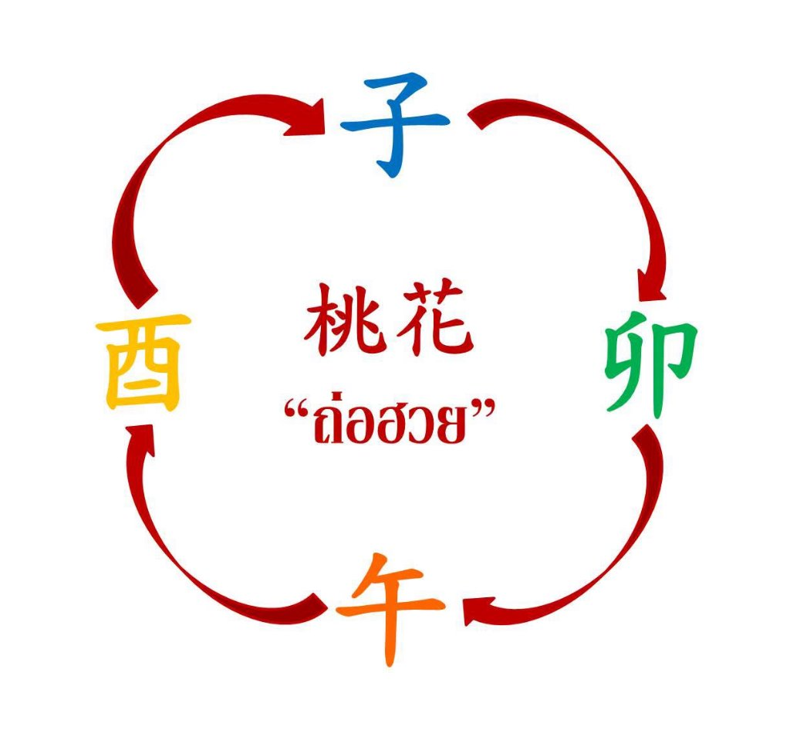

# ทฤษฎีที่ 08: 桃花 “ถ่อฮวย” (ดอกท้อ / ดาวเสน่ห์) — 子 卯 午 酉

> **แหล่งที่มา:** เพจ *แม่ไม้ดวงจีน 八字 : Destiny Detective* (โพสต์ทฤษฎี “ถ่อฮวย”)  
> **หมวดหมู่:** ทฤษฎีดาวจร / ปฏิกิริยา 90 องศาของแม่ธาตุทั้ง ๔ / เสน่ห์และความรัก  
> **ภาพประกอบ:** [docs/bazi/images/theory_08_tao_hua_peach_blossom.jpg](docs/bazi/images/theory_08_tao_hua_peach_blossom.jpg)



---

## 1. นิยามและกลไกเชิงฟิสิกส์ธาตุของ 桃花 “ถ่อฮวย”

* **ปฏิกิริยา 90 องศาของแม่ธาตุทั้ง ๔:** เกิดขึ้นระหว่างกลุ่ม **四正 “ซี่เจี่ย”** (4 ยอดขุนพล / สี่สารทิศ) ได้แก่ `子`, `卯`, `午`, `酉`
* **วงจรการก่อเกิดแบบหมุนเวียน (Clockwise Generation Flow):**
  $$\酉 (\text{ทอง}) \xrightarrow{\text{ก่อเกิด}} 子 (\text{น้ำ}) \xrightarrow{\text{ก่อเกิด}} 卯 (\text{ไม้}) \xrightarrow{\text{ก่อเกิด}} 午 (\text{ไฟ}) \xrightarrow{\text{ข้ามธาตุดินไปก่อเกิด}} 酉 (\text{ทอง})$$
* **กฎพิเศษการข้ามธาตุ (The Leap Rule):**
  * ตามธรรมชาติ วงจรเบญจธาตุ `ไฟ` ต้องก่อเกิด `ดิน` ก่อน แล้ว `ดิน` จึงก่อเกิด `ทอง`
  * แต่ในปฏิกิริยา **桃花 “ถ่อฮวย” จะกระโดดข้ามธาตุดินจาก 午 (ไฟ) ไปเป็น 酉 (ทอง) โดยตรง!**
  * **ความหมายเชิงพลศาสตร์:** สื่อถึง *การเปลี่ยนแปลงอย่างฉับพลันจากสิ่งหนึ่งไปสู่อีกสิ่งหนึ่ง*, *การเร่งสปีดตัวคูณความเร็วให้สูงขึ้น*, *การกระตุ้นปฏิกิริยาให้เกิดผลรวดเร็วทันใจ*

---

## 2. ความหมายของ 桃花 “ถ่อฮวย” (สองด้าน: ดี vs ร้าย)

| ด้านดี (เมื่อเป็น 用神 ให้คุณ) | ด้านร้าย (เมื่อเป็น 忌神 ให้โทษ) |
| :--- | :--- |
| **ดาวเสน่ห์เมตตามหานิยม:** มีเสน่ห์ดึงดูดอย่างมาก | **ความสัมพันธ์เป็นพิษ:** เจ้าชู้ มากรัก ปัญหาชู้สาว |
| **โชคด้านความรัก:** มีคนเข้ามารัก ชื่นชอบ เอาอกเอาใจ | **คดีความและเรื่องอื้อฉาว:** ข่าวเสียหาย เสียชื่อเสียง ฉาวโฉ่ |
| **ความนิยมในสังคม:** แฟนคลับ/มวลชนชื่นชอบและสนับสนุน | **ภัยอันตรายส่วนบุคคล:** ถูกวางยา มอมยา ถูกล่วงละเมิดทางเพศ |
| **ความก้าวหน้าในงาน:** ลูกค้าหลั่งไหลเข้ามา, ได้รับอนุมัติงาน/เลื่อนตำแหน่ง | **ปัญหาการเงิน:** เครดิตเสียหาย, หนี้สูญ/หนี้เสีย, ถูกหลอกลวง |

---

## 3. ลำดับและทิศทางการอ่านปฏิกิริยาถ่อฮวย

1. **ถ่อฮวยที่มีอยู่ในแผงดวงเดิม (Natal Chart):**
   * ให้อ่านจาก **ซ้ายไปขวา ($\rightarrow$)** ตามลำดับเสาในดวง
2. **ถ่อฮวยที่มาจาก วัยจร (Da Yun - ทุกๆ 5 ปี):**
   * ให้อ่านจาก **ขวามาซ้าย ($\leftarrow$)** โดยนำวัยจรเข้ามากระทบกับตัวในแผงดวง
3. **ถ่อฮวยที่มาจาก ปีจร (Liu Nian - แต่ละปี):**
   * ให้อ่านจาก **ขวามาซ้าย ($\leftarrow$)** โดยนำปีจรเข้ามากระทบกับตัวในแผงดวง

---

## 4. กรณีศึกษา: การตีความถ่อฮวยให้คุณ vs ให้โทษ

### ตัวอย่าง: ดวงหญิง (坤) ดิถีธาตุไม้ `甲`
* **ในดวงเดิมมี:** `子`
* **ปีจรจรเข้ามาเป็น:** `酉` (เกิดปฏิกิริยาถ่อฮวย $酉 \rightarrow 子$)

#### วิเคราะห์สิบเทพ (十神) ของทั้ง 2 ตัว:
* **`子` คือ 正印 “เจี่ยอิ่ง” (ตราประทับตรง):**
  * หมายถึง: แม่, ผู้ใหญ่, เจ้านาย, สติปัญญา, ความรู้, วาสนาบารมี, สุขภาพ, ยารักษาโรค, อาหาร
* **`酉` คือ 正官 “เจี่ยกัว” (ดาวขุนนางตรง):**
  * หมายถึง: สามี, หน้าที่การงาน, ความรับผิดชอบ, ยศตำแหน่ง, เกียรติยศชื่อเสียง, กฎหมาย, ระเบียบ, คดีความ, การจองจำ

---

### บทวิเคราะห์ผลพยากรณ์:

> **หลักตัดสินชี้ขาด:** 桃花 “ถ่อฮวย” จะดีหรือร้าย **ขึ้นอยู่กับว่าเป็น 用神 “เอ่งซิ้ง” หรือ 忌神 “กี่ซิ้ง”**

1. **กรณี `酉` เป็น 忌神 “กี่ซิ้ง” (ธาตุให้โทษ):**
   * *พยากรณ์:* ให้ระวังอย่างยิ่งเกี่ยวกับเรื่องอื้อฉาวคาวโลกีย์ ปัญหาชู้สาว ข่าวเสื่อมเสียชื่อเสียง
   * อาจถูกวางยา มอมยา หรือถูกล่วงละเมิดทางเพศ และอาจพัวพันถึงคดีความหรือเรื่องผิดกฎหมาย
2. **กรณี `酉` เป็น 用神 “เอ่งซิ้ง” (ธาตุให้คุณ):**
   * *พยากรณ์:* จะได้พบเจอกับคนรักที่ดี สมหวังในความรัก
   * ประสบความสำเร็จในหน้าที่การงานอย่างสูง ได้รับการโปรโมทเลื่อนขั้นเลื่อนตำแหน่ง มีชื่อเสียงและเกียรติยศ

---

## 5. การประยุกต์ใช้ในระบบคำนวณโค้ด (`bazi.js`)

```javascript
// ตรวจจับคู่ถ่อฮวย (Peach Blossom pairs)
const TAO_HUA_PAIRS = [
  { from: '酉', to: '子', flow: 'Metal->Water', leap: false },
  { from: '子', to: '卯', flow: 'Water->Wood',  leap: false },
  { from: '卯', to: '午', flow: 'Wood->Fire',   leap: false },
  { from: '午', to: '酉', flow: 'Fire->Metal',  leap: true } // Special speed-boost leap
];

function checkTaoHua(branch1, branch2) {
  return TAO_HUA_PAIRS.find(p => 
    (p.from === branch1 && p.to === branch2) ||
    (p.from === branch2 && p.to === branch1)
  );
}
```
