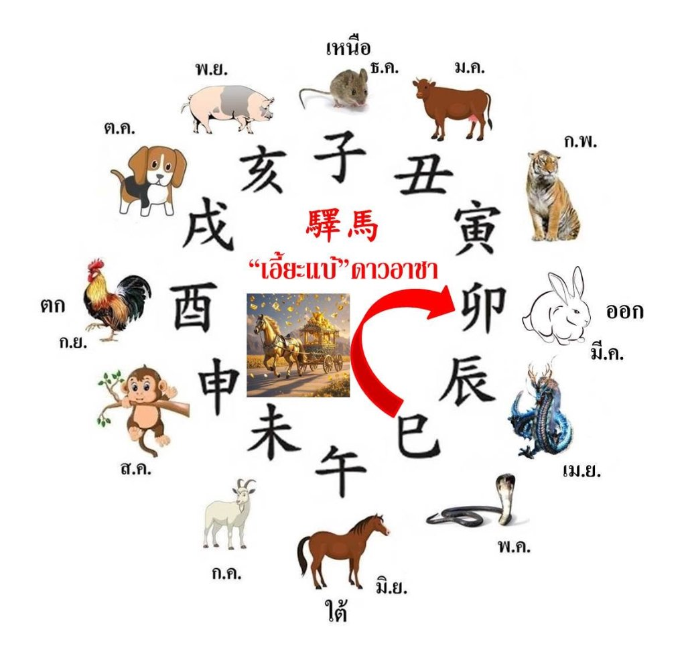

# ทฤษฎีที่ 09: 驛馬 “เอี้ยะแบ้” (ดาวม้าอาชา / การถ่ายเทธาตุและการเปลี่ยนแปลง)

> **แหล่งที่มา:** เพจ *แม่ไม้ดวงจีน 八字 : Destiny Detective* (โพสต์ทฤษฎี “เอี้ยะแบ้”)  
> **หมวดหมู่:** ทฤษฎีดาวจร / ปฏิกิริยาสี่อาชา (四馬) / การโยกย้ายและถ่ายเทธาตุ  
> **ภาพประกอบ:** [docs/bazi/images/theory_09_yi_ma_travelling_horse.jpg](docs/bazi/images/theory_09_yi_ma_travelling_horse.jpg)



---

## 1. นิยามและแก่นแท้: “เอี้ยะแบ้มีความหมายมากกว่าการเดินทาง”

ในตำราดวงจีนทั่วไป มักแปล 驛馬 “เอี้ยะแบ้” ว่าหมายถึงการเดินทางไกลหรือการไปต่างประเทศเท่านั้น  
แต่ในสายวิชา **แม่ไม้ดวงจีน 八字 : Destiny Detective** ชี้ให้เห็นมิติทางพลังงานที่ลึกซึ้งกว่า:

* **การถ่ายเทธาตุ:** หมายถึงการถ่ายเท ถ่ายโอน หรือการแปรเปลี่ยนจากธาตุหนึ่งไปสู่อีกธาตุหนึ่งอย่างฉับพลัน
* **พลวัตความเร็วสูง:** การเคลื่อนไหว ขยับ อยู่ไม่ติดที่ อยู่ไม่นิ่ง การเปลี่ยนแปลงอย่างรวดเร็ว
* **จุดเปลี่ยนผันของชีวิต (Turning Point):**
  * การเริ่มต้นสิ่งใหม่ หรือ การสิ้นสุดเรื่องเก่า
  * การเกิด หรือ การตาย
  * การได้เลื่อนตำแหน่ง หรือ ถูกปรับลดตำแหน่ง
  * เงินทองไหลทะลักเข้ามา หรือ เงินทองรั่วไหลออกไป
  * การย้ายถิ่นฐาน ย้ายบ้าน ย้ายออฟฟิศ หรือการเดินทางไกล

---

## 2. กลุ่มไตรภาคี (三合) และการก่อกำเนิด ๔ อาชา (四馬)

ปฏิกิริยาเอี้ยะแบ้ เกิดขึ้นจากความสัมพันธ์ระหว่างกลุ่มไตรภาคี (三合 “ซาฮะ”) กับตัวอาชาที่ธาตุไตรภาคีนั้นให้กำเนิด:

| กลุ่มไตรภาคีตั้งต้น (三合) | ธาตุกลุ่ม | ก่อเกิดธาตุ | ตัวดาวอาชา (驛馬 “เอี้ยะแบ้”) | หมายเหตุ |
| :--- | :--- | :--- | :--- | :--- |
| **申 子 辰** | **ธาตุน้ำ** | $\rightarrow$ ก่อเกิด **ธาตุไม้** | **`寅` (ขาล)** | น้ำก่อเกิดไม้ตามธรรมชาติ |
| **亥 卯 未** | **ธาตุไม้** | $\rightarrow$ ก่อเกิด **ธาตุไฟ** | **`巳` (มะเส็ง)** | ไม้ก่อเกิดไฟตามธรรมชาติ |
| **寅 午 戌** | **ธาตุไฟ** | $\rightarrow$ ก่อเกิด **ธาตุทอง** | **`申` (วอก)** | ⚡ **กฎข้ามธาตุดิน:** ข้ามธาตุดินไปเป็นธาตุทองโดยตรง |
| **巳 酉 丑** | **ธาตุทอง** | $\rightarrow$ ก่อเกิด **ธาตุน้ำ** | **`亥` (กุน)** | ทองก่อเกิดน้ำตามธรรมชาติ |

> [!NOTE]
> ตัวดาวอาชาทั้ง 4 ตัว (`寅`, `巳`, `申`, `亥`) ก็คือกลุ่ม **四馬 “ซี่แบ้” (๔ ม้าต้นฤดู)** นั่นเอง!

---

## 3. หลักเกณฑ์การพิจารณาปฏิกิริยา 驛馬 “เอี้ยะแบ้”

1. **เงื่อนไขการเกิดปฏิกิริยา:**
   * เมื่อตัวอาชา `寅`, `巳`, `申`, `亥` โคจรมาพบกับ **ตัวใดตัวหนึ่ง** ในกลุ่ม 三合 “ซาฮะ” ที่เป็นธาตุต้นกำเนิดของตน (ไม่จำเป็นต้องครบทั้ง 3 ตัว ขอเพียงเจอตัวใดตัวหนึ่ง เช่น `巳` เจอ `卯`)
2. **พิจารณาผ่านสิบเทพ (十神 “จับซิ้ง”):**
   * วิเคราะห์ว่าตัวที่มากระทบและตัวอาชาเป็นสิบเทพตัวใด เช่น เป็นเรื่องการเงิน, อำนาจ, หน้าที่การงาน, เครดิต, หนี้สิน, ที่อยู่อาศัย หรือทรัพย์สิน
3. **พิจารณาผ่านวงศ์ญาติ (六亲 “หลักชิง”):**
   * บ่งบอกถึงบุคคลที่เกี่ยวข้อง เช่น ตัวเอง, พ่อ, แม่, พี่น้อง, คู่ครอง (เมีย/สามี), หรือบุตรหลาน
4. **ตัดสิน ดี หรือ เสีย ตามรูปดวง (用神 vs 忌神):**
   * หากเป็นธาตุที่ให้คุณ $\rightarrow$ ผลพยากรณ์ไปในทางบวก สำเร็จ รวดเร็ว ก้าวหน้า
   * หากเป็นธาตุที่ให้โทษ $\rightarrow$ ผลพยากรณ์ไปในทางเสียหาย ผิดพลาด ขาดทุน เสียเงินทอง

---

## 4. กรณีศึกษา: การตีความเอี้ยะแบ้ในดวงจริง

### ข้อมูลดวงตัวอย่าง:
* เพศชาย (乾) ดิถีธาตุน้ำ `壬`
* ในดวงมี `卯` (อยู่ในกลุ่ม 亥卯未 ธาตุไม้)
* ปีจรคือ `乙巳`
  * `巳` โคจรเข้ามาเจอกับ `卯` เกิดปฏิกิริยา **驛馬 “เอี้ยะแบ้”** (ไม้ก่อเกิดไฟ)
* **การถอดรหัสสิบเทพ & วงศ์ญาติ:**
  * `巳` (ไฟ) สำหรับดิถีน้ำ 壬 = **偏財 “เพียงไช้” (โชคลาภ, เงินก้อน, พ่อ, เมีย/ผู้หญิง)**
  * `乙` และ `卯` (ไม้) สำหรับดิถีน้ำ 壬 = **傷官 “เซียกัว” (สติปัญญา, ความสามารถ, ไหวพริบ, การริเริ่มโปรเจกต์, การเคลื่อนไหวเปลี่ยนแปลง)**

---

### บทวิเคราะห์เปรียบเทียบ:

#### 1. กรณีดวงหยาง (ดวงแข็ง):
* **ธาตุให้คุณ:** ธาตุไม้ และ ธาตุไฟ
* **ธาตุให้โทษ:** ธาตุดิน, ธาตุทอง และ ธาตุน้ำ
* **คำทำนาย:**
  > ปีนี้จะมี Project และแผนงานใหม่ๆ เข้ามา มีการขยายสาขา ขยายกิจการ พบลู่ทางธุรกิจและโอกาสทำเงินใหม่ๆ หยิบจับอะไรก็เป็นเงินเป็นทองไปหมด การงานราบรื่น สำเร็จ ได้กำไรเป็นกอบเป็นกำ และได้พบเจอผู้หญิงคนใหม่เข้ามาในชีวิต

#### 2. กรณีดวงหยิน (ดวงอ่อน):
* **ธาตุให้คุณ:** ธาตุดิน, ธาตุทอง และ ธาตุน้ำ
* **ธาตุให้โทษ:** ธาตุไม้ และ ธาตุไฟ
* **คำทำนาย:**
  > ปีนี้มักตัดสินใจผิดพลาด ทำอะไรด้วยความประมาทเลินเล่อ เกิดความเสียหายอย่างหนัก เสียเงินเสียทอง ใช้จ่ายฟุ่มเฟือย และเสียทรัพย์เพราะเรื่องผู้หญิง

---

## 5. การประยุกต์ใช้ในระบบคำนวณโค้ด (`bazi.js`)

```javascript
// แผนผังกลุ่มไตรภาคีสู่ดาวอาชาเอี้ยะแบ้
const YI_MA_MAPPING = {
  // ธาตุน้ำ (申子辰) ก่อเกิด ไม้ -> 寅
  WATER_SAN_HE: { triggerBranches: ['申', '子', '辰'], horseBranch: '寅', element: 'Wood' },
  // ธาตุไม้ (亥卯未) ก่อเกิด ไฟ -> 巳
  WOOD_SAN_HE:  { triggerBranches: ['亥', '卯', '未'], horseBranch: '巳', element: 'Fire' },
  // ธาตุไฟ (寅午戌) ก่อเกิด ทอง (ข้ามดิน) -> 申
  FIRE_SAN_HE:  { triggerBranches: ['寅', '午', '戌'], horseBranch: '申', element: 'Metal' },
  // ธาตุทอง (巳酉丑) ก่อเกิด น้ำ -> 亥
  METAL_SAN_HE: { triggerBranches: ['巳', '酉', '丑'], horseBranch: '亥', element: 'Water' }
};

// ตรวจสอบการเกิดปฏิกิริยาเอี้ยะแบ้
function detectYiMa(natalBranches, transitBranch) {
  const triggeredEvents = [];
  
  for (const [key, mapping] of Object.entries(YI_MA_MAPPING)) {
    // กรณีที่ 1: ปีจรเป็นตัวม้า และดวงเดิมมีตัวกระตุ้นตัวใดตัวหนึ่ง
    if (transitBranch === mapping.horseBranch) {
      const match = natalBranches.find(b => mapping.triggerBranches.includes(b));
      if (match) {
        triggeredEvents.push({
          type: 'YI_MA',
          horse: mapping.horseBranch,
          triggeredBy: match,
          element: mapping.element
        });
      }
    }
    // กรณีที่ 2: ดวงเดิมมีตัวม้า และปีจรเป็นตัวกระตุ้นในกลุ่ม
    if (natalBranches.includes(mapping.horseBranch) && mapping.triggerBranches.includes(transitBranch)) {
      triggeredEvents.push({
        type: 'YI_MA',
        horse: mapping.horseBranch,
        triggeredBy: transitBranch,
        element: mapping.element
      });
    }
  }
  return triggeredEvents;
}
```

