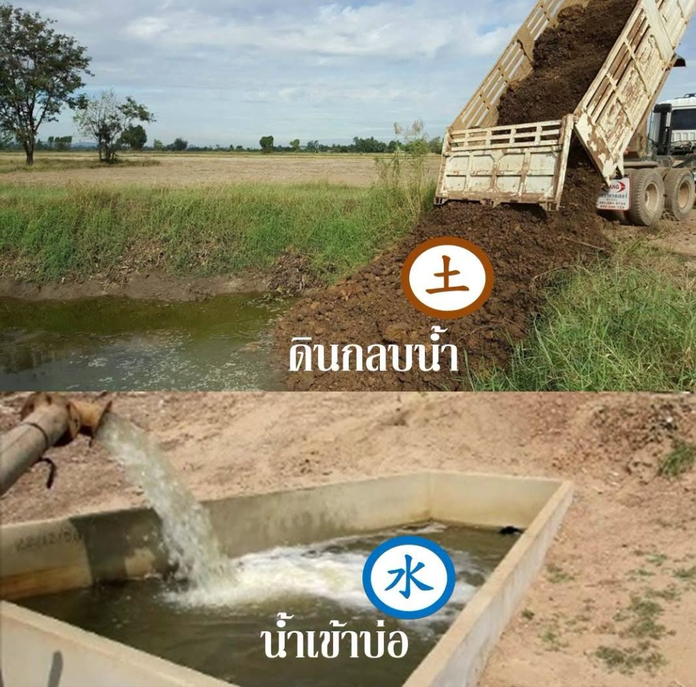

# ทฤษฎีที่ 10: ธรรมชาติฟิสิกส์แห่งธาตุ — ดินกลบน้ำ vs น้ำเข้าบ่อ (The Natural Physics of Earth & Water Interactions)

> **แหล่งที่มา:** เพจ *แม่ไม้ดวงจีน 八字 : Destiny Detective* (โพสต์ทฤษฎี “การพิจารณาหลักเกณฑ์ตามธรรมชาติ”)  
> **หมวดหมู่:** ปรัชญาธรรมชาติ / การปฏิสัมพันธ์ของธาตุตามความเป็นจริง / การจำแนกธาตุดิน 4 ฤดู  
> **ภาพประกอบ:** [docs/bazi/images/theory_10_natural_physics_earth_water_interaction.jpg](docs/bazi/images/theory_10_natural_physics_earth_water_interaction.jpg)



---

## 1. ปรัชญาหัวใจ: “กฎเกณฑ์คือของตาย คนคือของเป็น”

> *“สรรพสิ่งควรพิจารณาโดยสอดคล้องกับธรรมชาติ มิใช่ตามๆ กันไป กฎเกณฑ์คือของตาย คนคือของเป็น ควรพิจารณาและไตร่ตรองด้วยปัญญาของตนเอง”*

ในวิชาแม่ไม้ดวงจีน ไม่ยึดติดกับการท่องจำแบบนกแก้วนกขุนทอง เช่น ท่องจำเพียงว่าราศีแฝง (暗藏 “อ่ำชั้ง”) ของดินตัวนั้นตัวนี้มีอะไรบ้าง หรือเห็นตัวอักษร 3 ตัวก็ด่วนสรุปว่าเป็นไตรภาคี (三合 “ซาฮะ”) เสมอไป  
**แต่ต้องดูว่า “ใครเป็นฝ่ายจรเข้ามา” และ “สภาวะธรรมชาติจริงของธาตุนั้นทำปฏิกิริยาอย่างไร”**

---

## 2. ธรรมชาติของธาตุดินปลายฤดูทั้ง ๔ (辰, 未, 戌, 丑)

ธาตุดินไม่ได้เหมือนกันทุกตัว แต่ละตัวมีสภาพอุณหภูมิและความชื้นตามฤดูกาลจริง:

| ราศีดิน | ช่วงเดือนจริง | สภาพอากาศตามธรรมชาติ | คุณลักษณะของดิน | ธาตุเทียบเคียง |
| :--- | :--- | :--- | :--- | :--- |
| **`辰` (เฉิน)** | เมษายน (ย่างเข้าฤดูร้อน) | แดดเริ่มแรง ความร้อนสะสม | **ดินแห้ง** | เปรียบดังดินหยาง **`戊`** |
| **`未` (เว่ย)** | กรกฎาคม (ฤดูร้อนจัด) | อากาศร้อนอบอ้าวถึงขีดสุด | **ดินร้อนผาก** | เปรียบดังดินหยาง **`戊`** |
| **`戌` (ซวี)** | ตุลาคม (ปลายฝนต้นหนาว) | ความชื้นเริ่มก่อตัว อากาศเย็นลง | **ดินชื้น** | เปรียบดังดินหยิน **`己`** |
| **`丑` (โฉ่ว)** | มกราคม (ฤดูหนาวจัด) | หนาวเย็น แฉะ น้ำแข็งเกาะ | **ดินแฉะ / โคลน** | เปรียบดังดินหยิน **`己`** |

> [!IMPORTANT]
> **หลักพิจารณา:** ให้พิจารณาธาตุดินโดยสอดคล้องตามฤดูกาล มิได้จำเป็นต้องไปนั่งท่องจำตัวราศีแฝง (暗藏) ให้สับสน

---

## 3. มิติเชิงลึก: การรวมไตรภาคีน้ำ (申子辰) ตามฟิสิกส์ธรรมชาติ

พิจารณาดวงดิถีธาตุไม้ **`甲`** ที่ในดวงมีราศีล่าง `申` และมีคู่กระทบอีกตัว โดยมีปีจรเข้ามา:

```
[กรณี A: ดินกลบน้ำ]            [กรณี B: น้ำเข้าบ่อ]
    ปีจร                               ปีจร
x   甲   x   x        x            x   甲   x   x        x
x    x   申  子  <--  辰            x    x   申  辰  <--  子
```

---

### กรณี A: ปีจร `辰` (ดิน) จรเข้ามาหา `申` + `子` $\rightarrow$ “ดินกลบน้ำ”

เมื่อปีจรเป็น **`辰` (ธาตุดิน)**:
* **ธรรมชาติของดินกับน้ำ:** ดินมีหน้าที่ถม ปิดกั้น และกลบน้ำ  
* **ผลลัพธ์เชิงฟิสิกส์:** **`辰` (ดิน) เข้ามา “กลบน้ำ `子`”** ไม่ได้รวมเป็นไตรภาคีน้ำ (三合 申子辰) อย่างที่ตำราทั่วไปเข้าใจ แต่ดินเข้ามาทำลายน้ำโดยตรง!
* **การตีความตามสิบเทพ (十神):**
  * `子` คือ **正印 “เจี่ยอิ่ง”** (ผู้ใหญ่, สติปัญญา, ความช่วยเหลือ, สุขภาพ, ความสงบ)
  1. **ถ้าธาตุดิน (土) เป็น 忌神 (ธาตุให้โทษ):**
     * ดิน `辰` เข้ามากลบทำลาย `子` (เจี่ยอิ่งที่ดี) หายไป
     * **ผลพยากรณ์:** หน้าที่การงานเสียหาย ขาดผู้ใหญ่ช่วยเหลือสนับสนุน ถูกตัดแขนตัดขา ขัดแย้งกับผู้ใหญ่ เสียเงินเสียทอง
  2. **ถ้าธาตุดิน (土) เป็น 用神 (ธาตุให้คุณ):**
     * ดิน `辰` เข้ามากลบทำลาย `子` (เจี่ยอิ่งที่เป็นตัวเสีย/กดทับดวง) ทิ้งไป
     * **ผลพยากรณ์:** เกิดโชคลาภ ได้เงินได้ทอง การงานราบรื่นคล่องตัว ไร้อุปสรรค พ้นจากการถูกผู้ใหญ่ขัดขวางหรือสร้างความวุ่นวาย

---

### กรณี B: ปีจร `子` (น้ำ) จรเข้ามาหา `申` + `辰` $\rightarrow$ “น้ำเข้าบ่อ / น้ำท่วมดิน”

เมื่อปีจรเป็น **`子` (ธาตุน้ำ)**:
* **ธรรมชาติของน้ำกับดิน:** น้ำไหลเข้าสู่แอ่งดิน ทำให้ดินชุ่มชื้น เติมเต็มบ่อให้กลายเป็นสระน้ำขนาดใหญ่  
* **ผลลัพธ์เชิงฟิสิกส์:** **`子` (น้ำ) เข้ามา “ท่วมดิน `辰`”** ทำให้ดินมีความชุ่มชื้น และ **“เกิดการร่วมตัวเป็น 三合 (申子辰 ธาตุน้ำ) ได้อย่างสมบูรณ์”** ส่งกำลังกลายเป็นกระแส 印 (อิ่ง) อันทรงพลัง!
* **การตีความตามสิบเทพ (十神):**
  1. **ถ้าน้ำ (水) เป็น 用神 (ธาตุให้คุณ):**
     * น้ำ `子` เข้ามาท่วมดิน `辰` (ที่เป็นตัวเสีย) ให้ชุ่มชื้น และผสานเป็น ซาฮะน้ำ (印 อิ่ง) ส่งเสริมดวงเต็มกำลัง
     * **ผลพยากรณ์:** ประสบผลสำเร็จในหน้าที่การงาน ได้เลื่อนยศ เลื่อนตำแหน่ง ขึ้นเงินเดือน มีโชคลาภรายได้เพิ่มพูน ผู้ใหญ่หนุนหลังเต็มที่
  2. **ถ้าน้ำ (水) เป็น 忌神 (ธาตุให้โทษ):**
     * น้ำ `子` เข้ามาท่วมดิน `辰` (ที่เป็นตัวดี) ทำให้ดินเละพังทลาย และก่อตัวเป็น ซาฮะน้ำ (印 อิ่ง) ที่ให้โทษ
     * **ผลพยากรณ์:** ผู้ใหญ่เข้ามากดดัน จู้จี้จุกจิก ก้าวก่าย วุ่นวายจนทำให้หน้าที่การงานเสียหายหนัก

---

## 4. ตารางสรุปเปรียบเทียบตรรกะสำหรับการเขียนโปรแกรม (`bazi.js`)

| สภาวะ | ตัวในดวงเดิม | ตัวที่จรเข้ามา | ปฏิกิริยาจริงตามธรรมชาติ | ผลต่อกลุ่มไตรภาคี (三合) | ผลต่อสิบเทพ |
| :--- | :--- | :--- | :--- | :--- | :--- |
| **ดินกลบน้ำ** | มี `申` + `子` (น้ำ) | **`辰` (ดินแห้ง)** จรมา | ดินถม/กลบน้ำ | **ไม่เกิดซาฮะน้ำ!** (ดินทำลายน้ำก่อน) | ทำลายดาว `子` (印) ทันที |
| **น้ำเข้าบ่อ** | มี `申` + `辰` (ดิน) | **`子` (น้ำแกนกลาง)** จรมา | น้ำไหลท่วมดิน/ชุ่มชื้น | **เกิดซาฮะน้ำสมบูรณ์!** (申子辰 合水) | เสริมพลังกระแส `水` (印) มหาศาล |

```javascript
// แนวคิดการตรวจสอบทิศทางการจรของดิน-น้ำ ใน bazi.js
function evaluateWaterTrineTransit(natalBranches, transitBranch, isEarthFavorable, isWaterFavorable) {
  // กรณีดินจรเข้ามาหากลุ่มน้ำเดิม (ดินกลบน้ำ)
  if (transitBranch === '辰' && natalBranches.includes('子') && natalBranches.includes('申')) {
    return {
      sanHeFormed: false, // ดินกลบน้ำ ไม่เกิดไตรภาคีน้ำ
      mechanism: 'EARTH_BURY_WATER',
      destroyedBranch: '子',
      destroyedGod: 'Direct_Resource',
      outcome: isEarthFavorable ? 'FAVORABLE_BREAKTHROUGH' : 'UNFAVORABLE_LOSS_OF_SUPPORT'
    };
  }

  // กรณีน้ำจรเข้ามาหากลุ่มดินเดิม (น้ำเข้าบ่อ)
  if (transitBranch === '子' && natalBranches.includes('辰') && natalBranches.includes('申')) {
    return {
      sanHeFormed: true, // น้ำไหลเข้าบ่อ เกิดไตรภาคีน้ำเต็มตัว
      mechanism: 'WATER_FILL_RESERVOIR',
      boostedElement: 'Water',
      boostedGod: 'Resource_Authority',
      outcome: isWaterFavorable ? 'FAVORABLE_GREAT_SUCCESS' : 'UNFAVORABLE_HEAVY_PRESSURE'
    };
  }
}
```

