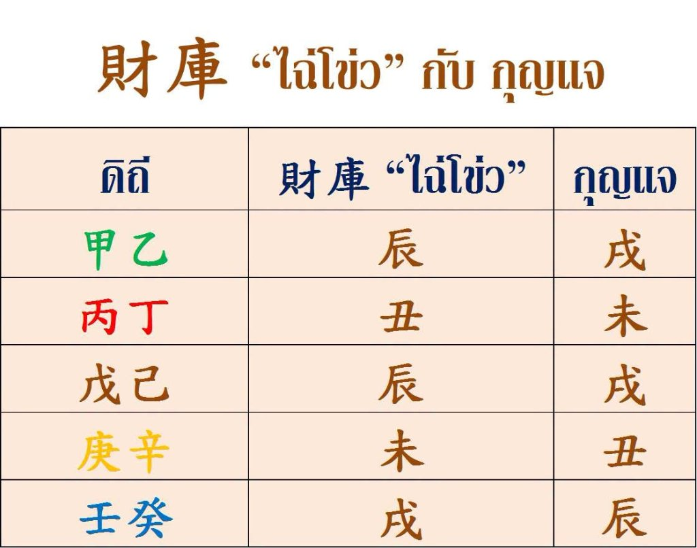

# ทฤษฎีที่ 11: 財庫 “ไฉ่โข่ว” (๔ บุคลิกคลังสมบัติ) และ “กุญแจไขคลัง”

> **แหล่งที่มา:** เพจ *แม่ไม้ดวงจีน 八字 : Destiny Detective* (โพสต์ทฤษฎี “ไฉ่โข่ว คลังสมบัติ กับ กุญแจ”)  
> **หมวดหมู่:** ทฤษฎีคลังสมบัติ (財庫) / ๔ ขุมคลัง (四庫) / กุญแจไขขุมทรัพย์ / กรณีศึกษาทายาทเจ้าสัว  
> **ภาพประกอบ:** [docs/bazi/images/theory_11_cai_ku_vault_and_key.jpg](docs/bazi/images/theory_11_cai_ku_vault_and_key.jpg)



---

## 1. ๔ บุคลิกภาพแห่งคลังสมบัติ (The 4 Wealth Vault Archetypes)

ขุมคลังทั้ง 4 ตัว (`丑`, `辰`, `未`, `戌`) ล้วนเป็นธาตุดิน แต่ละตัวทำหน้าที่เป็นสุสาน/คลังกักเก็บธาตุที่แตกต่างกัน และสะท้อน **“ลักษณะความมั่งคั่งและบุคลิกของเศรษฐี”** คนละแบบอย่างชัดเจน:

### 1. `丑` (โฉ่ว) — “เศรษฐีผู้สูงศักดิ์” (Noble Aristocrat)
* **ธาตุคลัง:** ดิน `丑` เป็น **คลังเก็บธาตุทอง (สุสานทอง 金庫)**
* **บุคลิกและลักษณะความรวย:**
  * เก็บงำความมั่งคั่งไว้ภายในอย่างมิดชิด ภายนอกดูเรียบง่าย สมถะ แต่มั่นคงดั่งหินผา
  * เปรียบประดุจทองคำ หรืออัญมณีล้ำค่าที่ซ่อนอยู่ใต้ผืนดินอันสงบเงียบ
  * ทรัพย์สิน เงินทอง หรือของมีค่าถูกเก็บรักษาไว้อย่างดีเยี่ยม **ไม่โอ้อวด แต่มีความมั่นคงสูงมาก**

### 2. `辰` (เฉิน) — “เศรษฐีเชื้อเจ้า / มังกรผู้มีบุญบารมี” (Royal Elite / Celestial Dragon)
* **ธาตุคลัง:** ดิน `辰` เป็น **คลังเก็บสะสมธาตุน้ำ (水庫) และธาตุไม้**
* **บุคลิกและลักษณะความรวย:**
  * สะท้อนถึง **อำนาจ วาสนา บารมี ความเป็นผู้นำสูงส่ง** มีมาดคุณนายหรือเชื้อเจ้า
  * บุคลิกภายนอกดูสง่างาม น่าเกรงขาม รักเกียรติรักศักดิ์ศรี มีรสนิยมเลิศหรู ภูมิฐาน
  * แม้ภายนอกจะดูดุดันหรือใจร้อนในบางครั้ง แต่เนื้อแท้มีความโอบอ้อมอารี มีเมตตา และเป็นที่พึ่งพาได้ของผู้อื่น

### 3. `未` (เว่ย) — “เศรษฐีชั้นธรรมดา / รวยเงียบยั่งยืน” (Humble Self-Made Wealth)
* **ธาตุคลัง:** ดิน `未` เป็น **คลังเก็บธาตุไม้ (สุสานไม้ 木庫)**
* **บุคลิกและลักษณะความรวย:**
  * ความมั่งคั่งที่ไม่ได้หวือหวา ไม่ได้ร่ำรวยล้นฟ้าให้ใครเห็น แต่เป็น **ความมั่นคง มีกินมีใช้ไม่ขาดมือ**
  * พึ่งพาตนเองได้ รากฐานแข็งแรง ใช้ชีวิตเรียบง่าย รวยเงียบๆ ไม่เดือดร้อนใคร
  * มักสะสมความมั่งคั่งจากที่ดิน เกษตรกรรม อสังหาริมทรัพย์ หรือธุรกิจส่วนตัวขนาดกลางที่มั่นคงยาวนาน

### 4. `戌` (ซวี) — “เจ้าสัว / พ่อค้าวาณิชระดับยักษ์ใหญ่” (The Merchant Tycoon)
* **ธาตุคลัง:** ดิน `戌` เป็น **คลังเก็บธาตุไฟ (สุสานไฟ 火庫)**
* **บุคลิกและลักษณะความรวย:**
  * เจ้าสัวผู้กุมความมั่งคั่งทางการค้า มีพลังแห่ง **ความรับผิดชอบ ความซื่อสัตย์ และการรักษาคำสัตย์วาจา**
  * เป็นนักสู้ชีวิตทางการค้า ขยันขันแข็ง อดทนต่ออุปสรรคทุกรูปแบบ
  * มีสัญชาตญาณเฉียบคมในการปกป้องผลประโยชน์ ปกป้องกิจการให้ขยายใหญ่และเติบโตอย่างมั่นคง

---

## 2. ตารางคู่ “ไฉ่โข่ว (คลังสมบัติ)” กับ “กุญแจไขคลัง”

ในวิชาแม่ไม้ดวงจีน การมีคลังสมบัติ (`財庫`) ในดวง แปลว่ามีความสามารถในการเก็บสะสมทรัพย์  
แต่การจะ **“เปิดคลังนำทรัพย์สินออกมาใช้ให้งอกเงยสูงสุด”** ต้องอาศัย **“กุญแจ” (The Key)** ซึ่งเกิดจากการที่ตัวปะทะ (沖 “ชง”) โคจรเข้ามาไขเปิดประตูคลัง:

| ดิถีวัน (日主) | ธาตุโชคลาภ (财) | 財庫 “ไฉ่โข่ว” (คลังสมบัติ) | กุญแจไขคลัง (The Key) | กลไกปะทะเปิดคลัง |
| :--- | :--- | :--- | :--- | :--- |
| **甲 / 乙 (ไม้)** | ดิน (土) | **`辰`** (คลังน้ำ/คลังสมบัติ) | **`戌`** | 辰 - 戌 沖 (ชงเปิดคลัง) |
| **丙 / 丁 (ไฟ)** | ทอง (金) | **`丑`** (คลังทอง) | **`未`** | 丑 - 未 沖 (ชงเปิดคลัง) |
| **戊 / 己 (ดิน)** | น้ำ (水) | **`辰`** (คลังน้ำ) | **`戌`** | 辰 - 戌 沖 (ชงเปิดคลัง) |
| **庚 / 辛 (ทอง)** | ไม้ (木) | **`未`** (คลังไม้) | **`丑`** | 丑 - 未 沖 (ชงเปิดคลัง) |
| **壬 / 癸 (น้ำ)** | ไฟ (火) | **`戌`** (คลังไฟ) | **`辰`** | 辰 - 戌 沖 (ชงเปิดคลัง) |

---

## 3. กรณีศึกษาดวงจริง: “ครูดวงลูกชายเจ้าสัวซีพี”

```
[แผงดวงลูกชายเจ้าสัวซีพี]
ยาม       วัน      เดือน     ปี
辛       丁       癸       丁
丑 (คลัง) 亥       卯      未 (กุญแจ)
```

* **ดิถี:** ธาตุไฟหยิน **`丁`**
* **การตรวจพบคลังสมบัติและกุญแจ:**
  * สำหรับดิถีไฟ 丁 $\rightarrow$ **`丑` คือ 財庫 “ไฉ่โข่ว” (คลังสมบัติธาตุทอง)** ตั้งอยู่ที่เสายาม
  * และ **`未` คือ “กุญแจ”** ตั้งอยู่ที่เสาปี!
* **บทวิเคราะห์ตามหลักครูดวง:**
  1. **มีทั้งคลังสมบัติและกุญแจอยู่ในดวงชะตาเดิม:** ทำให้ขุมทรัพย์สามารถถูกเปิดออก นำพาความมั่งคั่งระดับอภิมหาเศรษฐีออกมาใช้ประโยชน์และต่อยอดธุรกิจได้อย่างมหาศาล
  2. **บุคลิกของคลัง `丑` (เศรษฐีผู้สูงศักดิ์):** เก็บงำความมั่งคั่งไว้ข้างใน ไม่โอ้อวด ใช้ชีวิตเรียบง่ายและถ่อมตน แม้จะครอบครองทรัพย์สินมหาศาลระดับประเทศก็ตาม

---

## 4. แนวทางการเขียนตรรกะระบบคำนวณ (`bazi.js`)

```javascript
// ตารางจับคู่คลังสมบัติและกุญแจไขคลัง
const CAI_KU_AND_KEY = {
  '甲': { vault: '辰', key: '戌', archetype: 'Royal Elite / Dragon' },
  '乙': { vault: '辰', key: '戌', archetype: 'Royal Elite / Dragon' },
  '丙': { vault: '丑', key: '未', archetype: 'Noble Aristocrat' },
  '丁': { vault: '丑', key: '未', archetype: 'Noble Aristocrat' },
  '戊': { vault: '辰', key: '戌', archetype: 'Royal Elite / Dragon' },
  '己': { vault: '辰', key: '戌', archetype: 'Royal Elite / Dragon' },
  '庚': { vault: '未', key: '丑', archetype: 'Humble Self-Made Wealth' },
  '辛': { vault: '未', key: '丑', archetype: 'Humble Self-Made Wealth' },
  '壬': { vault: '戌', key: '辰', archetype: 'Merchant Tycoon' },
  '癸': { vault: '戌', key: '辰', archetype: 'Merchant Tycoon' },
};

function analyzeCaiKuAndKey(dayMasterStem, natalBranches, transitBranch) {
  const config = CAI_KU_AND_KEY[dayMasterStem];
  if (!config) return null;

  const hasVaultInNatal = natalBranches.includes(config.vault);
  const hasKeyInNatal   = natalBranches.includes(config.key);
  const keyInTransit    = transitBranch === config.key;

  return {
    vaultBranch: config.vault,
    keyBranch: config.key,
    archetype: config.archetype,
    hasVault: hasVaultInNatal,
    hasKey: hasKeyInNatal,
    isUnlockedByTransit: hasVaultInNatal && keyInTransit,
    isSelfUnlocked: hasVaultInNatal && hasKeyInNatal // มีทั้งคลังและกุญแจในดวงเดิม แบบดวงลูกชายเจ้าสัวซีพี
  };
}
```
