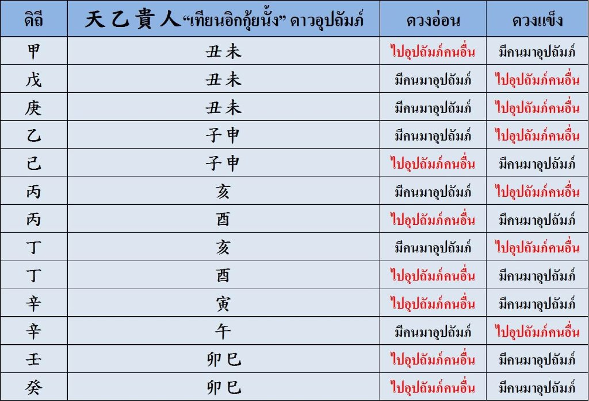

# ทฤษฎีที่ 12: 天乙貴人 “เทียนอิกกุ้ยนั้ง” (ดาวอุปถัมภ์) — “ดูดีดี ใครอุปถัมภ์ใคร”

> **แหล่งที่มา:** เพจ *แม่ไม้ดวงจีน 八字 : Destiny Detective* (โพสต์ทฤษฎี “เทียนอิกกุ้ยนั้ง”)  
> **หมวดหมู่:** ทฤษฎีดาวมงคล (神煞) / ดาวอุปถัมภ์ / การจำแนกผู้ช่วยเหลือ vs ผู้แบกรับภาระ  
> **ภาพประกอบ:** [docs/bazi/images/theory_12_tian_yi_gui_ren_nobleman.jpg](docs/bazi/images/theory_12_tian_yi_gui_ren_nobleman.jpg)



---

## 1. นิยามและค่านิยมดั้งเดิม vs ความเป็นจริงเชิงธาตุ

* **ความหมายทั่วไป:** **天乙貴人 “เทียนอิกกุ้ยนั้ง”** แปลว่า เทพดาวอุปถัมภ์ ฟ้าดินคุ้มครอง แคล้วคลาดปลอดภัย มีคนคอยอุปถัมภ์ค้ำชูช่วยเหลือ
* **จุดเปลี่ยนทางความคิดของแม่ไม้ดวงจีน:**
  > **“มิใช่ว่ามีเทียนอิกกุ้ยนั้งแล้วทุกคนจะได้รับการอุปถัมภ์เสมอไป... ต้องดูดีดีว่า ใครอุปถัมภ์ใคร!”**

---

## 2. กฎการชี้ขาด: 用神 (มีคนช่วยเรา) vs 忌神 (เราต้องไปช่วยคนอื่น)

1. **เมื่อดาวกุ้ยนั้งเป็น 用神 “เอ่งซิ้ง” (ธาตุให้คุณ/ธาตุเสริมดวง):**
   * **“มีคนมาอุปถัมภ์เรา”**
   * มีผู้ใหญ่ เจ้านาย มิตรสหาย หรือผู้มีบารมีคอยยื่นมือเข้ามาช่วยเหลือ อุปถัมภ์ค้ำชู ทำอะไรก็แคล้วคลาด มีแบ็กหลังดี
2. **เมื่อดาวกุ้ยนั้งเป็น 忌神 “กี่ซิ้ง” (ธาตุให้โทษ/ธาตุตัดทอนดวง):**
   * **“เราต้องไปอุปถัมภ์คนอื่น!”**
   * กลายเป็นว่าเราไม่มีคนมาอุปถัมภ์ แต่ตัวเราเองต้องกลายเป็นฝ่ายแบกรับภาระ คอยช่วยเหลือผู้อื่น คอยเหน็ดเหนื่อยหาเงินเลี้ยงดูผู้อื่น หรือถูกพึ่งพาอาศัยจนตนเองลำบาก

---

## 3. ตารางจับคู่ดิถีกับดาวอุปถัมภ์ (天乙貴人) ตามสภาพดวง

| ดิถีวัน (日主) | ราศีล่างที่เป็น 天乙貴人 | สภาพ: ดวงอ่อน (弱) | สภาพ: ดวงแข็ง (強) |
| :---: | :---: | :---: | :---: |
| **甲 (ไม้หยาง)** | **丑, 未** | ❌ **ไปอุปถัมภ์คนอื่น** | ✅ **มีคนมาอุปถัมภ์** |
| **戊 (ดินหยาง)** | **丑, 未** | ✅ **มีคนมาอุปถัมภ์** | ❌ **ไปอุปถัมภ์คนอื่น** |
| **庚 (ทองหยาง)** | **丑, 未** | ✅ **มีคนมาอุปถัมภ์** | ❌ **ไปอุปถัมภ์คนอื่น** |
| **乙 (ไม้หยิน)** | **子, 申** | ✅ **มีคนมาอุปถัมภ์** | ❌ **ไปอุปถัมภ์คนอื่น** |
| **己 (ดินหยิน)** | **子, 申** | ❌ **ไปอุปถัมภ์คนอื่น** | ✅ **มีคนมาอุปถัมภ์** |
| **丙 (ไฟหยาง) - 亥** | **亥** | ✅ **มีคนมาอุปถัมภ์** | ❌ **ไปอุปถัมภ์คนอื่น** |
| **丙 (ไฟหยาง) - 酉** | **酉** | ❌ **ไปอุปถัมภ์คนอื่น** | ✅ **มีคนมาอุปถัมภ์** |
| **丁 (ไฟหยิน) - 亥** | **亥** | ✅ **มีคนมาอุปถัมภ์** | ❌ **ไปอุปถัมภ์คนอื่น** |
| **丁 (ไฟหยิน) - 酉** | **酉** | ❌ **ไปอุปถัมภ์คนอื่น** | ✅ **มีคนมาอุปถัมภ์** |
| **辛 (ทองหยิน) - 寅** | **寅** | ❌ **ไปอุปถัมภ์คนอื่น** | ✅ **มีคนมาอุปถัมภ์** |
| **辛 (ทองหยิน) - 午** | **午** | ✅ **มีคนมาอุปถัมภ์** | ❌ **ไปอุปถัมภ์คนอื่น** |
| **壬 (น้ำหยาง)** | **卯, 巳** | ❌ **ไปอุปถัมภ์คนอื่น** | ✅ **มีคนมาอุปถัมภ์** |
| **癸 (น้ำหยิน)** | **卯, 巳** | ❌ **ไปอุปถัมภ์คนอื่น** | ✅ **มีคนมาอุปถัมภ์** |

---

## 4. นัยยะลึกซึ้งของทิศและชนชั้น (丑 vs 未)

ในคู่ดาวอุปถัมภ์ `丑` และ `未` (เช่น ของดิถี 甲, 戊, 庚) ยังมีมิติของชนชั้นและระดับสังคมแฝงอยู่ด้วย:

* **`丑` (โฉ่ว) — สถิตอยู่ทิศเหนือ:**
  * โดยนัยหมายถึง **คนที่สูงศักดิ์กว่า, ผู้มีบารมี, ผู้ใหญ่, ชนชั้นสูง, พวกไฮโซ**
  * ถ้าเป็นคุณ $\rightarrow$ ได้ผู้หลักผู้ใหญ่หรือคนชั้นสูงมาช่วย
  * ถ้าเป็นโทษ $\rightarrow$ ต้องไปรับใช้แบกภาระให้ผู้มีอิทธิพลหรือคนชั้นสูง
* **`未` (เว่ย) — สถิตอยู่ทิศใต้:**
  * โดยนัยหมายถึง **คนที่อยู่ต่ำศักดิ์กว่า, คนธรรมดาทั่วไป, ลูกน้อง, ประชาชนระดับรากหญ้า**
  * ถ้าเป็นคุณ $\rightarrow$ ได้รับแรงหนุนและความนิยมจากคนทั่วไปและมวลชน
  * ถ้าเป็นโทษ $\rightarrow$ ต้องไปคอยกอบกู้ ช่วยเหลือ แบกรับภาระของคนธรรมดาหรือผู้ด้อยโอกาสกว่าตน

---

## 5. ตัวอย่างการวิเคราะห์ดวงจริง

```
x   甲   x   x
x    x   未   x
```
* **ดิถี:** ธาตุไม้ **`甲`**
* **ดาวเทียนอิกกุ้ยนั้ง:** มี **`未`** อยู่ในดวง
* **การจำแนกตามความแข็งแกร่งของดวง:**
  1. **กรณีเป็น “ดวงอ่อน”:**
     * ธาตุดิน (土) คือ 忌神 “กี่ซิ้ง” (ธาตุให้โทษ)
     * **พยากรณ์:** เจ้าชะตาเป็นคนที่ไม่มีดวงคนมาอุปถัมภ์ แต่ชีวิตกลับต้องเป็นฝ่ายไปคอยช่วยเหลือผู้อื่น แบกรับภาระดูแลคนรอบข้าง หรือต้องไปช่วยเหลือผู้ที่ด้อยศักดิ์กว่าตนเอง
  2. **กรณีเป็น “ดวงแข็ง”:**
     * ธาตุดิน (土) คือ 用神 “เอ่งซิ้ง” (ธาตุให้คุณ / เจี่ยไช้-เพียงไช้)
     * **พยากรณ์:** เป็นคนที่มีดวงอุปถัมภ์สูงมาก มีคนคอยช่วยเหลือค้ำชู พ่อและภรรยาคอยส่งเสริมสนับสนุน และเป็นที่รักใคร่ชื่นชอบของมวลชนคนทั่วไป

---

## 6. แนวทางการเขียนตรรกะระบบคำนวณ (`bazi.js`)

```javascript
// ตารางเทียนอิกกุ้ยนั้งและผลลัพธ์ตามความแข็งแกร่งของดวง
const TIAN_YI_RULES = {
  '甲': { branches: ['丑', '未'], weakChartGivesHelp: true,  strongChartGetsHelp: true },
  '戊': { branches: ['丑', '未'], weakChartGetsHelp: true,   strongChartGivesHelp: true },
  '庚': { branches: ['丑', '未'], weakChartGetsHelp: true,   strongChartGivesHelp: true },
  '乙': { branches: ['子', '申'], weakChartGetsHelp: true,   strongChartGivesHelp: true },
  '己': { branches: ['子', '申'], weakChartGivesHelp: true,  strongChartGetsHelp: true },
  '丙': {
    '亥': { weakChartGetsHelp: true, strongChartGivesHelp: true },
    '酉': { weakChartGivesHelp: true, strongChartGetsHelp: true }
  },
  '丁': {
    '亥': { weakChartGetsHelp: true, strongChartGivesHelp: true },
    '酉': { weakChartGivesHelp: true, strongChartGetsHelp: true }
  },
  '辛': {
    '寅': { weakChartGivesHelp: true, strongChartGetsHelp: true },
    '午': { weakChartGetsHelp: true, strongChartGivesHelp: true }
  },
  '壬': { branches: ['卯', '巳'], weakChartGivesHelp: true,  strongChartGetsHelp: true },
  '癸': { branches: ['卯', '巳'], weakChartGivesHelp: true,  strongChartGetsHelp: true }
};

function evaluateTianYiGuiRen(dayMasterStem, chartBranches, isChartStrong) {
  // ตรวจสอบว่ามีดาวเทียนอิกกุ้ยนั้งในดวงหรือไม่
  // จากนั้นคำนวณว่า "มีคนมาอุปถัมภ์เรา" (Gets Help) หรือ "เราไปอุปถัมภ์คนอื่น" (Gives Help)
  // พร้อมวิเคราะห์นัยยะชนชั้น (丑 = สูงศักดิ์/ไฮโซ, 未 = คนธรรมดาทั่วไป/ลูกน้อง)
}
```

