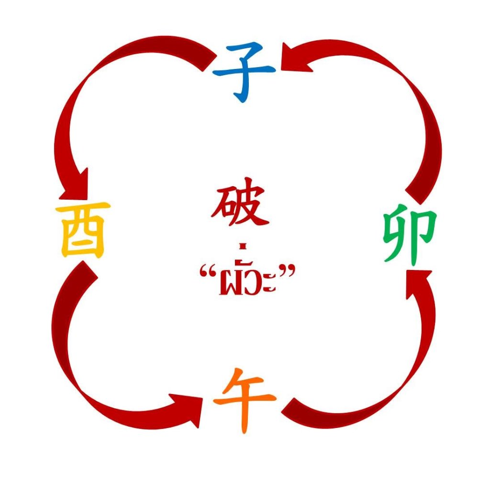

# ทฤษฎีที่ 13: 破 “ผั่วะ” (การแตกหัก / การรั่วไหลและถ่ายเทธาตุ) — 子 卯 午 酉

> **แหล่งที่มา:** เพจ *แม่ไม้ดวงจีน 八字 : Destiny Detective* (โพสต์ทฤษฎี “ผั่วะ”)  
> **หมวดหมู่:** ทฤษฎีปฏิกิริยาราศีล่าง / 刑破 (เฮ้งผั่วะ) / การถ่ายเทระบายธาตุ 90 องศา  
> **ภาพประกอบ:** [docs/bazi/images/theory_13_po_destruction_and_drainage.jpg](docs/bazi/images/theory_13_po_destruction_and_drainage.jpg)



---

## 1. นิยามและฟิสิกส์แห่ง 破 “ผั่วะ”

* **ปฏิกิริยา 90 องศา ทวนกระแส:** เช่นเดียวกับ 桃花 “ถ่อฮวย” ปฏิกิริยา **刑破 “ผั่วะ”** เกิดขึ้นระหว่าง ๔ ยอดขุนพล (**四正 “ซี่เจี่ย”**) ได้แก่ `子`, `卯`, `午`, `酉`
* **ทิศทางของพลังงาน (Counter-Clockwise Drainage Flow):**
  * ในขณะที่ **ถ่อฮวย (桃花)** เป็นการเดินตามเข็มนาฬิกา ($\酉 \rightarrow 子 \rightarrow 卯 \rightarrow 午 \rightarrow \酉$)
  * **ผั่วะ (破)** คือการที่ธาตุผลลัพธ์ **ย้อนกลับมาดูดกลืน/ถ่ายเทระบายพลังงานออกจากตัวตั้ง** ในทิศทวนเข็มนาฬิกา:
    $$\酉 (\text{ตัวตั้ง}) \xleftarrow{\text{น้ำมาระบายทอง}} 子$$
    $$子 (\text{ตัวตั้ง}) \xleftarrow{\text{ไม้มาถ่ายเทน้ำ}} 卯$$
    $$卯 (\text{ตัวตั้ง}) \xleftarrow{\text{ไฟมาถ่ายเทไม้}} 午$$
    $$午 (\text{ตัวตั้ง}) \xleftarrow{\text{ทองมาถ่ายเทไฟ}} 酉$$
* **กลไกความเร็ว:** สื่อถึงการเปลี่ยนแปลงจากสิ่งหนึ่งไปสู่อีกสิ่งหนึ่งอย่างฉับพลัน เป็นการเพิ่มสปีดเร่งให้กระบวนการเกิดผลเร็วขึ้น

---

## 2. ความหมายของ 破 “ผั่วะ” (สองด้าน: แตกหักสูญเสีย vs ปลดปล่อยเป็นเงินทอง)

| ด้านร้าย (เมื่อเป็น 忌神 ธาตุให้โทษ) | ด้านดี (เมื่อเป็น 用神 ธาตุให้คุณ) |
| :--- | :--- |
| **แตกหัก / เสียหาย:** พังทลาย แตกหัก ไม่มีวันกลับมาเป็นเหมือนเดิม | **รั่วออกมาเป็นเงินเป็นทอง:** เงินทองผลกำไรไหลทะลักออกมาไม่ขาดสาย |
| **รั่วไหล / สุรุ่ยสุร่าย:** เงินทองรั่วไหล เก็บเงินไม่อยู่ ควบคุมไม่อยู่ | **เปิดเผย / ปลดปล่อย:** ความจริงเปิดเผย ได้รับอิสรภาพ พ้นจากพันธนาการ |
| **ความเจ็บป่วย:** สุขภาพทรุดโทรม ร่างกายรั่วพร่อง มีอาการป่วย | **การขยายตัวและการเดินทาง:** ขยายสาขา/กิจการ เดินทางติดต่อธุรกิจสำเร็จ |
| **ความสัมพันธ์แตกหัก:** บาดหมาง ทะเลาะวิวาท เข้าใจผิด แตกหักตัดขาด | **ความก้าวหน้า:** ได้รับการเลื่อนยศ เลื่อนขั้นตำแหน่ง ได้แสดงฝีมือเต็มที่ |

---

## 3. ตารางคู่ปฏิกิริยา 破 “ผั่วะ” และการถ่ายเทระบายธาตุ

| ตัวตั้งในดวง | ตัวจรที่มากระทบ | ปฏิกิริยาทางธรรมชาติ | ธาตุที่ถูกระบาย/ดึงพลัง |
| :---: | :---: | :--- | :--- |
| **`酉` (ทอง)** | **`子` (น้ำ)** | น้ำมาระบายทอง ($酉 \leftarrow 子$) | ทองถูกน้ำดึงถ่ายเทกำลังออกไป |
| **`子` (น้ำ)** | **`卯` (ไม้)** | ไม้มาถ่ายเทน้ำ ($子 \leftarrow 卯$) | น้ำถูกไม้ดูดซับถ่ายเทกำลังออกไป |
| **`卯` (ไม้)** | **`午` (ไฟ)** | ไฟมาถ่ายเทไม้ ($卯 \leftarrow 午$) | ไม้ถูกไฟเผาผลาญถ่ายเทกำลังออกไป |
| **`午` (ไฟ)** | **`酉` (ทอง)** | ทองมาถ่ายเทไฟ ($午 \leftarrow 酉$) | ไฟถูกทองดึงถ่ายเทกำลังออกไป (ก้าวกระโดด) |

---

## 4. กรณีศึกษา: การวิเคราะห์ผั่วะในดวงจริง (ปีจร พ.ศ. 2569 丙午)

```
                     ปีจร (พ.ศ. ๒๕๖๙)
x    甲    x    x          丙 (สุ.จิ.ปุ.ลิ. / คำพูด)
x    寅    x    卯  <--    午 (Action / ฝีมือ / การกระทำ)
```

* **ดิถี:** ธาตุไม้ **`甲`**
* **ในดวงเดิมมี:** **`卯`** (ไม้)
* **ปีจร 2569 คือ `丙午`:**
  * **ราศีบน `丙` (ไฟหยาง):** คือ **食神 “เจี้ยะซิ้ง”** $\rightarrow$ การพูด, การเจรจา, การสื่อสาร, ความคิดสร้างสรรค์ (สุ.จิ.ปุ.ลิ.)
  * **ราศีล่าง `午` (ไฟหยิน):** คือ **傷官 “เซียกัว”** $\rightarrow$ Action, การกระทำ, การลงมือทำ, การแสดงออก, ฝีมือ, การเดินทาง, การเปลี่ยนแปลง
* **ปฏิกิริยาผั่วะ:**
  * `午` (ไฟ) จรเข้ามากระทบกับ `卯` (ไม้) ในดวงเดิม $\rightarrow$ **ไฟมาถ่ายเทไม้ ($卯 \leftarrow 午$) ก่อเกิดเป็น 破 “ผั่วะ”**

---

### บทวิเคราะห์คำพยากรณ์:

1. **กรณีธาตุไฟ (火) เป็น 用神 “เอ่งซิ้ง” (ธาตุให้คุณ):**
   * ไม้ถ่ายเทออกเป็นไฟอย่างรวดเร็วและเป็นคุณ
   * **ผลพยากรณ์:** เกิดการ **“รั่วไหลออกมาเป็นเงินเป็นทอง”** มีการขยายสาขา ขยายกิจการ เดินทางเจรจาติดต่อธุรกิจประสบผลสำเร็จอย่างงดงาม การพูดและการกระทำสร้างชื่อเสียงและรายได้อย่างก้าวกระโดด
2. **กรณีธาตุไฟ (火) เป็น 忌神 “กี่ซิ้ง” (ธาตุให้โทษ):**
   * ไม้ถูกดึงพลังไปเผาไหม้จนแตกหักเสียหาย
   * **ผลพยากรณ์:** เกิดความประมาทเลินเล่อ ทำอะไรผิดพลาดเสียหาย เกิดอุบัติเหตุ **ต้องระวังคำพูดคำจา (เจี้ยะซิ้ง) และอารมณ์การกระทำ (เซียกัว) เป็นพิเศษ** อาจทำให้เกิดความเข้าใจผิด บาดหมาง ทะเลาะเบาะแว้ง ถึงขั้นแตกหักตัดขาดความสัมพันธ์กันได้

---

## 5. แนวทางการเขียนตรรกะระบบคำนวณ (`bazi.js`)

```javascript
// ตรวจจับคู่ผั่วะ (Po - Destruction & Drainage)
const PO_PAIRS = [
  { base: '酉', trigger: '子', flow: 'Water drains Metal' },
  { base: '子', trigger: '卯', flow: 'Wood drains Water' },
  { base: '卯', trigger: '午', flow: 'Fire drains Wood' },
  { base: '午', trigger: '酉', flow: 'Metal drains Fire' }
];

function checkPoInteraction(baseBranch, incomingBranch) {
  return PO_PAIRS.find(p => p.base === baseBranch && p.trigger === incomingBranch);
}
```

