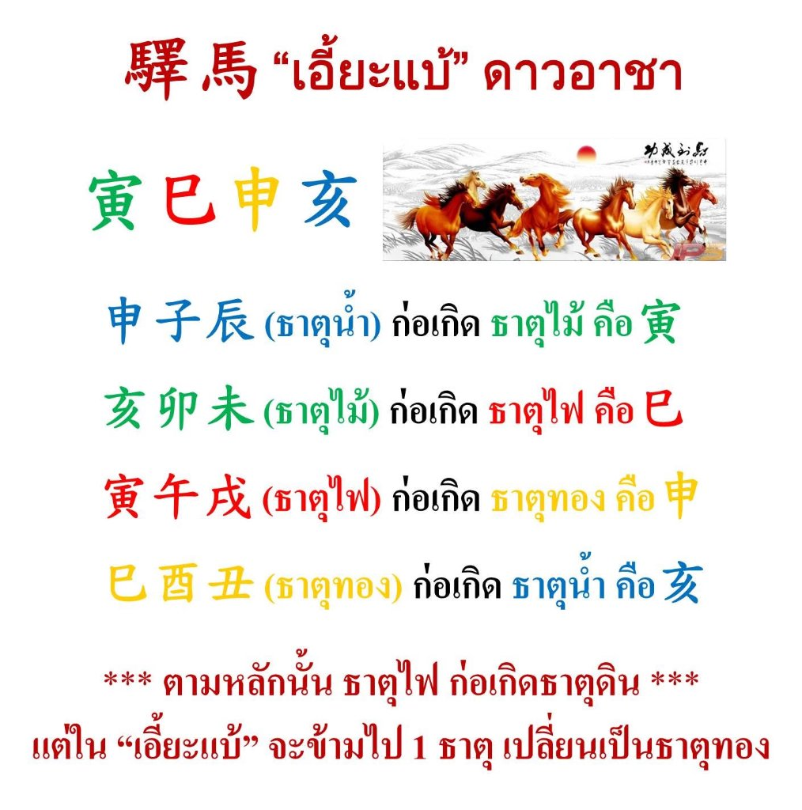

# ทฤษฎีที่ 15: 驛馬 “เอี้ยะแบ้” (ดาวอาชา) — เอี้ยะแบ้มา vs เอี้ยะแบ้ไป (Incoming vs Outgoing Mechanics)

> **แหล่งที่มา:** เพจ *แม่ไม้ดวงจีน 八字 : Destiny Detective* (โพสต์ทฤษฎี “เอี้ยะแบ้มา หรือ เอี้ยะแบ้ไป”)  
> **หมวดหมู่:** ทฤษฎีดาวจร / ปฏิกิริยาสี่อาชา (四馬) / การจำแนกทิศทางเหตุการณ์ (ในบ้าน vs นอกบ้าน)  
> **ภาพประกอบ:** [docs/bazi/images/theory_15_yi_ma_incoming_vs_outgoing.jpg](docs/bazi/images/theory_15_yi_ma_incoming_vs_outgoing.jpg)



---

## 1. ปรัชญาหัวใจ: “ผังดวงเปรียบเสมือนบ้าน — ใครจะมา หรือ ใครจะไป”

ในทฤษฎีชั้นสูงของวิชาแม่ไม้ดวงจีน การพิจารณาดาวม้าอาชา (驛馬 “เอี้ยะแบ้”) ไม่ได้ดูแค่ว่าเกิดการเดินทางหรือไม่  
แต่ต้องแยกแยะทิศทางของพลังงานระหว่าง **“ในบ้าน” (ดวงเดิม)** กับ **“นอกบ้าน” (ปีจร/วัยจร)**:

* **ผังดวง 8 ตัวอักษร (八字 “โป๊ยหยี่”):** เปรียบเสมือน **“ตัวบ้าน / ถิ่นพำนักของเรา”**
* **ปีจร หรือ วัยจร:** เปรียบเสมือน **“ผู้มาเยือนจากภายนอก หรือ สภาพแวดล้อมนอกบ้าน”**

---

## 2. ทบทวน 4 กลุ่มไตรภาคีสู่ 4 ตัวอาชา (三合 $\rightarrow$ 驛馬)

| กลุ่มไตรภาคีตั้งต้น (三合) | ธาตุกลุ่ม | ก่อเกิดธาตุ | ตัวดาวอาชา (驛馬) | กฎพิเศษ |
| :--- | :--- | :--- | :---: | :--- |
| **申 子 辰** | ธาตุน้ำ | $\rightarrow$ ก่อเกิด **ธาตุไม้** | **`寅`** | น้ำก่อเกิดไม้ |
| **亥 卯 未** | ธาตุไม้ | $\rightarrow$ ก่อเกิด **ธาตุไฟ** | **`巳`** | ไม้ก่อเกิดไฟ |
| **寅 午 戌** | ธาตุไฟ | $\rightarrow$ ก่อเกิด **ธาตุทอง** | **`申`** | ⚡ ไฟข้ามดินไปก่อเกิดทอง |
| **巳 酉 丑** | ธาตุทอง | $\rightarrow$ ก่อเกิด **ธาตุน้ำ** | **`亥`** | ทองก่อเกิดน้ำ |

---

## 3. มิติที่ 1: “เอี้ยะแบ้เป็นการเข้ามา” (Incoming / เข้ามาหาเราที่บ้าน)

### โครงสร้างดวงตัวอย่าง:
```
           (ในบ้าน)                 (ปีจร/นอกบ้าน)
x     甲      x      x                   x
x     寅      x      x     <--           辰
```
* **ในบ้าน (ดวงเดิม):** มีตัวม้าอาชา **`寅`** (比肩 ปีเกย = ตัวเอง, เพื่อน, หุ้นส่วน)
* **นอกบ้าน (ปีจร):** มีตัวเชื้อไตรภาคี **`辰`** (偏財 เพียงไช้ = เงินทอง, โชคลาภ, การลงทุน, หญิง/คนรัก)
* **กลไก:** `辰` (นอกบ้าน) เดินทาง **เข้ามาหา** `寅` (ในบ้าน) $\rightarrow$ **“เอี้ยะแบ้เป็นการเข้ามา”**

#### คำพยากรณ์:
1. **เมื่อเป็นธาตุให้คุณ (用神):**
   * มีพี่น้อง เพื่อนฝูง หุ้นส่วน **“เดินทางเข้ามาหาถึงบ้าน/ออฟฟิศ”** เพื่อร่วมลงทุน
   * มีข้อเสนอการลงทุนใหม่ๆ วิ่งเข้ามาให้เลือกถึงที่ ได้ลาภลอย คนรู้จักนำโชคลาภมาให้ถึงมือ
   * หากดิถีเป็นเพศชาย จะมีผู้หญิงหรือคนรักเข้ามาในชีวิต
2. **เมื่อเป็นธาตุให้โทษ (忌神):**
   * คนภายนอกนำความเดือดร้อนเข้ามาหา ตัดสินใจลงทุนผิดพลาด สูญเสียเงินทอง
   * หากดิถีเป็นเพศชาย จะเสียหายหรือเดือดร้อนเพราะผู้หญิงเข้ามาสร้างปัญหา

---

## 4. มิติที่ 2: “เอี้ยะแบ้เป็นการออกไป” (Outgoing / เราต้องออกไปข้างนอก)

### โครงสร้างดวงตัวอย่าง:
```
           (ในบ้าน)                 (ปีจร/นอกบ้าน)
x     甲      x      x                   x
x     辰      x      x     <--           寅
```
* **ในบ้าน (ดวงเดิม):** มีตัวเชื้อไตรภาคี **`辰`** (偏財 เพียงไช้ = ทรัพย์สิน, ฐานการเงิน, กิจการเดิม)
* **นอกบ้าน (ปีจร):** มีตัวม้าอาชา **`寅`** (比肩 ปีเกย = ม้าอาชาพาเคลื่อนไหวออกนอก)
* **กลไก:** ตัวม้าอาชา `寅` อยู่นอกบ้าน กระตุ้นให้เราต้อง **“ออกเดินทางไปข้างนอก”** $\rightarrow$ **“เอี้ยะแบ้เป็นการออกไป”**

#### คำพยากรณ์:
1. **เมื่อเป็นธาตุให้คุณ (用神):**
   * ตัวเราจะได้ **“เดินทางออกไปพบปะ”** เพื่อนใหม่ พันธมิตรใหม่ หุ้นส่วนใหม่ข้างนอก
   * การออกไปลุยตลาดภายนอกได้รับการสนับสนุนอย่างดี ทำให้เกิดรายได้และเงินทองไหลกลับเข้ามาเพิ่มขึ้น
   * หากดิถีเป็นเพศชาย จะได้พบคนรักที่เคยเป็นเพื่อนกันมาก่อน หรือคนที่เคยรู้จักกันมาก่อนในอดีต
2. **เมื่อเป็นธาตุให้โทษ (忌神):**
   * การเดินทางออกไปข้างนอกจะไปพบเจอกับศัตรู คู่แข่ง หรือมิจฉาชีพ
   * ถูกหลอกลวง ถูกแย่งชิงผลประโยชน์ แย่งลาภ ทำให้เสียเงินเสียทองจากการออกไปทำธุรกิจภายนอก

---

## 5. สรุปตรรกะเปรียบเทียบสำหรับการพัฒนาระบบ AI (`bazi.js`)

| สภาวะ | ตัวในดวงเดิม (ในบ้าน) | ตัวที่จรเข้ามา (นอกบ้าน) | ทิศทางพลังงาน | รูปธรรมของเหตุการณ์ |
| :--- | :--- | :--- | :--- | :--- |
| **เอี้ยะแบ้ เข้ามา** | มีตัวอาชา (`寅 / 巳 / 申 / 亥`) | มีตัวไตรภาคีมากระทบ | **ภายนอกวิ่งเข้ามาหาเรา** | หุ้นส่วน/คนรัก/โอกาสวิ่งเข้ามาหา, คนนำโชคมาให้ถึงที่ |
| **เอี้ยะแบ้ ออกไป** | มีตัวไตรภาคี (`辰 / 未 / 戌 / 丑` ฯลฯ) | มีตัวอาชาจรมากระทบ | **ตัวเราต้องเคลื่อนออกไป** | ต้องเดินทางออกไปลุยข้างนอก, ออกไปหาเพื่อนใหม่/ตลาดใหม่ |

```javascript
// ตรวจสอบทิศทาง เอี้ยะแบ้ มา vs ไป ใน bazi.js
function evaluateYiMaDirection(natalBranches, transitBranch) {
  const HORSES = ['寅', '巳', '申', '亥'];
  const isHorseInNatal = natalBranches.some(b => HORSES.includes(b));
  const isTransitHorse = HORSES.includes(transitBranch);

  if (isHorseInNatal && !isTransitHorse) {
    return {
      direction: 'INCOMING',
      description: 'เอี้ยะแบ้เข้ามาหาในบ้าน (โอกาส/ผู้คน/เรื่องราววิ่งเข้ามาหาเรา)'
    };
  } else if (!isHorseInNatal && isTransitHorse) {
    return {
      direction: 'OUTGOING',
      description: 'เอี้ยะแบ้ออกไปนอกบ้าน (เจ้าชะตาต้องเดินทาง เคลื่อนไหว หรือออกไปพบเจอภายนอก)'
    };
  }
  return { direction: 'NEUTRAL' };
}
```

