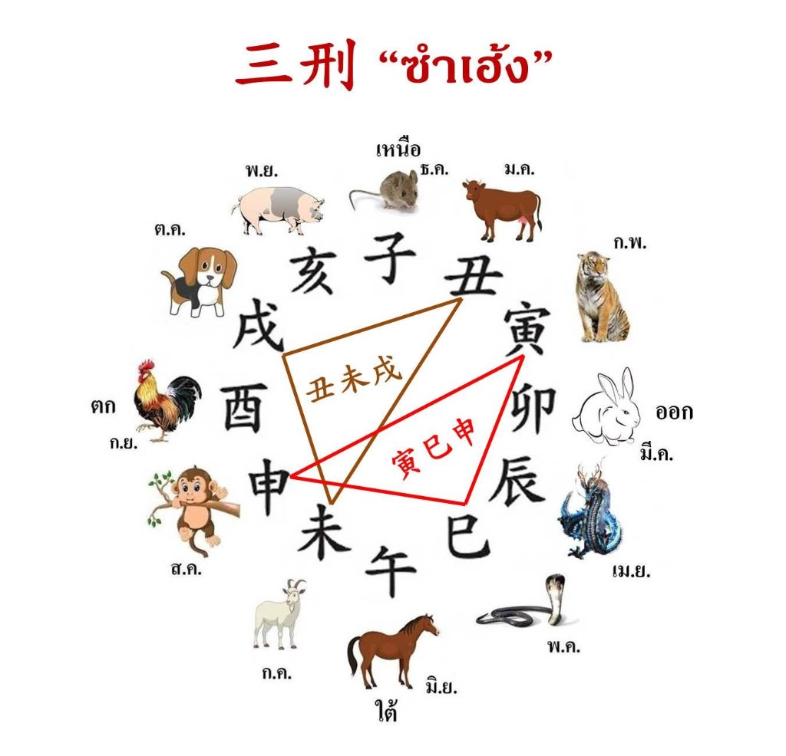

# ทฤษฎีที่ 16: 三刑 “ซำเฮ้ง” (๒ กลุ่มสามเหลี่ยมลงทัณฑ์) — “อย่าให้ชื่อทำให้เข้าใจผิด” (โทษทัณฑ์พุ่งชน vs ผลบุญหนุนส่ง)

> **แหล่งที่มา:** เพจ *แม่ไม้ดวงจีน 八字 : Destiny Detective* (โพสต์ทฤษฎี “ซำเฮ้ง ๒ กลุ่ม 丑未戌 และ 寅巳申”)  
> **หมวดหมู่:** ทฤษฎีปฏิกิริยาราศีล่าง / 刑 (เฮ้ง) / สามเหลี่ยมมุมฉาก / ปรัชญาไม่ยึดติดชื่อ / ปฏิกิริยาให้คุณ vs ให้โทษ  
> **ภาพประกอบ:** [docs/bazi/images/theory_16_san_xing_both_groups.jpg](docs/bazi/images/theory_16_san_xing_both_groups.jpg)



---

## 1. นิยามและฟิสิกส์แห่ง 刑 “เฮ้ง”

* **กลไกการเร่งสปีด (High-Velocity Catalyst):**  
  **刑 “เฮ้ง”** คือปฏิกิริยาที่เร่งให้เกิด **การเปลี่ยนแปลงอย่างรวดเร็ว กะทันหัน ฉับพลัน และรุนแรง** เป็นการเพิ่มสปีดตัวคูณเวลาให้ส่งผลเร็วขึ้น
* **หลักการสองด้านแห่งหยิน-หยาง (Dual Nature of Xing):**
  * **ถ้าเป็น 忌神 (กี่ซิ้ง - ธาตุให้โทษ):** $\rightarrow$ **“โทษทัณฑ์พุ่งชน”** (เคราะห์กรรม เบียดเบียน ขัดแย้ง ก่อเรื่องวิวาท เข้าใจผิด ถูกใส่ร้าย กลั่นแกล้ง ประมาทเลินเล่อ เสียหายหนัก อุบัติเหตุ สุขภาพพังทลาย)
  * **ถ้าเป็น 用神 (เอ่งซิ้ง - ธาตุให้คุณ):** $\rightarrow$ **“ผลบุญหนุนส่ง / ผลบุญพุ่งชน”** (ความมั่นใจ ความสามัคคี ช่วยเหลือเกื้อกูล เพิ่มพูน ประสบผลสำเร็จ ราบรื่น ได้ผลประโยชน์มหาศาล)

---

## 2. การจำแนก 三刑 “ซำเฮ้ง” ๒ กลุ่มหลัก

ในจักรราศี 12 นักษัตร มีกลุ่มซำเฮ้งที่ก่อตัวเป็นรูปสามเหลี่ยม 2 กลุ่ม ได้แก่:

### กลุ่มที่ 1: `丑 未 戌` — “ซำเฮ้งธาตุดิน (เฮ้งชง 3 มุม)”
* **กลไก:** การปะทะและขัดเกลาของธาตุดิน 3 มุม (`丑` แฉะหนาว, `未` ร้อนผาก, `戌` ชื้นแห้ง)
* **อุปมาทางธรณีวิทยา:**
  * ดั่ง **การเคลื่อนตัวของแผ่นเปลือกโลก (Tectonic Shift)** และการขยับของรอยเลื่อนแผ่นดินไหว หากอยู่ใต้สมุทรจะกลายเป็น **สึนามิ**
  * มีอานุภาพ **ยกแผ่นดินขึ้นกลายเป็นภูเขาสูงตระหง่าน** (สร้างความมั่งคั่งระดับมหาเศรษฐี) หรือทำให้ **แผ่นดินทรุดตัวจมหายเป็นหุบเหวลึก** (ล้มละลายพังทลาย)

### กลุ่มที่ 2: `寅 巳 申` — “ซำเฮ้ง 3 อาชา (สามเหลี่ยมมุมฉาก)”
* **กลไก:** ปฏิกิริยา 刑 “เฮ้ง” ทำมุม 90 องศาของ `寅` (ขาล) กับ `巳` (มะเส็ง) และ `巳` (มะเส็ง) กับ `申` (วอก)
* **รูปทรงเรขาคณิต:** ก่อตัวเป็น **“สามเหลี่ยมมุมฉาก”** (Right-Angled Triangle)
* **อานุภาพ:** มีความเร็วสูง ฉับพลัน กะทันหันยิ่งกว่ากลุ่มอื่น สื่อถึงอุบัติเหตุฉับพลัน หรือจุดพลิกผันชีวิตแบบฟ้าผ่า

---

## 3. ปรัชญาหัวใจสูงสุด: “อย่าให้ ‘ชื่อ’ ทำให้เข้าใจผิด อ่านดวงผิด”

> [!CAUTION]
> **“神煞 ‘สิ่งสั่วะ’ (เทพมาร), 沖 ‘ชง’, 合 ‘ฮะ’, 刑 ‘เฮ้ง’, 害 ‘ไห่’, 破 ‘ผั่ว’, 桃花 ‘ถ่อฮวย’, 三刑 ‘ซำเฮ้ง’ ฯลฯ เป็นเพียง ‘ชื่อ’!”**

* ความดีหรือร้ายในปาจื่อ **ไม่ได้อยู่ที่ตัว “ชื่อ”**
* **แต่อยู่ที่ว่า ธาตุที่เกิดปฏิกิริยานั้นเป็น 用神 “เอ่งซิ้ง” หรือ 忌神 “กี่ซิ้ง”**:
  * แม้ชื่อจะฟังดูน่ากลัว เช่น **ชง, เฮ้ง, ผั่วะ, ไห่** แต่หากเป็น **用神 (ธาตุให้คุณ)** $\rightarrow$ **การพยากรณ์ย่อมเป็นไปในทางที่ดีเลิศ เจริญรุ่งเรือง**
  * แม้ชื่อจะฟังดูมงคล เช่น **ฮะ, ไตรภาคี, ถ่อฮวย, กุ้ยนั้ง** แต่หากเป็น **忌神 (ธาตุให้โทษ)** $\rightarrow$ **การพยากรณ์ย่อมเป็นไปในทางฉาวโฉ่ สูญเสีย และเสียหายหนัก**

---

## 4. สรุปตรรกะสำหรับการเขียนระบบคำนวณ (`bazi.js`)

```javascript
// ตรวจจับ 2 กลุ่มซำเฮ้ง (San Xing Triple Punishments)
const SAN_XING_CONFIG = {
  EARTH_TRIO: {
    branches: ['丑', '未', '戌'],
    name: 'ซำเฮ้งธาตุดิน',
    nature: 'Tectonic Shift / Earth Tremor',
    element: 'Earth'
  },
  HORSES_RIGHT_ANGLE: {
    branches: ['寅', '巳', '申'],
    name: 'ซำเฮ้ง 3 อาชา (สามเหลี่ยมมุมฉาก)',
    nature: 'High-speed 90-degree catalytic shift',
    element: 'Metal-Wood-Fire cross dynamics'
  }
};

function detectSanXing(branchesList, favorableElements) {
  const results = [];
  for (const [key, config] of Object.entries(SAN_XING_CONFIG)) {
    const isComplete = config.branches.every(b => branchesList.includes(b));
    if (isComplete) {
      const isFavorable = favorableElements.includes(config.element);
      results.push({
        type: 'SAN_XING',
        groupKey: key,
        name: config.name,
        branches: config.branches,
        isFavorable: isFavorable,
        interpretation: isFavorable 
          ? 'ผลบุญหนุนส่ง (ขยายอาณาจักร มั่งคั่ง มั่นคง ก้าวกระโดด)' 
          : 'โทษทัณฑ์พุ่งชน (ขัดแย้ง แตกหัก คดีความ อุบัติเหตุ)'
      });
    }
  }
  return results;
}
```
