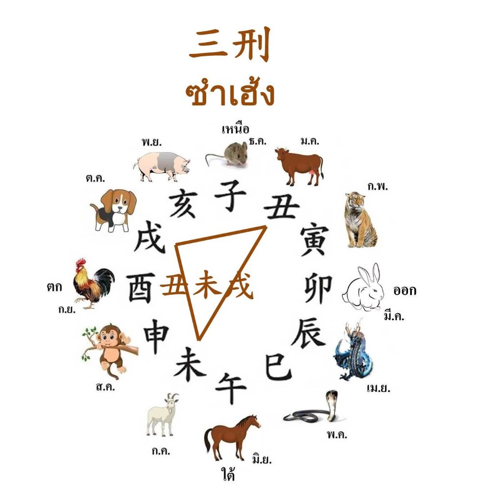

# ทฤษฎีที่ 16: 三刑 “ซำเฮ้ง” ธาตุดิน (丑 未 戌) — “โทษทัณฑ์พุ่งชน vs ผลบุญพุ่งชน”

> **แหล่งที่มา:** เพจ *แม่ไม้ดวงจีน 八字 : Destiny Detective* (โพสต์ทฤษฎี “ซำเฮ้ง 丑未戌”)  
> **หมวดหมู่:** ทฤษฎีปฏิกิริยาราศีล่าง / 刑 (เฮ้ง) / การเคลื่อนตัวของเปลือกโลก / ปฏิกิริยาให้คุณ vs ให้โทษ  
> **ภาพประกอบ:** [docs/bazi/images/theory_16_san_xing_earth.jpg](docs/bazi/images/theory_16_san_xing_earth.jpg)



---

## 1. นิยามและกลไกเชิงฟิสิกส์ของ 刑 “เฮ้ง”

* **กลไกการเร่งปฏิกิริยา (Speed Booster):**
  * **刑 “เฮ้ง”** คือปฏิกิริยาที่ทำให้เกิด **การเปลี่ยนแปลงอย่างรวดเร็ว เร่งด่วน กะทันหัน** เป็นการเพิ่มสปีดตัวคูณเวลาให้เรื่องราวสัมฤทธิ์ผลเร็วขึ้น
* **หลักการสองด้านแห่งหยิน-หยาง (Dual Nature of Xing):**
  * ในตำราดวงจีนดั้งเดิม มักมองว่า “เฮ้ง” มีแต่เรื่องเลวร้าย คดีความ อุบัติเหตุ หรือการติดคุก
  * แต่ในสายวิชา **แม่ไม้ดวงจีน** ชี้ชัดว่า **“สรรพสิ่งล้วนมี 2 ด้านตามหลักหยิน-หยาง”**:
    * **ถ้าเป็นธาตุที่ให้โทษ (忌神):** $\rightarrow$ **“โทษทัณฑ์พุ่งชน”** (เคราะห์กรรมกระหน่ำซ้ำอย่างรวดเร็ว)
    * **ถ้าเป็นธาตุที่ให้คุณ (用神):** $\rightarrow$ **“ผลบุญพุ่งชน”** (ลาภยศความสำเร็จถาโถมเข้ามาอย่างมหาศาล)

---

## 2. ฟิสิกส์แห่ง 三刑 “ซำเฮ้ง” ธาตุดิน (`丑`, `未`, `戌`)

* **การเฮ้งชงของธาตุดินทั้ง 3 มุม:**
  * เกิดขึ้นเมื่อราศีล่างกลุ่มคลังดิน 3 ตัว ได้แก่ **`丑` (หนาวแฉะ)**, **`未` (ร้อนผาก)**, และ **`戌` (แห้งชื้น)** มาพบกันครบ 3 ตัว (ไม่ว่าจะอยู่ในดวงเดิม หรือปีจร/วัยจรพามาบรรจบ)
* **การอุปมาเชิงธรณีฟิสิกส์:**
  * เปรียบเสมือน **การเคลื่อนตัวของเปลือกโลก (Tectonic Plate Shift) และการขยับของรอยเลื่อนแผ่นดิน**
  * นำไปสู่ **แผ่นดินไหวขนาดใหญ่** หากอยู่ใต้น้ำจะก่อตัวเป็น **คลื่นยักษ์สึนามิ**
  * พลังงานนี้สามารถยกแผ่นดินให้สูงขึ้นกลายเป็น **“เทือกเขาตระหง่าน”** (ความสำเร็จสูงเทียมฟ้า) หรือทำให้แผ่นดินทรุดตัวจมหายกลายเป็น **“หุบเหวลึก”** (ความล้มเหลวพังทลาย) ได้ในพริบตา

---

## 3. การเปรียบเทียบผลลัพธ์: โทษทัณฑ์ vs ผลบุญ

| ด้านร้าย (เมื่อธาตุดินเป็น 忌神 ให้โทษ) | ด้านดี (เมื่อธาตุดินเป็น 用神 ให้คุณ) |
| :--- | :--- |
| **เบียดเบียน / ขัดแย้ง:** ทะเลาะวิวาท เข้าใจผิด แตกหัก | **ความสามัคคี / พลังมวลชน:** ได้รับการสนับสนุน ช่วยเหลือท่วมท้น |
| **ใส่ร้าย / กลั่นแกล้ง:** ถูกแทงข้างหลัง เจอคดีความ ถูกฟ้องร้อง | **ความมั่นใจสูงส่ง:** กล้าตัดสินใจ ภาวะผู้นำเปล่งประกาย |
| **ประมาทเลินเล่อ:** ตัดสินใจผิดพลาด ขาดสติจนเสียหายหนัก | **ผลประโยชน์พุ่งชน:** ธุรกิจขยายตัวก้าวกระโดด โชคลาภก้อนโต |
| **ความพังทลาย:** เกิดอุบัติเหตุล้มละลาย ธุรกิจทรุดดั่งแผ่นดินแยก | **ความสำเร็จระดับแลนด์มาร์ก:** สร้างอาณาจักรธุรกิจ เป็นที่จดจำระดับโลก |

---

## 4. กฎเหล็กในการตัดสิน: “วิเคราะห์ความอ่อน-แข็งให้ถูกต้อง”

> [!IMPORTANT]
> **“วิเคราะห์ความอ่อน-แข็งของดวงได้ถูกต้อง จึงสามารถระบุได้ว่า 三刑 ‘ซำเฮ้ง’ ให้คุณหรือให้โทษ”**
> * หากเป็น **ดวงอ่อน (弱)** ที่ต้องการธาตุดิน/ธาตุไฟมาหนุน $\rightarrow$ เมื่อเกิดซำเฮ้งดิน `丑未戌` พลังดินจะหนุนเนื่องอย่างรุนแรง กลายเป็น **“ผลบุญพุ่งชน”** พลิกชีวิตสู่มหาเศรษฐีทันที
> * หากเป็น **ดวงแข็ง (強)** ที่ดินล้นเกินอยู่แล้ว $\rightarrow$ เมื่อเกิดซำเฮ้งดิน `丑未戌` พลังดินจะถล่มทลาย กลายเป็น **“โทษทัณฑ์พุ่งชน”** เกิดคดีความ ทะเลาะเบาะแว้ง และการสูญเสียทรัพย์สินมหาศาล

---

## 5. แนวทางการเขียนตรรกะระบบคำนวณ (`bazi.js`)

```javascript
// ตรวจจับปฏิกิริยาซำเฮ้งธาตุดิน (San Xing Earth Trio)
const SAN_XING_EARTH = ['丑', '未', '戌'];

function checkSanXingEarth(natalBranches, transitBranch) {
  const allBranches = [...natalBranches];
  if (transitBranch) allBranches.push(transitBranch);

  const hasChou = allBranches.includes('丑');
  const hasWei  = allBranches.includes('未');
  const hasXu   = allBranches.includes('戌');

  if (hasChou && hasWei && hasXu) {
    return {
      type: 'SAN_XING_EARTH',
      branches: ['丑', '未', '戌'],
      element: 'Earth',
      nature: 'Tectonic shift / High velocity catalyst',
      // ตัดสินผลลัพธ์ตามว่าธาตุดินเป็น 用神 หรือ 忌神
      getOutcome: (isEarthFavorable) => ({
        status: isEarthFavorable ? 'FAVORABLE_BLESSINGS_SURGE' : 'UNFAVORABLE_PENALTY_SURGE',
        labelThai: isEarthFavorable ? 'ผลบุญพุ่งชน (เติบโต มั่งคั่ง มั่นคงยิ่งใหญ่)' : 'โทษทัณฑ์พุ่งชน (ขัดแย้ง พังทลาย คดีความ)'
      })
    };
  }
  return null;
}
```
