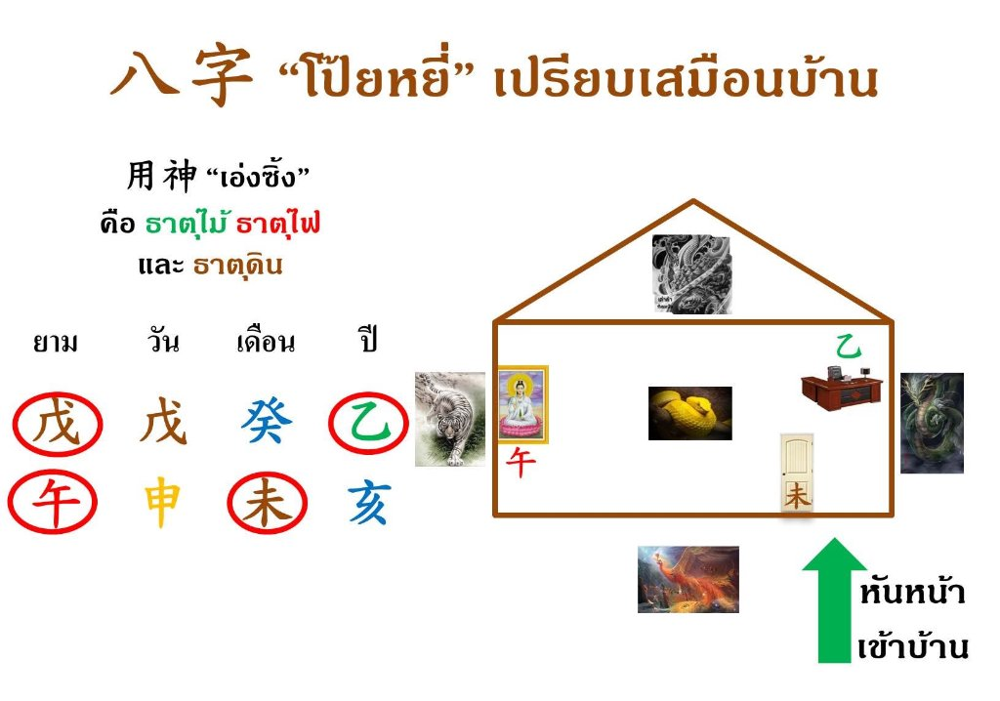

# ทฤษฎีที่ 17: 八字 “โป๊ยหยี่” เปรียบเสมือนบ้าน — การจัดตี่ลี่ฮวงจุ้ยเฉพาะบุคคลตามผังดวง

> **แหล่งที่มา:** เพจ *แม่ไม้ดวงจีน 八字 : Destiny Detective* (โพสต์ทฤษฎี “โป๊ยหยี่เปรียบเสมือนบ้าน & ตี่ลี่”)  
> **หมวดหมู่:** ตี่ลี่ฮวงจุ้ยเฉพาะบุคคล (Personalized Feng Shui) / สัตว์เทพทั้ง ๕ / การจัดวางตำแหน่งเสริมดวง  
> **ภาพประกอบ:** [docs/bazi/images/theory_17_bazi_house_feng_shui.jpg](docs/bazi/images/theory_17_bazi_house_feng_shui.jpg)



---

## 1. ปรัชญาหัวใจ: “ผังดวง ๘ ตัวอักษรคือแผนผังบ้านของคุณ”

ในศาสตร์แม่ไม้ดวงจีน ไม่ได้มองฮวงจุ้ยแยกขาดจากดวงชะตา แต่ผสาน **八字 “โป๊ยหยี่” เข้ากับ “ตี่ลี่” (ลักษณะทำเลที่อยู่อาศัย)**  
บ้านของแต่ละคนมีตำแหน่งมงคลที่แตกต่างกัน โดย **อ้างอิงจากตำแหน่งตัวอักษรที่เป็น 用神 “เอ่งซิ้ง” (ธาตุให้คุณ) ในผังดวง ๔ เสาของตนเอง**

---

## 2. โครงสร้างสัตว์เทพทั้ง ๕ ประจำทิศบ้าน (เมื่อยืนหันหน้าเข้าบ้าน)

> [!IMPORTANT]
> **มุมมองการยืน:** ยืนอยู่หน้าบ้านแล้ว **“หันหน้าเข้าหาตัวบ้าน”**

```
              [หลังบ้าน: เต่าดำ 玄武]
                 (ตำแหน่งประธาน/บารมี)
      ฝั่งซ้าย                             ฝั่งขวา
   [เสือขาว 白虎]                        [มังกรเขียว 青龙]
  (เสาวัน / เสายาม)                      (เสาเดือน / เสาปี)
                   [กลางบ้าน: งูเหลือง]
                       (สะอาด สว่าง)
              [หน้าบ้าน: หงส์แดง 朱雀]
                   (ลานโล่ง สว่าง สะอาด)
                     ^
                     |
               [หันหน้าเข้าบ้าน]
```

1. **ฝั่งขวาบ้าน $\rightarrow$ มังกรเขียว (青龙):** ตรงกับ **เสาปี และ เสาเดือน** (ด้านขวาของผังดวง)
2. **ฝั่งซ้ายบ้าน $\rightarrow$ เสือขาว (白虎):** ตรงกับ **เสาวัน และ เสายาม** (ด้านซ้ายของผังดวง)
3. **หน้าบ้าน $\rightarrow$ หงส์แดง (朱雀):** ลานหน้าบ้าน ควรโล่ง สะอาด สว่างสดใส
4. **หลังบ้าน $\rightarrow$ เต่าดำ (玄武):** ตำแหน่งประธานและบารมี ควรนิ่ง สงบ สะอาด สว่าง
5. **กลางบ้าน $\rightarrow$ งูเหลือง (黄蛇 - จุดศูนย์กลางธาตุดิน):** หัวใจของบ้าน ต้องสะอาด เป็นระเบียบ ไม่รกรุงรัง

---

## 3. หลักการจัดวางสิ่งของตามตำแหน่ง 用神 (ธาตุให้คุณ)

### แผงดวงตัวอย่าง:
```
ยาม (ซ้าย)   วัน (ซ้าย)   เดือน (ขวา)   ปี (ขวา)
戊           戊           癸           乙
午           申           未           亥
```
* **ดิถี:** ธาตุดิน **`戊`**
* **สภาพดวง:** **“ดวงอ่อน”**
* **ธาตุที่ให้คุณ (用神):** **ธาตุไม้ (木)**, **ธาตุไฟ (火)**, และ **ธาตุดิน (土)**
* **ธาตุที่ให้โทษ (忌神):** **ธาตุน้ำ (水)** และ **ธาตุทอง (金)**

---

### การกำหนดตำแหน่งฟังก์ชันในบ้านตามตัวดวง:

#### 1. ประตูทางเข้าบ้าน (Main Door) $\rightarrow$ วางที่ตำแหน่ง `未` (ฝั่งมังกรเขียว - ขวา):
* `未` (ดิน) คือ **比劫 “ปี่เกี๊ยบ”** (พี่น้อง มิตรสหาย เพื่อนร่วมงาน หุ้นส่วน ที่คอยช่วยเหลือสนับสนุน)
* `未` อยู่ที่เสาเดือน (ฝั่งขวาของดวง)
* **ผลลัพธ์:** วางประตูทางเข้าไว้ **“ฝั่งขวา (มังกรเขียว)”** เพื่อเปิดรับกัลยาณมิตร พันธมิตร และผู้สนับสนุนเข้ามาสู่บ้าน

#### 2. โต๊ะทำงาน (Work Desk) $\rightarrow$ วางที่ตำแหน่ง `乙` (ฝั่งมังกรเขียว - ขวา):
* `乙` (ไม้) คือ **正官 “เจี่ยกัว”** (ชื่อเสียง เกียรติยศ อำนาจ หน้าที่การงาน เครดิต ความรับผิดชอบ)
* `乙` อยู่ที่เสาปีราศีบน (ฝั่งขวาบนของดวง)
* **ผลลัพธ์:** จัดวางโต๊ะทำงานไว้ **“ฝั่งขวา (มังกรเขียว)”** เสริมพลังอำนาจบารมีและความก้าวหน้าในหน้าที่การงาน

#### 3. หิ้งบูชาสิ่งศักดิ์สิทธิ์ (Altar / Shrine) $\rightarrow$ วางที่ตำแหน่ง `午` (ฝั่งเสือขาว - ซ้าย):
* `午` (ไฟ) คือ **正印 “เจี่ยอิ่ง”** (แม่ ผู้ใหญ่ เจ้านาย วาสนา สติปัญญา สิ่งศักดิ์สิทธิ์คุ้มครอง)
* `午` อยู่ที่เสายามราศีล่าง (ฝั่งซ้ายล่างของดวง)
* **ผลลัพธ์:** ตั้งหิ้งพระหรือสิ่งศักดิ์สิทธิ์ไว้ **“ฝั่งซ้าย (เสือขาว)”** ได้รับความคุ้มครองและเมตตาบารมีจากครูบาอาจารย์และสิ่งศักดิ์สิทธิ์

---

## 4. ข้อห้ามและหลักรักษาพลังงานประจำทิศ

1. **ตำแหน่งหงส์แดง (หน้าบ้าน):**
   * ต้องโล่ง สะอาด สว่าง ไม่อับทึบ
   * ⚠️ **ข้อห้ามเฉพาะบุคคล:** สำหรับดวงนี้ **ห้ามวางน้ำพุ น้ำตก บ่อปลา หรืออ่างบัวที่หน้าบ้านเด็ดขาด!** ทั้งฝั่งซ้ายและขวา เพราะ **ธาตุน้ำ (水) เป็นธาตุให้โทษ (忌神)** ของดวง หากวางน้ำหน้าบ้านจะดึงดูดพลังร้าย ความเสียหาย และการเสียเงินทองเข้ามา
2. **ตำแหน่งงูเหลือง (กลางบ้าน):**
   * เป็นจุดกระจายลมปราณ ต้องสะอาด สว่าง เป็นระเบียบ **ห้ามวางสิ่งของรกเกะกะ กองขยะ หรือห้องเก็บของ**
3. **ตำแหน่งเต่าดำ (หลังบ้าน - ประธานบารมี):**
   * ควรสะอาด สว่าง มั่นคง
   * เป็นตำแหน่งที่เหมาะสมอย่างยิ่งในการตั้ง **ตี่จู้เอี๊ยะ, ฮก ลก สิ่ว, พระพุทธรูป หรือองค์เทพประธาน** เพื่อคุ้มครองฐานอำนาจของผู้อยู่อาศัย

> **สรุปหัวใจตี่ลี่ 3 ประการ:**
> 1. **ความสะอาด** (ไร้พลังอัปมงคล)
> 2. **ความสว่าง** (พลังหยางเจริญรุ่งเรือง)
> 3. **ความเป็นระเบียบ** (พลังปราณไหลเวียนคล่องตัว)
