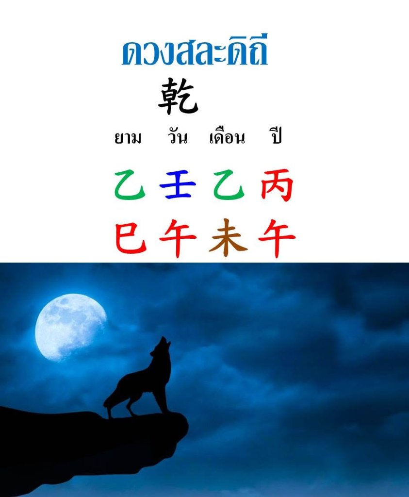

# ทฤษฎีที่ 18: ดวงสละดิถี (从格 Cong Ge) — “๑๐ วิถีสุนัขป่า” และสูตรคำนวณตัวคูณโชคลาภ

> **แหล่งที่มา:** เพจ *แม่ไม้ดวงจีน 八字 : Destiny Detective* (โพสต์ทฤษฎี “ดวงสละดิถี กับ ๑๐ วิถีสุนัขป่า”)  
> **หมวดหมู่:** รูปดวงพิเศษ (Special Structures) / ดวงสละดิถี (从格) / สูตรคำนวณตัวคูณโชคลาภ (Fortune Multipliers) / ปรัชญาสุนัขป่า (Lone Wolf)  
> **ภาพประกอบ:** [docs/bazi/images/theory_18_cong_ge_lone_wolf.jpg](docs/bazi/images/theory_18_cong_ge_lone_wolf.jpg)



---

## 1. นิยามและโครงสร้างของ “ดวงสละดิถี” (从格 Cong Ge)

* **ดวงสละดิถี (Follow The Leader / Abandoning Day Master):**  
  คือรูปดวงพิเศษที่ **“ไม่มีธาตุพวกพ้อง (比劫 ปี่เกี๊ยบ) และ ไม่มีธาตุที่ให้กำเนิดดิถี (印 อิ่ง) เลยแม้แต่ตัวเดียวในแผงดวง ๘ ตัวอักษร!”**
* **ธรรมชาติของพลังงาน:**  
  ดิถีไม่สามารถตั้งหลักยืนหยัดด้วยตัวเองได้ จึงต้อง **“ยอมสละตัวตน ยอมจำนน ไหลตามกระแสของธาตุที่มีกำลังครองเมืองในดวง”**
* **กฎเหล็กการเลือกธาตุให้คุณ vs ให้โทษ:**
  * **ธาตุที่ให้คุณ (用神 “เอ่งซิ้ง”):** ธาตุที่ดวงกำลังไหลตามไป (เช่น ธาตุถ่ายเท/ผลงาน, ธาตุโชคลาภ/เงินทอง, ธาตุอำนาจ)
  * **ธาตุที่ให้โทษเด็ดขาด (忌神 “กี่ซิ้ง”):** **ธาตุของดิถีเอง (比劫) และ ธาตุกำเนิดดิถี (印)**
  * ⚠️ **ห้ามมี 印 “อิ่ง” และ 比劫 “ปี่เกี๊ยบ” เข้ามาในดวงเด็ดขาด!** เพราะจะทำให้ดิถีพยายามลุกขึ้นมาต้านกระแสแม่น้ำเชี่ยวกราก ส่งผลให้ชีวิตพังทลายทันที

---

## 2. ตัวอย่างการวิเคราะห์โครงสร้างดวงสละดิถีจริง

```
[แผงดวง ๔ เสา — ชาย (乾)]
ยาม       วัน      เดือน     ปี
乙       壬       乙       丙
巳       午       未       午
```

* **ดิถีวัน (Day Master):** ธาตุน้ำหยาง **`壬`**
* **การตรวจสอบธาตุในดวง:**
  * ธาตุน้ำ (`壬`, `癸`, `亥`, `子`) = ไม่มีตัวอื่นเลย มีเพียงดิถี 壬 ตัวเดียว
  * ธาตุทองที่กำเนิดน้ำ (`庚`, `辛`, `申`, `酉`) = ไม่มีเลยแม้แต่ตัวเดียว
  * ธาตุอื่นๆ: ไม้ (`乙`, `乙`), ไฟ (`丙`, `巳`, `午`, `午`), ดิน (`未`) ครองดวงทั้งหมด
* **สรุป:** เข้าเกณฑ์ **“ดวงสละดิถีตามธาตุไม้-ไฟ-ดิน” (สละดิถีตามลาภ/ผลงาน)**
  * **ธาตุให้คุณ (用神):** **ธาตุไม้ (木)**, **ธาตุไฟ (火)**, และ **ธาตุดิน (土)**
  * **ธาตุให้โทษ (忌神):** **ธาตุทอง (金)** และ **ธาตุน้ำ (水)**

---

## 3. สูตรคำนวณตัวคูณโชคลาภ (Multiplier Calculation System)

เมื่อดวงสละดิถีพบกับปีจรและเดือนจรที่เป็นธาตุให้คุณ (ธาตุไฟและไม้) ปฏิกิริยาต่างๆ จะซ้อนทับกันกลายเป็น **“ตัวคูณเงินทองมหาศาล”**:

### กรณีศึกษา: ปีจร พ.ศ. 2569 (`丙午`) เดือน มีนาคม (`卯`)
สำหรับดิถีน้ำ 壬:
* `巳` และ `午` คือ **偏財 (เพียงไช้)** และ **正財 (เจี่ยไช้)** = เงินทอง โชคลาภ ก้อนใหญ่
* ธาตุไฟและไม้เป็น **用神 (ให้คุณ)** สูงสุด

#### การคำนวณตัวคูณ 3 เด้ง (รวม 7 เท่า):
1. **ปีจร `午` ทำปฏิกิริยา 自刑 “จื่อเฮ้ง” (Self-Punishment) กับ `午` ในดวงเดิม:**
   * กฎการคูณ: **จื่อเฮ้งมีพลังทวีคูณเป็น ๒ เท่า (Double)**
   * ในดวงเดิมมี `午` ถึง 2 เสา (เสาปี + เสาวัน)
   * $\text{ตัวคูณ} = 2 \times 2 = \mathbf{4\text{ เท่า}}$
2. **เดือนจร `卯` ทำปฏิกิริยา 桃花 “ถ่อฮวย” กับ `午` ในดวงเดิม:**
   * ปฏิกิริยาถ่อฮวย ($卯 \rightarrow 午$): เป็นที่ชื่นชอบของผู้คน ลูกค้าหลั่งไหลเข้ามา
   * กระทบ 2 เสา (เสาปี + เสาวัน)
   * $\text{ตัวคูณ} = \mathbf{2\text{ เท่า}}$
3. **เดือนจร `卯` ทำปฏิกิริยา 驛馬 “เอี้ยะแบ้” กับ `巳` ที่เสายามเกิด:**
   * ปฏิกิริยาเอี้ยะแบ้ ($亥卯未 \rightarrow 巳$): โปรเจกต์สำเร็จลุล่วงตามเป้าหมาย งานใหญ่สำเร็จ
   * กระทบ 1 เสา
   * $\text{ตัวคูณ} = \mathbf{1\text{ เท่า}}$

$$\mathbf{\text{ผลรวมตัวคูณความมั่งคั่ง}} = 4 + 2 + 1 = \mathbf{7\text{ เท่า (เติมนูล 0 เจ็ดหลัก = หลักสิบล้าน)}}$$

---

## 4. ปรัชญาดวงสละดิถี: “๑๐ วิถีสุนัขป่า (Lone Wolf Philosophy)”

คนที่มีดวงสละดิถี เปรียบเสมือนสุนัขป่าเดียวดายที่ทรงพลัง (Lone Wolf) ซึ่งมีวิถีแห่งการดำเนินชีวิต 10 ประการ:

1. **การพึ่งพาตัวเอง คือ พลังที่แท้จริง:** ไม่หวังพึ่งใคร ยืนหยัดด้วยลำแข้งตนเอง
2. **ดู ฟัง และ เลือกจังหวะ (ช่างสังเกต):** สุนัขป่าไม่เห่าพร่ำเพรื่อเหมือนหมาบ้าน แต่มองและเลือกจังหวะลงมือ
3. **ไม่ใส่ใจกับเสียงเห่าหอน:** คนที่เข้าใจไม่ต้องอธิบาย คนที่ไม่เข้าใจอธิบายไปก็ไม่ฟัง
4. **นิ่งแต่ไม่อ่อนแอ (สงบสยบความเคลื่อนไหว):** การนิ่งคือการสะสมพลัง ไม่ใช่การยอมแพ้
5. **แข่งขันกับตัวเอง:** มุ่งพัฒนาและเดินตามเส้นทางแห่งความชำนาญของตน
6. **จริงใจกับตัวเอง:** เป็นในสิ่งที่ตัวเองเป็น ไม่ลอกเลียนแบบใคร
7. **อดทนและรอเวลา:** ไม่ทำอะไรสะเปะสะปะ รู้จักรอคอยจังหวะฟ้าดินที่ใช่
8. **ใช้พลังอย่างมีเป้าหมาย:** ทุ่มเททุกหยาดเหงื่อลงไปที่จุดชี้ขาดสำคัญ
9. **เรียนรู้ที่จะอยู่โดยลำพัง:** หลีกเลี่ยงความวุ่นวายของฝูงชนที่ไร้สาระ
10. **เลือกคน ไม่เลือกฝูง:** เฟ้นหาเฉพาะคนที่จริงใจและร่วมอุดมการณ์

> **“ดวงสละดิถี มิใช่การไม่มีใคร... แต่เป็นการไม่เดินออกนอกเส้นทางของตนเอง”**

---

## 5. ตรรกะสำหรับการเขียนโปรแกรมคำนวณ (`bazi.js`)

```javascript
// ตรวจสอบโครงสร้างดวงสละดิถี (Cong Ge Detection)
function detectCongGe(dayMasterStem, natalStems, natalBranches) {
  const companionElement = getElementOfStem(dayMasterStem);
  const resourceElement  = getGeneratingElement(companionElement);

  // ตรวจสอบว่าในดวงมีธาตุพวกพ้อง หรือธาตุกำเนิด หรือไม่
  const allStemsExceptDM = natalStems.filter((_, idx) => idx !== 1); // ตัดดิถีวันออก
  const allBranches = natalBranches;

  const hasCompanionOrResource = [...allStemsExceptDM, ...allBranches].some(char => {
    const el = getElement(char);
    return el === companionElement || el === resourceElement;
  });

  return {
    isCongGe: !hasCompanionOrResource,
    type: 'CONG_GE',
    unfavorableElements: [companionElement, resourceElement], // ห้ามเอา 印 และ 比劫
    philosophy: 'Lone Wolf (๑๐ วิถีสุนัขป่า)'
  };
}
```

