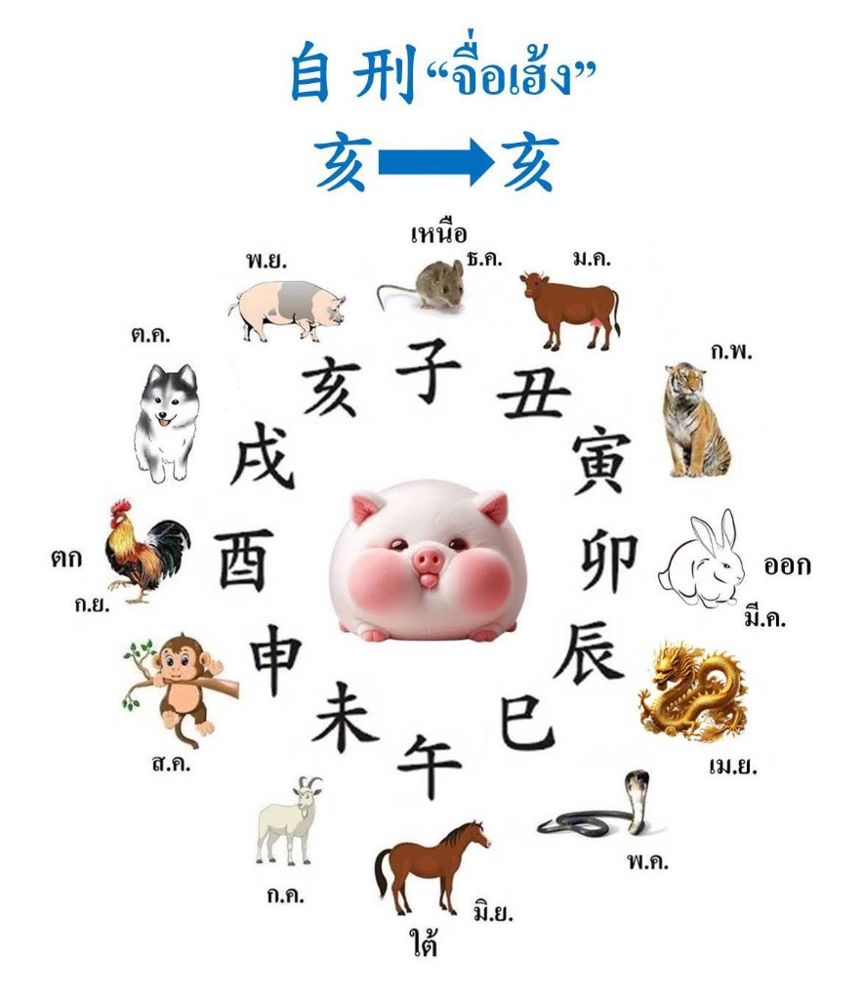

# ทฤษฎีที่ 19: 自刑 “จื่อเฮ้ง” (亥 ➡️ 亥 ต้นฤดูหนาว) — กฎทวีคูณ ๒ เท่า (The Double Multiplier Rule)

> **แหล่งที่มา:** เพจ *แม่ไม้ดวงจีน 八字 : Destiny Detective* (โพสต์ทฤษฎี “จื่อเฮ้ง 亥 ➡️ 亥”)  
> **หมวดหมู่:** ทฤษฎีปฏิกิริยาราศีล่าง / 自刑 (จื่อเฮ้ง) / ต้นฤดูหนาว / กฎการทวีคูณผลลัพธ์  
> **ภาพประกอบ:** [docs/bazi/images/theory_19_zi_xing_self_punishment_hai.jpg](docs/bazi/images/theory_19_zi_xing_self_punishment_hai.jpg)



---

## 1. ธรรมชาติแห่ง `亥` (ต้นฤดูหนาว — ๗ พ.ย. ถึง ๖ ธ.ค.)

* **สภาวะต้นฤดู (四馬 “ซี่แบ้”):**  
  `亥` เป็นตัวแทนของ **ต้นฤดูหนาว** (จุดเริ่มต้นของธาตุน้ำ)
* **ความหมายเชิงพลังงาน:**  
  * การก่อเกิด การริเริ่ม การเริ่มต้นทำสิ่งใหม่ๆ
  * การเปิดโครงการใหม่ การเริ่มต้นธุรกิจหรือโปรเจกต์ใหม่
  * บุคลิก: ร่าเริง แจ่มใส สนุกสนาน คล่องแคล่ว

---

## 2. กฎเหล็กของ 自刑 “จื่อเฮ้ง”: “มีผลเป็น ๒ เท่า (Double)”

ในวิชาปาจื่อ **自刑 “จื่อเฮ้ง” (Self-Punishment)** ประกอบด้วย 4 ตัวอักษร ได้แก่ `辰`, `午`, `酉`, และ **`亥`**  
เมื่อตัวอักษรเหล่านี้โคจรมาพบกับตัวของมันเอง (เช่น `亥` พบ `亥`):

> [!IMPORTANT]
> **“自刑 ‘จื่อเฮ้ง’ มีผลทวีคูณเป็น ๒ เท่า (Double) เสมอ!”**
> ไม่ว่าผลลัพธ์จะเป็นด้านดีหรือด้านเสีย จะเกิดขึ้นแบบ **“คูณสอง” (เกิด 2 เรื่อง, 2 สาขา, หรือ 2 จังหวะ)**

---

## 3. ตัวอย่างการอ่านดวงจริง: ดิถีทอง `辛` พบ `亥` จื่อเฮ้ง

```
                 (ปีจร หรือ เดือนจร)
x    辛    x    x         x
x    亥    x    x  <--   亥 (เกิด 自刑)
```

* **ดิถีวัน:** ธาตุทองหยิน **`辛`**
* **ตัวตั้งในดวงเดิม:** มี **`亥`** (ธาตุน้ำ)
* **ตัวจรเข้ามากระทบ:** มี **`亥`** (ปีจร หรือ เดือนจร) เข้ามาชนกับ `亥` เดิม $\rightarrow$ **เกิด 自刑 “จื่อเฮ้ง” ทันที**
* **ถอดรหัสผ่านสิบเทพ (十神):**
  * `亥` (น้ำ) สำหรับดิถีทอง 辛 คือ **傷官 “เซียกัว”**
  * **ความหมายของเซียกัว:** Action, การลงมือกระทำ, การแสดงออก, ความสามารถ, เทคนิคฝีมือ, ไหวพริบปฏิภาณ, การเดินทางโยกย้าย, การเริ่มต้นสิ่งใหม่, การปลดปล่อย, และการได้รับอิสรภาพ

---

### บทวิเคราะห์ผลพยากรณ์แบบทวีคูณ:

#### 1. กรณีธาตุน้ำ (水) เป็น 用神 “เอ่งซิ้ง” (ธาตุให้คุณ):
* ผลดีเกิดขึ้นแบบ **ทวีคูณ ๒ เท่า (Double)**:
  * ขยายธุรกิจ ขยายกิจการ **พร้อมกันถึง ๒ สาขา!**
  * เริ่มต้นโครงการใหม่ เพิ่มช่องทางการตลาด **๒ ช่องทาง!**
  * รายได้และโอกาสไหลเข้ามาเป็นสองเท่าตัว

#### 2. กรณีธาตุน้ำ (水) เป็น 忌神 “กี่ซิ้ง” (ธาตุให้โทษ):
* ผลเสียเกิดขึ้นแบบ **ทวีคูณ ๒ เท่า (Double)**:
  * การงานเกิดความเสียหาย ผิดพลาด ตกหล่น เสียเงินทอง **๒ เรื่องพร้อมกัน!**
  * เกิดอุบัติเหตุ ลื่นล้ม หกล้ม หรือบาดเจ็บทางร่างกาย **๒ เท่า / ๒ ครั้ง!**

---

## 4. ตรรกะสำหรับการเขียนโปรแกรมคำนวณ (`bazi.js`)

```javascript
// กลุ่มราศีล่างที่เกิด 自刑 (Self-Punishment)
const ZI_XING_BRANCHES = ['辰', '午', '酉', '亥'];

function detectZiXing(natalBranches, transitBranch, isFavorable) {
  if (!ZI_XING_BRANCHES.includes(transitBranch)) return null;

  // นับจำนวนตัวซ้ำในดวงเดิม
  const matchCount = natalBranches.filter(b => b === transitBranch).length;
  if (matchCount > 0) {
    const multiplier = 2 * matchCount; // จื่อเฮ้งมีผล 2 เท่าต่อเสาที่ชน
    return {
      type: 'ZI_XING',
      branch: transitBranch,
      multiplier: multiplier,
      impact: isFavorable ? 'DOUBLE_FAVORABLE_EXPANSION' : 'DOUBLE_UNFAVORABLE_DAMAGE',
      summaryThai: isFavorable
        ? `เกิดผลดีทวีคูณ ${multiplier} เท่า (ขยายกิจการ ${multiplier} สาขา/ช่องทาง)`
        : `เกิดผลเสียทวีคูณ ${multiplier} เท่า (ระวังความผิดพลาดเสียหาย ${multiplier} เรื่อง)`
    };
  }
  return null;
}
```

