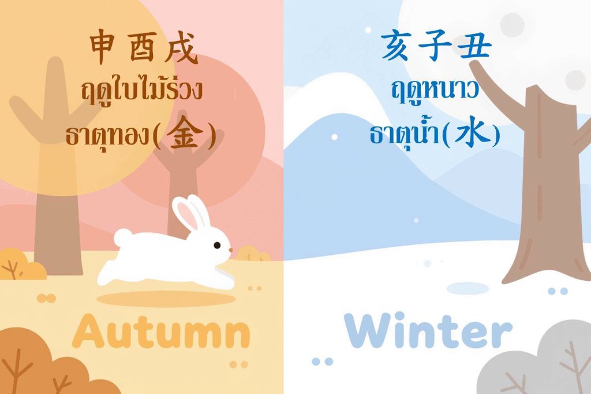

# ทฤษฎีที่ 20: 六害 “หลักไห่” (申 ➡️ 亥 น้ำมาระบายทอง) — ฟิสิกส์แห่งเส้นแวงและการผลัดเปลี่ยนฤดู

> **แหล่งที่มา:** เพจ *แม่ไม้ดวงจีน 八字 : Destiny Detective* (โพสต์ทฤษฎี “หลักไห่ 申 ➡️ 亥”)  
> **หมวดหมู่:** ทฤษฎีปฏิกิริยาราศีล่าง / 六害 (หลักไห่) / การเปลี่ยนผ่านฤดูกาล (Autumn to Winter) / เส้นแวง  
> **ภาพประกอบ:** [docs/bazi/images/theory_20_liu_hai_six_harms_shen_hai.jpg](docs/bazi/images/theory_20_liu_hai_six_harms_shen_hai.jpg)



---

## 1. นิยามเชิงฟิสิกส์: 六害 “หลักไห่” คือปฏิกิริยาตามแนวตั้ง (เส้นแวง)

* **แกนเส้นแวง (Longitude Dynamics):**  
  ในผังจักรราศี 12 นักษัตร ปฏิกิริยา **六害 “หลักไห่”** เกิดจากการจับคู่ในแนวตั้งฉากตามเส้นแวง
* **คุณลักษณะของพลังงาน:**  
  เป็นปฏิกิริยาที่ **“ฉับพลัน ทันที เร่งด่วน รวดเร็ว”** เกิดขึ้นโดยไม่มีการเตือนล่วงหน้า

---

## 2. การผลัดเปลี่ยนฤดูกาล: จากธาตุทอง (金) สู่ธาตุน้ำ (水)

* **申 酉 戌:** คือ ฤดูใบไม้ร่วง ครองอำนาจโดย **ธาตุทอง (金)**
* **亥 子 丑:** คือ ฤดูหนาว ครองอำนาจโดย **ธาตุน้ำ (水)**
* **`亥` (ต้นฤดูหนาว - เดือนพฤศจิกายน):**  
  เป็นรอยต่อสำคัญแห่ง **“การผลัดเปลี่ยนฤดู”** จากกระแสทองกลายเป็นกระแสน้ำ  
  เมื่อ `申` (ต้นฤดูใบไม้ร่วง ธาตุทอง) มากระทบกับ `亥` (ต้นฤดูหนาว ธาตุน้ำ) เกิดปฏิกิริยา:
  $$\申 \xrightarrow{\quad \text{六害 (หลักไห่)} \quad} 亥 \quad \Longrightarrow \quad \mathbf{\text{“น้ำมาระบายทอง” (Water Draining Metal)}}$$

---

## 3. ตัวอย่างการอ่านดวงจริง: ดิถีทอง `庚` พบ `亥` จรมาทำปฏิกิริยา “ไห่”

```
                 (ปีจร หรือ เดือนจร)
x    庚    x    x         x
x    申    x    x  <--   亥 (เกิด 害 “ไห่”)
```

* **ดิถีวัน:** ธาตุทองหยาง **`庚`**
* **ตัวตั้งในดวงเดิม:** เสาวันมี **`申`** (ธาตุทองหยาง)
* **ตัวจรเข้ามากระทบ:** มี **`亥`** จรเข้ามาทำปฏิกิริยา 害 “ไห่” กับ `申` (น้ำมาระบายทอง)
* **ถอดรหัสผ่านสิบเทพ (十神):**
  * **`申` (ทอง):** คือ **比肩 “ปีเกย”** $\rightarrow$ ตัวเอง, พี่น้อง, เพื่อนฝูง, หุ้นส่วน, คู่แข่ง
  * **`亥` (น้ำ):** คือ **食神 “เจี้ยะซิ้ง”** $\rightarrow$ Acting, Action, การแสดงออก, ความสามารถ, ฝีมือ, การเดินทาง, การโยกย้าย, การเปลี่ยนแปลง

---

### บทวิเคราะห์ผลพยากรณ์:

> **หลักตัดสินชี้ขาด:** 害 “ไห่” จะดีหรือร้าย **ขึ้นอยู่กับว่าเป็น 用神 “เอ่งซิ้ง” หรือ 忌神 “กี่ซิ้ง”**

1. **กรณีธาตุน้ำ (水) เป็น 用神 “เอ่งซิ้ง” (ธาตุให้คุณ):**
   * น้ำมาระบายทองอย่างถูกจังหวะ พลังทองที่นิ่งอยู่ถูกดึงออกมาแสดงศักยภาพอย่างรวดเร็ว
   * **ผลพยากรณ์:** ขยายกิจการ ขยายสาขา เพิ่มช่องทางการตลาด ได้รับผลตอบแทนสูง และได้ติดต่อทำธุรกิจใหม่ในต่างแดน หรือต่างประเทศสำเร็จอย่างฉับพลัน
2. **กรณีธาตุน้ำ (水) เป็น 忌神 “กี่ซิ้ง” (ธาตุให้โทษ):**
   * น้ำมาระบายทองจนสูญเสียกำลัง เกิดความแปรปรวนแบบกะทันหัน
   * **ผลพยากรณ์:** การดำเนินงานผิดพลาด เสียหาย สะดุด หยุดชะงัก ลื่นล้ม หกล้ม หรือประสบอุบัติเหตุอย่างไม่คาดฝัน

---

## 4. ตรรกะสำหรับการเขียนโปรแกรมคำนวณ (`bazi.js`)

```javascript
// ตรวจจับคู่หลักไห่ (Six Harms)
const LIU_HAI_PAIRS = [
  { branchA: '申', branchB: '亥', nature: 'Water drains Metal (น้ำมาระบายทอง - ฉับพลัน)' },
  { branchA: '酉', branchB: '戌', nature: 'Metal pierces Earth' },
  { branchA: '未', branchB: '子', nature: 'Earth muddies Water' },
  { branchA: '午', branchB: '丑', nature: 'Fire scorches Earth' },
  { branchA: '巳', branchB: '寅', nature: 'Fire drains Wood' },
  { branchA: '辰', branchB: '卯', nature: 'Wood penetrates Earth' }
];

function checkLiuHai(natalBranches, transitBranch, isFavorable) {
  for (const pair of LIU_HAI_PAIRS) {
    const hasAInNatal = natalBranches.includes(pair.branchA);
    const hasBInNatal = natalBranches.includes(pair.branchB);

    if ((hasAInNatal && transitBranch === pair.branchB) || (hasBInNatal && transitBranch === pair.branchA)) {
      return {
        type: 'LIU_HAI',
        pair: [pair.branchA, pair.branchB],
        nature: pair.nature,
        isFavorable: isFavorable,
        speed: 'Instantaneous / Sudden (ฉับพลัน ทันที)',
        interpretation: isFavorable
          ? 'ผลดีฉับพลัน (ขยายสาขา เปิดตลาดต่างแดน โครงการสำเร็จเร็ว)'
          : 'ผลเสียฉับพลัน (สะดุด ผิดพลาด อุบัติเหตุกะทันหัน)'
      };
    }
  }
  return null;
}
```
