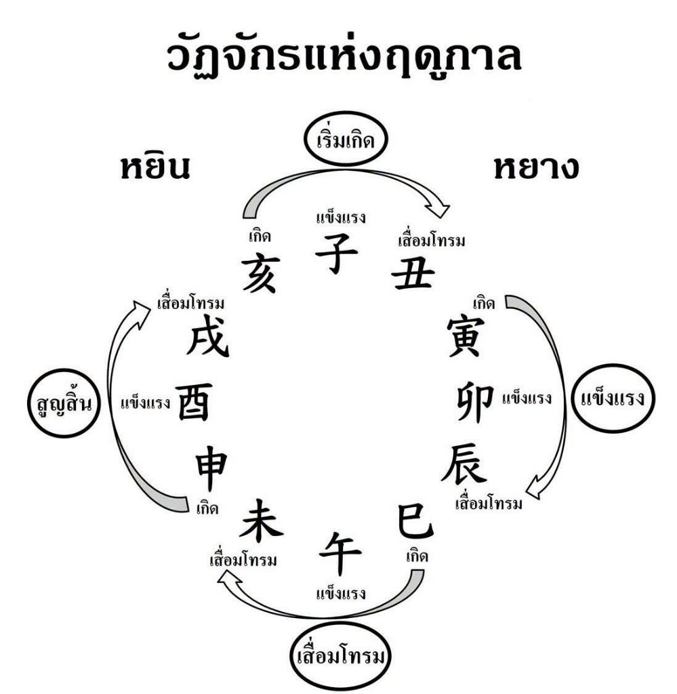

# ทฤษฎีที่ 29: วัฏจักรแห่งฤดูกาล & ราศีแฝงตามธรรมชาติ (Natural Hidden Stems) — ปฏิกิริยาซ้อน ชง + เอี้ยะแบ้

> **แหล่งที่มา:** เพจ *แม่ไม้ดวงจีน 八字 : Destiny Detective* (โพสต์ทฤษฎี “พิจารณาธาตุต่างๆ โดยสอดคล้องกับธรรมชาติ”)  
> **หมวดหมู่:** ปรัชญาธรรมชาติ / วัฏจักรแห่งฤดูกาล / การปฏิวัติราศีแฝง (暗藏) / ปฏิกิริยาซ้อนทับ (180 องศา ชง + เอี้ยะแบ้)  
> **ภาพประกอบ:** [docs/bazi/images/theory_29_seasonal_cycle_and_natural_hidden_stems.jpg](docs/bazi/images/theory_29_seasonal_cycle_and_natural_hidden_stems.jpg)



---

## 1. ปรัชญาหัวใจ: “พิจารณาธาตุให้ครบรอบด้านโดยสอดคล้องกับธรรมชาติ”

ในวิชาแม่ไม้ดวงจีน การตีความธาตุต้องพิจารณาในบริบท มิติ และนัยยะรอบด้าน โดยอิงความเป็นจริงตามธรรมชาติเป็นหลัก:
* **ก่อเกิด (ต้นฤดู):** เริ่มต้น ริเริ่ม สิ่งใหม่ โครงการใหม่ ร่าเริง แจ่มใส
* **แข็งแรง (กลางฤดู):** มั่นคง เจริญเติบโตเต็มที่ มั่นใจ เชื่อมั่นในตัวเอง ดื้อรั้น
* **เสื่อมโทรม (ปลายฤดู):** สุกงอม เก็บเกี่ยวเข้ายุ้งฉาง กักเก็บเข้าคลัง สุสาน นิ่งสงบ รอดูท่าทีและจังหวะใหม่

---

## 2. การปฏิวัติ 暗藏 “อ่ำชั้ง” (ราศีแฝง) ตามธรรมชาติจริง

ในตำราดวงจีนยุคเก่า มักท่องจำราศีแฝงแบบตายตัว แต่วิชาแม่ไม้ดวงจีนได้เปิดมุมมองเชิงฟิสิกส์ธรรมชาติที่แท้จริง:

| ราศีล่าง | สภาวะตามฤดูกาล | ราศีแฝง (อิงตามตำราดั้งเดิม) | **ราศีแฝง (เมื่ออิงตามธรรมชาติจริง)** | เหตุผลทางฟิสิกส์ธรรมชาติ |
| :---: | :---: | :---: | :---: | :--- |
| **`亥`** | **ต้นฤดูหนาว (ก่อเกิด)** | `壬`, `甲` | ⚡ **`癸` (เพียงตัวเดียว)** | เป็นธาตุน้ำที่ **เพิ่งเริ่มก่อเกิด** จึงมีสภาพเป็นน้ำหยินเบาๆ (`癸`) ไม่ใช่น้ำเชี่ยวกราก |
| **`子`** | **กลางฤดูหนาว (แข็งแรง)** | `癸` | ⚡ **`壬` (น้ำทรงพลัง)** | เป็นธาตุน้ำที่ **แข็งแรง เจริญเติบโตเต็มที่** ดั่งมหาสมุทรหรือแม่น้ำสายใหญ่ (`壬`) |
| **`丑`** | **ปลายฤดูหนาว (เสื่อมโทรม)** | `己`, `辛`, `癸` | **`己`, `辛`, `癸` (ตรงตามตำรา)** | เป็นธาตุน้ำที่ **อ่อนกำลังลง** เพราะดิน `己` เข้ามาหยุดกระแสและกักเก็บน้ำไว้ จึงเป็น **ดินแฉะ/โคลน** |

---

## 3. มิติปฏิกิริยาซ้อนทับ: 沖 (ชง 180 องศา) + 驛馬 (เอี้ยะแบ้ ถ่ายเทธาตุ)

เมื่อตัวจรเข้ามากระทบกับตัวในดวงเดิม บางครั้ง **ไม่ได้เกิดปฏิกิริยาเพียงชั้นเดียว แต่เกิดขึ้นพร้อมกันถึง ๒ ปฏิกิริยาซ้อนทับกัน**:

```
                 (ปีจร หรือ เดือนจร)
x    庚    x    x         x
x     x    x    巳  <--   亥
```

* **ดิถีวัน:** ธาตุทองหยาง **`庚`**
* **ตัวในดวงเดิม:** เสาปีมี **`巳`** (七殺 ฉิกสั่วะ = ยศ, ตำแหน่ง, อำนาจ, กฎหมาย, หน้าที่การงาน)
* **ตัวที่จรเข้ามา:** **`亥`** (食神 เจี้ยะซิ้ง = Action, การแสดงออก, ความสามารถ, การเดินทางโยกย้าย)
* **การซ้อนทับกันของ ๒ ปฏิกิริยา:**
  1. **ปฏิกิริยา 沖 “ชง” (180 องศา):** `亥` กับ `巳` ชงปะทะกันโดยตรง เกิดการเคลื่อนไหวอย่างรุนแรง
  2. **ปฏิกิริยา 驛馬 “เอี้ยะแบ้”:** กลุ่มไตรภาคีทอง `巳酉丑` ก่อเกิดน้ำ `亥` จึงเป็นปฏิกิริยาถ่ายเทธาตุและการเดินทางโยกย้าย

---

### บทวิเคราะห์ผลพยากรณ์:

> **หลักตัดสิน:** จะดีหรือร้าย ขึ้นอยู่กับว่า **ธาตุน้ำ (水) เป็น 用神 หรือ 忌神**

1. **กรณีธาตุน้ำ (水) เป็น 用神 “เอ่งซิ้ง” (ธาตุให้คุณ):**
   * ชงและเอี้ยะแบ้ส่งผลในทางผลักดันความก้าวหน้า
   * **ผลพยากรณ์:** **ได้รับการเลื่อนยศ เลื่อนขั้น เลื่อนตำแหน่ง หรือได้เดินทางไกลไปรับตำแหน่งหน้าที่ใหม่ในสถานที่ใหม่/สาขาใหม่ เช่น ย้ายไปประจำตำบล อำเภอ หรือจังหวัดใหม่ที่เจริญรุ่งเรือง**
2. **กรณีธาตุน้ำ (水) เป็น 忌神 “กี่ซิ้ง” (ธาตุให้โทษ):**
   * ชงและเอี้ยะแบ้กลายเป็นการกระแทกทำลายและขับไล่
   * **ผลพยากรณ์:** **ถูกเด้งฟ้าผ่า, ถูกสั่งย้ายแบบไม่เต็มใจ, ปรับลดตำแหน่ง, หรือถูกลดอำนาจหน้าที่การงาน**

---

## 4. แนวทางการเขียนระบบตรรกะคำนวณ (`bazi.js`)

```javascript
// ตารางราศีแฝงเปรียบเทียบ: ตำราดั้งเดิม vs ธรรมชาติจริง
const NATURAL_HIDDEN_STEMS = {
  '亥': { textbook: ['壬', '甲'], natural: ['癸'], nature: 'น้ำต้นฤดูก่อเกิด (หยินเบาๆ)' },
  '子': { textbook: ['癸'],        natural: ['壬'], nature: 'น้ำกลางฤดูแข็งแรง (หยางทรงพลัง)' },
  '丑': { textbook: ['己', '辛', '癸'], natural: ['己', '辛', '癸'], nature: 'ดินแฉะกักเก็บน้ำปลายฤดู' }
};

// ตรวจสอบปฏิกิริยาซ้อนทับ ชง + เอี้ยะแบ้ (亥 沖 巳)
function evaluateClashAndYiMaCombo(branchA, branchB, isFavorable) {
  if ((branchA === '亥' && branchB === '巳') || (branchA === '巳' && branchB === '亥')) {
    return {
      type: 'COMBO_CLASH_AND_YI_MA',
      description: 'ปฏิกิริยา 180 องศา ชง ซ้อนทับกับ เอี้ยะแบ้ (ถ่ายเทธาตุ)',
      isFavorable: isFavorable,
      outcome: isFavorable
        ? 'ได้เลื่อนยศ เลื่อนขั้น หรือเดินทางไปรับตำแหน่งใหม่ในต่างสาขา/ต่างจังหวัด'
        : 'ถูกเด้ง ถูกสั่งย้ายฟ้าผ่า ปรับลดตำแหน่งหน้าที่'
    };
  }
  return null;
}
```
