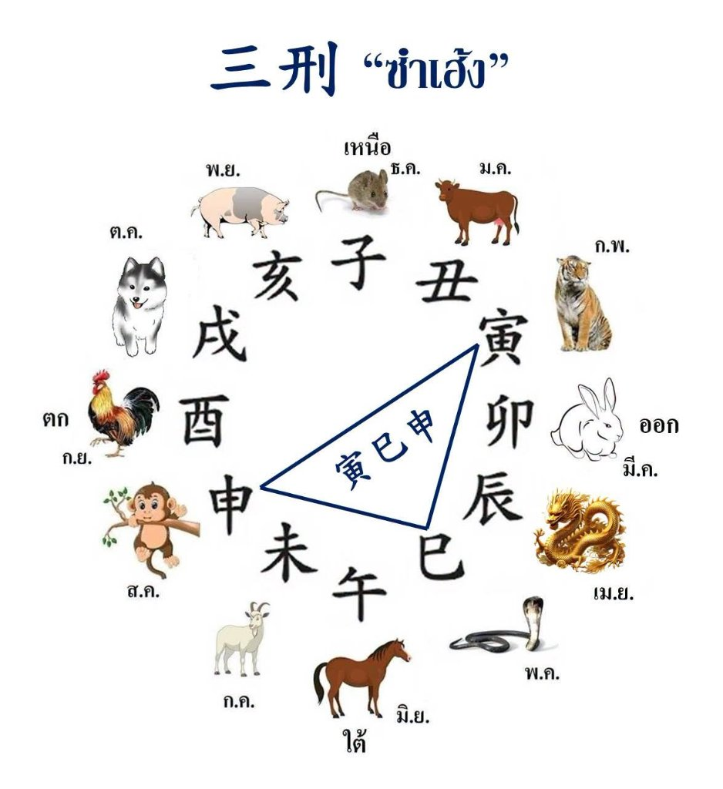

# ทฤษฎีที่ 32: 三刑 “ซำเฮ้ง” 寅 巳 申 (๓ อาชาพายุหมุน) — อุปมาเคมี ๓ ชนิด & กฎตัวเร่งปฏิกิริยาปิดท้าย

> **แหล่งที่มา:** เพจ *แม่ไม้ดวงจีน 八字 : Destiny Detective* (โพสต์ทฤษฎี “ซำเฮ้ง 寅巳申 ดั่งพายุหมุนและเคมี ๓ ชนิด”)  
> **หมวดหมู่:** ทฤษฎีปฏิกิริยาราศีล่าง / 三刑 (ซำเฮ้ง) / สี่อาชาต้นฤดู (四馬) / สามเหลี่ยมมุมฉาก / ปรัชญาเคมีตัวปิดท้าย  
> **ภาพประกอบ:** [docs/bazi/images/theory_32_san_xing_horses_triangle.jpg](docs/bazi/images/theory_32_san_xing_horses_triangle.jpg)



---

## 1. นิยามและฟิสิกส์แห่ง “ซำเฮ้ง ๓ อาชา” (寅 巳 申)

* **การรวมตัวของ ๓ ต้นฤดู:**
  * **`寅` (ขาล):** ต้นฤดูใบไม้ผลิ (ธาตุไม้ 木)
  * **`巳` (มะเส็ง):** ต้นฤดูร้อน (ธาตุไฟ 火)
  * **`申` (วอก):** ต้นฤดูใบไม้ร่วง (ธาตุทอง 金)
* **อุปมาทางอุตุนิยมวิทยา:**
  * เปรียบดัง **สภาพอากาศที่เปลี่ยนแปลงแปรปรวนอย่างกะทันหัน** การปะทะกันของมวลอากาศต่างอุณหภูมิ ก่อตัวเป็น **“พายุหมุนที่พัดโหมกระหน่ำอย่างรุนแรงและรวดเร็ว”**
  * ทำให้เกิดผลลัพธ์แบบฉับพลันทันที มีพลังการเปลี่ยนแปลงสูงที่สุดกลุ่มหนึ่งในปาจื่อ

---

## 2. ปรัชญาเคมีวิทยา: “กฎตัวแปรปิดท้าย (ยาบำรุง vs ยาพิษ)”

> [!IMPORTANT]
> *“เปรียบดั่งสารเคมี ๓ ชนิด... เมื่อมีเคมี ๒ ชนิดผสมรออยู่ในดวงเดิม แล้วมีเคมีตัวที่ ๓ โคจรเข้ามาผสมปิดท้าย  
> **ผลลัพธ์ของปฏิกิริยาจะถูกตัดสินชี้ขาดโดย ‘เคมีตัวปิดท้าย’ นี้เท่านั้น!**”*

```
   [สารเคมี 2 ตัวในดวงเดิม]  +  [สารเคมีตัวปิดท้ายที่จรมา]  =  [ผลลัพธ์สุทธิ]
         (寅 + 巳)        +       申 (เป็น 用神 ให้คุณ)    =  ยาบำรุง (เลื่อนยศตำแหน่ง)
         (寅 + 巳)        +       申 (เป็น 忌神 ให้โทษ)    =  ยาพิษ (คดีความ/เครดิตเสีย)
         (申 + 寅)        +       巳 (เป็น 用神 ให้คุณ)    =  ยาบำรุง (ขยายกิจการ/สาขา)
         (申 + 寅)        +       巳 (เป็น 忌神 ให้โทษ)    =  ยาพิษ (ธุรกิจพัง/อุบัติเหตุ)
```

* **ถ้าตัวปิดท้ายเป็น 用神 (ธาตุที่ดวงต้องการ):** $\rightarrow$ สารเคมีทั้งหมดจะทำปฏิกิริยาเปลี่ยนเป็น **“ยาบำรุงขนานเอก (ผลบุญหนุนส่ง)”**
* **ถ้าตัวปิดท้ายเป็น 忌神 (ธาตุที่ดวงไม่ต้องการ):** $\rightarrow$ สารเคมีทั้งหมดจะทำปฏิกิริยาเปลี่ยนเป็น **“ยาพิษทำลายล้าง (โทษทัณฑ์พุ่งชน)”**

---

## 3. กรณีศึกษาเปรียบเทียบตัวปิดท้าย (ดิถีไม้ `甲`)

### กรณีที่ 1: ในดวงเดิมมี `寅` + `巳` แล้วมี `申` (ทอง) จรเข้ามาปิดท้าย
```
x    甲    x    x         x
x    寅    巳    x  <--   申 (ตัวปิดท้าย: ธาตุทอง 官殺)
```
* **ตัวปิดท้าย:** คือ **`申` (ธาตุทอง $\rightarrow$ 官殺 กัวสั่วะ: ยศ, ตำแหน่ง, อำนาจ, กฎหมาย, เครดิต)**
* **บทวิเคราะห์:**
  * ✅ **เมื่อธาตุทองเป็น 用神 (ให้คุณ):** **ได้รับการเลื่อนยศ เลื่อนตำแหน่ง มีชื่อเสียงอำนาจ ได้รับการยอมรับ**
  * ❌ **เมื่อธาตุทองเป็น 忌神 (ให้โทษ):** **เกิดคดีความขึ้นโรงขึ้นศาล, เครดิตเสียหาย, ปัญหาการเซ็นสัญญาค้ำประกัน, หรือถูกฟ้องร้อง**

---

### กรณีที่ 2: ในดวงเดิมมี `申` + `寅` แล้วมี `巳` (ไฟ) จรเข้ามาปิดท้าย
```
x    甲    x    x         x
x    申    寅    x  <--   巳 (ตัวปิดท้าย: ธาตุไฟ 食傷)
```
* **ตัวปิดท้าย:** คือ **`巳` (ธาตุไฟ $\rightarrow$ 食傷 เจี้ยะเซีย: การกระทำ Action, ความสามารถ, การขยายงาน)**
* **บทวิเคราะห์:**
  * ✅ **เมื่อธาตุไฟเป็น 用神 (ให้คุณ):** **ได้เริ่มโครงการใหม่, ขยายธุรกิจ, ขยายสาขา, เพิ่มช่องทางการตลาด, สำเร็จล้นหลาม**
  * ❌ **เมื่อธาตุไฟเป็น 忌神 (ให้โทษ):** **ดำเนินธุรกิจผิดพลาดล้มเหลว, เกิดความเสียหายทางการเงิน, ประสบอุบัติเหตุ, สุขภาพเจ็บป่วย**

---

## 4. แนวทางการเขียนระบบตรรกะคำนวณ (`bazi.js`)

```javascript
// ฟังก์ชันตรวจจับและประเมินผล ซำเฮ้ง 寅巳申 ตามกฎเคมีตัวปิดท้าย
function evaluateYinSiShenCatalyst(natalBranches, transitBranch, favorableElements) {
  const trio = ['寅', '巳', '申'];
  const hasNatalMatches = trio.filter(b => natalBranches.includes(b));

  // ต้องมีในดวงเดิมอย่างน้อย 2 ตัว และตัวจรเข้ามาเป็นตัวที่ 3 ที่เติมเต็ม
  if (hasNatalMatches.length >= 2 && trio.includes(transitBranch) && !hasNatalMatches.includes(transitBranch)) {
    const closingElement = getBranchElement(transitBranch);
    const isClosingFavorable = favorableElements.includes(closingElement);

    return {
      type: 'SAN_XING_CATALYST',
      trio: trio,
      closingBranch: transitBranch,
      closingElement: closingElement,
      isFavorable: isClosingFavorable,
      formula: isClosingFavorable ? 'ยาบำรุง (ผลบุญหนุนส่ง)' : 'ยาพิษ (โทษทัณฑ์พุ่งชน)',
      speed: 'พายุหมุน ฉับพลัน รุนแรง รวดเร็ว',
      impactDomain: getGodDomain(closingElement)
    };
  }
  return null;
}
```

