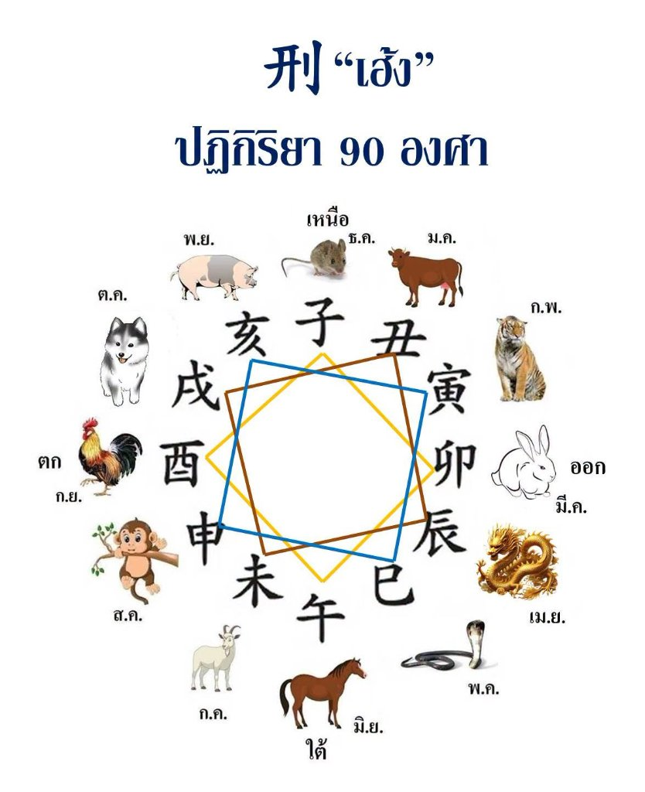

# ทฤษฎีที่ 33: 刑 “เฮ้ง” ปฏิกิริยา 90 องศา (๓ หมวดใหญ่: ๔ อาชา, ๔ ขุนพล, ๔ ขุมคลัง) — การเร่งสปีด, ทิศทางการอ่าน & ปฏิกิริยาแตกย่อย (破/桃花)

> **แหล่งที่มา:** เพจ *แม่ไม้ดวงจีน 八字 : Destiny Detective* (โพสต์ทฤษฎี “刑 เฮ้ง ปฏิกิริยา 90 องศา และ ๓ หมวดใหญ่”)  
> **หมวดหมู่:** ทฤษฎีปฏิกิริยาราศีล่าง / 刑 (เฮ้ง 90 องศา) / ๓ กลุ่มสี่เหลี่ยมจัตุรัส / ตัวเร่งสปีด (Speed Accelerator) / ทิศทางการอ่านดวง / 破 (ผั่ว)  
> **ภาพประกอบ:** [docs/bazi/images/theory_33_xing_90_degree_three_categories.jpg](docs/bazi/images/theory_33_xing_90_degree_three_categories.jpg)



---

## 1. นิยามและฟิสิกส์แห่ง 刑 “เฮ้ง” (ปฏิกิริยา 90 องศา)

* **ความหมายเชิงเรขาคณิตจักรราศี:**
  * 刑 (เฮ้ง) คือ **การทำมุม 90 องศา (มุมฉาก/สี่เหลี่ยมจัตุรัส)** ของนักษัตรราศีล่างบนวงกลม 12 นักษัตร
* **กลไกการทำงาน:**
  * หมายถึง **การถ่ายเทและแปรสภาพจากธาตุหนึ่งไปสู่อีกธาตุหนึ่ง**
  * หมายถึง **การเปลี่ยนแปลงจากสิ่งหนึ่งไปสู่อีกสิ่งหนึ่ง**
  * ทำหน้าที่เป็น **“ตัวเพิ่มสปีด เร่งให้เร็วขึ้น (Speed Accelerator)”** ของเหตุการณ์และผลกระทบในชีวิต
* **นัยยะและการแสดงออก:**
  * เบียดเบียน กระทบกระทั่ง กระแทก ขัดแย้ง โต้เถียง วิวาท
  * การงานชะงักงัน ไม่ก่อเกิดการงาน เกิดเรื่องเข้าใจผิด
  * เกิดความวุ่นวาย โกลาหล ถูกใส่ความ หาเรื่อง ถูกป้ายสี
* **กฎเหล็กแม่ไม้ดวงจีน:**
  > [!IMPORTANT]
  > ***“刑 เฮ้ง จะดีหรือร้าย... ขึ้นอยู่กับรูปดวงและธาตุที่โคจรเข้ามา ว่าเป็นธาตุให้คุณ (用神) หรือให้โทษ (忌神) เท่านั้น!”***  
  > * หากเป็นธาตุที่ให้คุณ $\rightarrow$ ผลบุญหนุนส่ง เลื่อนยศ ตำแหน่ง ผู้ใหญ่อุปถัมภ์ กิจการสำเร็จก้าวกระโดด  
  > * หากเป็นธาตุที่ให้โทษ $\rightarrow$ โทษทัณฑ์พุ่งชน ป่วยไข้ คดีความ ถูกใส่ร้าย ธุรกิจล้มเหลว เสียหาย  

---

## 2. โครงสร้าง ๓ หมวดใหญ่ของปฏิกิริยา 90 องศา

ในผังวงกลม 12 นักษัตร ราศีล่างที่ทำมุม 90 องศาต่อกันสามารถแบ่งออกเป็น **๓ สี่เหลี่ยมจัตุรัสหลัก** ตามธรรมชาติของฤดูกาล:

```
                  [12 นักษัตร 360 องศา]
                            |
       +--------------------+--------------------+
       |                    |                    |
 ๑. 四驛馬 (ซี่เอี้ยะแบ้)   ๒. 四正 (ซี่เจี่ย)     ๓. 四財庫 (ซี่ไฉ่โคว่)
  ๔ อาชา/๔ ม้าต้นฤดู     ๔ ขุนพล/๔ แม่ธาตุกึ่งกลาง   ๔ คลัง/๔ สุสานดินปลายฤดู
    (寅 巳 申 亥)         (子 卯 午 酉)          (丑 辰 未 戌)
```

| หมวดที่ | กลุ่มนักษัตร | สัญลักษณ์เรขาคณิต | บทบาทและปฏิกิริยาเสริม | ลักษณะเด่น |
| :---: | :---: | :---: | :--- | :--- |
| **๑** | **四驛馬 “ซี่เอี้ยะแบ้”**<br>(๔ ม้า / ๔ อาชา) | `寅` `巳` `申` `亥`<br>(ต้นฤดูทั้ง ๔) | 驛馬 (ดาวพาหะ/การเดินทาง/โยกย้าย)<br>三刑 (ซำเฮ้ง 3 มุม 寅巳申) | การเริ่มต้น โครงการใหม่ การโยกย้ายฉับพลัน เร่งสปีดการเปลี่ยนผ่าน |
| **๒** | **四正 “ซี่เจี่ย”**<br>(๔ ขุนพล / แม่ธาตุ) | `子` `卯` `午` `酉`<br>(กลางฤดูทั้ง ๔) | 桃花 (ถ่อฮวย ดอกท้อ เสน่ห์)<br>破 (ผั่วะ ทำลาย/แตกร้าว/รั่วซึม) | พลังธาตุบริสุทธิ์เข้มข้นที่สุด เร่งสปีดเรื่องความสัมพันธ์ ชื่อเสียง เกียรติยศ และสุขภาพ |
| **๓** | **四財庫 “ซี่ไฉ่โคว่”**<br>(๔ ขุมคลัง / ดิน ๔ ฤดู) | `丑` `辰` `未` `戌`<br>(ปลายฤดูทั้ง ๔) | 刑沖 (เฮ้งชง คลังชนคลัง)<br>三刑 (ซำเฮ้งดิน 丑未戌) | การสะสม กักเก็บ ปลดล็อกคลังสมบัติ ที่ดิน อสังหาริมทรัพย์ มรดก |

---

## 3. ทิศทางการอ่านปฏิกิริยา (Reading Flow & Vector Mechanics)

การพิจารณาการกระทบกระทั่งของ 刑 (เฮ้ง) มีทิศทางการไหลของพลังงานที่ชัดเจน:

```
[ดวงเดิม (Natal Chart)]                <=== [วัยจร / ปีจร (Transit)]
-----------------------                     -------------------------
   ปี -> เดือน -> วัน -> ยาม                     วัยจร (大運 5 ปี): ขวามาซ้าย
 (อ่านจาก ซ้าย ไป ขวา)                         ปีจร (流年 1 ปี): ขวามาซ้าย
```

1. **มีอยู่ในดวงเดิม (Natal Interaction):**
   * **อ่านจากซ้ายไปขวา** (ปี $\rightarrow$ เดือน $\rightarrow$ วัน $\rightarrow$ ยาม)
   * แสดงถึงความสัมพันธ์ภายในจิตใจ ครอบครัว วงศ์ตระกูล องค์กรเดิม
2. **มาจากวัยจร (大運 Da Yun - อิทธิพลรอบละ 5 ปี):**
   * **อ่านจากขวามาซ้าย** (วัยจรพุ่งเข้ามากระทบดวงเดิม)
   * กำหนดทิศทางภาพรวมของชีวิต ภาระหน้าที่ หรือโอกาสในระยะยาว
3. **มาจากปีจร (流年 Liu Nian - อิทธิพลรายปี 1 ปี):**
   * **อ่านจากขวามาซ้าย** (ปีจรพุ่งเข้ามากระแทกดวงเดิมและวัยจร)
   * เป็นตัวกระตุ้นเหตุการณ์แบบเฉียบพลัน ปะทุขึ้นในรอบปีนั้นๆ

---

## 4. กรณีศึกษาตัวอย่างเชิงปฏิบัติ

### กรณีศึกษาที่ ๑: 刑 (เฮ้ง) ในกลุ่ม “ซี่เอี้ยะแบ้” (ดิถีไม้ `甲`)

```
                                    ปีจร
x     甲      x        x             x
x      x      寅       x    <--      亥
```

* **สถานะดวง:** ดิถีไม้ `甲` มีราศีล่างวัน/เดือนเป็น `寅` (ขาล - ไม้หยาง)
* **ตัวจร:** `亥` (กุน - น้ำหยิน/ต้นฤดูหนาว) จรเข้ามากระทบ เกิดปฏิกิริยา **刑 (เฮ้ง 90 องศา)**
* **ผลลัพธ์ตามธาตุให้คุณ/ให้โทษ:**
  * **ถ้าน้ำ (`水`) เป็นคุณ (用神):**
    * ได้รับการช่วยเหลือ เกื้อกูล สนับสนุนจากผู้ใหญ่ เจ้านาย
    * ได้เลื่อนขั้น เลื่อนยศ ปรับตำแหน่ง ได้รับทรัพย์สิน มรดก หรือที่ดินเพิ่มขึ้น
  * **ถ้าน้ำ (`水`) เป็นโทษ (忌神):**
    * ผู้ใหญ่ เจ้านาย หรือแม่ เข้ามาวุ่นวาย จู้จี้ กดดัน
    * เกิดความเครียด ขัดแย้ง เข้าใจผิดในองค์กร การงานกลายเป็นภาระหนักอึ้ง

---

### กรณีศึกษาที่ ๒: 刑 ในกลุ่ม “ซี่เจี่ย” ที่แสดงผลเป็น 破 (ผั่ว) (ดิถีไม้ `甲` หญิง 坤造)

```
        坤 (ดวงหญิง)                   ปีจร
x      甲        x         x          x          
x       x        酉        x   <--    子
```

* **การทำมุม:** `子` (ชวด - น้ำ) จรเข้ามากระทำกับ `酉` (ระกา - ทอง) ในดวงเดิม ทำมุม 90 องศา เกิดปฏิกิริยา **破 “ผั่ว” (แตกร้าว/ทำลาย/รั่วซึม)**
* **การถอดรหัสสิบเทพ (Ten Gods Decryption):**
  * **`子` (น้ำ) คือ 正印 “เจี่ยอิ่ง” (ดาวแม่/ดาวอินทรี):**
    * หมายถึง แม่, ผู้ใหญ่, เจ้านาย, หัวหน้า
    * ความรู้, ความคิด, ความจำ, สติปัญญา, คุณธรรม
    * ชื่อเสียง, ตำแหน่ง, วาสนา, เกียรติยศ
    * สุขภาพ, ร่างกาย, อาหารการกิน, ยารักษาโรค
  * **`酉` (ทอง) คือ 正官 “เจี่ยกัว” (ดาวข้าราชการ/สามี):**
    * หมายถึง หน้าที่การงาน, ความรับผิดชอบ, ยศ, ตำแหน่ง, อำนาจ, กฎหมาย, ระเบียบวินัย
    * การควบคุม, คดีความ, จองจำ, ติดคุก, โทษประหาร
    * การรักษา, การเยียวยา, การกักเก็บ, การกินยา
    * การผ่าตัด (อวัยวะภายใน), ยาพิษ
    * **เป็นดาวสามี (Official Star)** ของดิถีเพศหญิง

#### ผลการทำนายตามสภาวะธาตุ:
* **ถ้าธาตุน้ำ (`水` - 子) เป็นธาตุที่ให้โทษ (忌神):**
  * ⚠️ **สุขภาพ:** ระวังอาการเจ็บไข้ได้ป่วย ล้มหมอนนอนเสื่อ ร่างกายทรุดโทรม การกินยาผิดขนาด หรือต้องผ่าตัด
  * ⚠️ **คดีความและชื่อเสียง:** ถูกผู้ใหญ่หรือเจ้านายใส่ร้ายป้ายสี ถูกกลั่นแกล้ง เกิดคดีความ เรื่องอื้อฉาวเสื่อมเสียชื่อเสียง
  * ⚠️ **การงานและธุรกิจ:** ดำเนินธุรกิจผิดพลาด การงานเสียหาย ยศตำแหน่งหลุดลอย
  * ⚠️ **ความรัก:** มีปัญหาขัดแย้งกับสามี สามีเจ็บป่วย หรือสามีนำความเดือดร้อนภาระหนี้สินมาให้
* **ถ้าธาตุน้ำ (`水` - 子) เป็นธาตุที่ให้คุณ (用神):**
  * ✨ **หน้าที่การงาน:** ได้รับการเลื่อนยศ เลื่อนตำแหน่งอย่างรวดเร็ว ได้รับมอบหมายอำนาจสำคัญ
  * ✨ **ผู้ใหญ่อุปถัมภ์:** หัวหน้า เจ้านาย หรือผู้ใหญ่คอยหนุนหลัง ช่วยเหลือทุกเรื่อง
  * ✨ **ความสำเร็จ:** ประสบความสำเร็จอย่างสูงในด้านธุรกิจการงาน การสอบแข่งขันชนะเลิศ
  * ✨ **ชีวิตคู่:** สามีเกื้อหนุน ช่วยสร้างฐานะความมั่นคง

---

## 5. สรุปแม่ไม้ประจำทฤษฎี

1. **刑 (เฮ้ง) คือ สปีดเร่ง 90 องศา:** ไม่ใช่เรื่องโชคร้ายเสมอไป แต่คือ **"แรงปะทะที่เร่งความเร็วในการเปลี่ยนผ่าน"**
2. **๓ กลุ่มเรขาคณิตต้องจำให้ขึ้นใจ:**
   * `寅巳申亥` (๔ อาชา) $\rightarrow$ การเดินทาง การเริ่มใหม่ การโยกย้ายตำแหน่ง
   * `子卯午酉` (๔ ขุนพล) $\rightarrow$ เสน่ห์ (桃花), แตกร้าว/รั่วซึม (破), ชื่อเสียง และสุขภาพ
   * `丑辰未戌` (๔ ขุมคลัง) $\rightarrow$ การเงิน คลังสมบัติ มรดก ที่ดิน และอสังหาริมทรัพย์
3. **การอ่านทิศทาง:** ในดวงอ่าน **ซ้ายไปขวา**, จรเข้ามากระทบอ่าน **ขวามาซ้าย**
4. **เกณฑ์ตัดสินสุดท้าย:** ใช้ **用神 (ให้คุณ) vs 忌神 (ให้โทษ)** เป็นไม้บรรทัดชี้ขาดผลลัพธ์ทุกครั้ง

