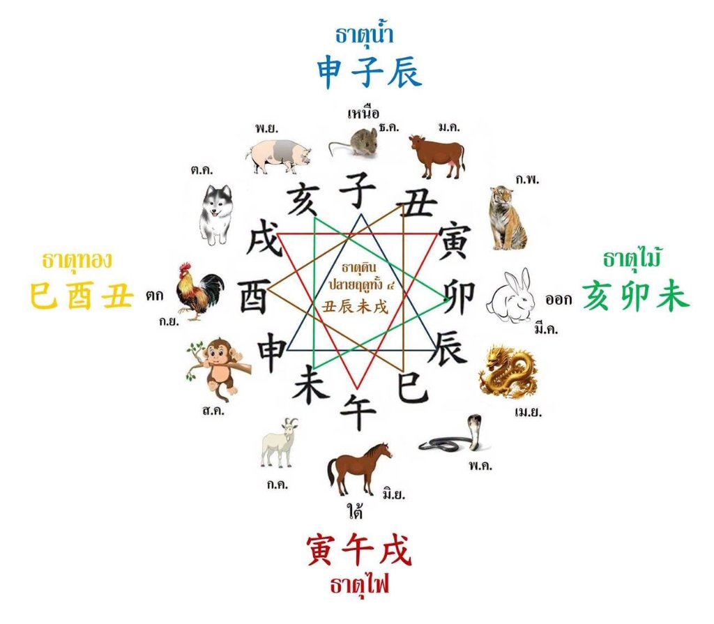

# ทฤษฎีที่ 39: 三合 “ซาฮะ” สามสมพงษ์ — เมื่อใด 合 “ฮะ” และเมื่อใด 不合 “ไม่ฮะ” (กฎชงคั่นกลาง, แม่ธาตุจร vs คลังดินกลบกระแส & ปรัชญาอย่ารวยแต่ชื่อ)

> **แหล่งที่มา:** เพจ *แม่ไม้ดวงจีน 八字 : Destiny Detective* (โพสต์ทฤษฎี “三合 ซาฮะ สามสมพงษ์ : เมื่อใดจึงฮะ และเมื่อใดไม่ฮะ”)  
> **หมวดหมู่:** ทฤษฎีปฏิกิริยาราศีล่าง / 三合 (ซาฮะ ไตรภาคี 60 องศา) / 半三合 (ปั๊วซาฮะ ทวิภาคี) / เงื่อนไขการฮะสำเร็จ vs ล้มเหลว / ฟิสิกส์ธรรมชาติคลังดินกลบกระแส  
> **ภาพประกอบ:** [docs/bazi/images/theory_39_san_he_diagram.jpg](docs/bazi/images/theory_39_san_he_diagram.jpg)



---

## 1. นิยามและเรขาคณิตแห่ง 三合 “ซาฮะ” (สามสมพงษ์)

* **ความหมายเชิงสังคมและพลังงาน:**
  * หมายถึง **สายสัมพันธ์ การร่วมมือกัน การช่วยเหลือเกื้อกูล หุ้นส่วน พันธมิตร (Partner)**
* **ความหมายเชิงเรขาคณิตจักรราศี:**
  * คือ **การร่วมธาตุจากการทำมุม 60 องศาของสามเหลี่ยมด้านเท่า** ทั้งสามมุมบนวงกลม 12 นักษัตรราศีล่าง
* **๔ กลุ่มไตรภาคี (The 4 Trines):**
  1. **`申` `子` `辰`** $\rightarrow$ ไตรภาคี **ธาตุน้ำ (水)**
  2. **`亥` `卯` `未`** $\rightarrow$ ไตรภาคี **ธาตุไม้ (木)**
  3. **`寅` `午` `戌`** $\rightarrow$ ไตรภาคี **ธาตุไฟ (火)**
  4. **`巳` `酉` `丑`** $\rightarrow$ ไตรภาคี **ธาตุทอง (金)**
* **ธรรมชาติของ ๔ สุสานดินปลายฤดู (丑 辰 未 戌) ตามหลักฟิสิกส์จริง:**
  * **`丑` (มกราคม - ฤดูหนาว):** ดินแฉะ ดินโคลนเย็น $\rightarrow$ เปรียบดัง **ดิน `己`** (ราศีแฝงคือ `己`)
  * **`辰` (เมษายน - ย่างเข้าหน้าร้อน):** ดินแห้ง ดินอุ่น $\rightarrow$ เปรียบดัง **ดิน `戊`** (ราศีแฝงคือ `戊`)
  * **`未` (กรกฎาคม - ฤดูร้อน):** ดินแห้งร้อนผาก ดินแตกระแหง $\rightarrow$ เปรียบดัง **ดิน `戊`** (ราศีแฝงในตำราคือ `己` แต่ธรรมชาติจริงเป็นดินแห้งร้อนจัด)
  * **`戌` (ตุลาคม - ปลายฝนต้นหนาว):** ดินชื้น เก็บเกี่ยวรวงข้าว $\rightarrow$ เปรียบดัง **ดิน `己`** (ราศีแฝงในตำราคือ `戊` แต่ธรรมชาติจริงมีความชื้นของฝนปลายฤดู)

---

## 2. 半三合 “ปั๊วซาฮะ” (ทวิภาคี / ภาคีครึ่งหนึ่ง)

คือการจับคู่ร่วมปรองดองแบบ ๒ ตัว โดย **กฎเหล็กคือ “ต้องมีแม่ธาตุทั้ง ๔ (子, 卯, 午, 酉) เป็นแกนกลางเสมอ”**:
* **ธาตุน้ำ:** `申` + `子` หรือ `子` + `辰`
* **ธาตุไม้:** `亥` + `卯` หรือ `卯` + `未`
* **ธาตุไฟ:** `寅` + `午` หรือ `午` + `戌`
* **ธาตุทอง:** `巳` + `酉` หรือ `酉` + `丑`

---

## 3. กฎชี้ขาด: เมื่อใด 合 “ฮะ” และเมื่อใด 不合 “ไม่ฮะ”?

> [!IMPORTANT]
> *“ปฏิกิริยา 三合 มิใช่ว่าจะสัมฤทธิ์ผลทุกครั้งที่ตัวนักษัตรมาเจอกันครบเสมอไป  
> จะต้องพิจารณา **ฤดูกาล, ความแข็ง-อ่อนของรูปดวง, กฎการชงคั่นกลาง และฟิสิกส์ธรรมชาติของตัวที่จรเข้ามา** เสมอ!”*

### กฎข้อที่ ๑: กฎการชงติดแม่ธาตุ (Adjacent Clash Breaks San He)
* **ถ้ามีตัว 沖 “ชง” อยู่ติดกับ “แม่ธาตุ” พอดี:** $\implies$ **合 “ฮะ” ไม่สำเร็จ! (แตกหัก)**
* **ถ้ามีตัวชง แต่มีตัวอื่นคั่นกลาง (ไม่ได้ติดกับแม่ธาตุ):** $\implies$ **合 “ฮะ” สำเร็จ! (กระแสไหลผ่านได้)**

```
  ตัวอย่างที่ ๑ (ฮะไม่สำเร็จ):
       x      x      x      x
      申      子     午     辰
              [子 ชง 午 ติดกัน]  ===>  三合 ล้มเหลว! (ไม่เกิดน้ำ)

  ตัวอย่างที่ ๒ (ฮะสำเร็จ):
       x      x      x      x
      申      子     辰     午
              [子 ไม่ได้ติดกับ 午 มี 辰 คั่น] ===>  三合 สำเร็จ! (เกิดน้ำ)
```

---

### กฎข้อที่ ๒: ผลลัพธ์ตัดสินด้วย 用神 vs 忌神 (ให้คุณ vs ให้โทษ)
แม้ ซาฮะ จะก่อตัวสำเร็จ แต่ไม่ได้หมายความว่าจะดีเสมอไป:
* **ตัวอย่าง:** ดิถีน้ำ `壬` รวมซาฮะน้ำ `申子辰`
  * **ถ้าดวงอ่อน (น้ำเป็น 用神):** พี่น้องรักใคร่ปรองดอง หุ้นส่วนร่วมมือสร้างกำไร ช่วยเหลือเกื้อกูลกัน
  * **ถ้าดวงแข็ง (น้ำเป็น 忌神):** (#ดวงแข็งไม่ชอบ印และ比劫) พี่น้องแก่งแย่งแข่งขัน อิจฉาริษยา แย่งชิงมรดกและลาภผล

---

## 4. กฎเวกเตอร์ตัวจร: “ใครอยู่ก่อน ใครจรมาทีหลัง?” (Order of Entry)

เมื่อในดวงเดิมมีเพียง ๒ ตัว (ขาด ๑ ตัว) แล้วมีตัวที่ ๓ จรเข้ามา **มิใช่ว่าจะกลายเป็นซาฮะเสมอไป!**  
ต้องดูว่าตัวที่จรเข้ามาทำปฏิกิริยาอย่างไรกับธรรมชาติของตัวเดิม:

### กรณีศึกษา ก: ในดวงมี `申` + `子` แล้ว `辰` (ดินปลายฤดู) จรเข้ามา

```
                                          ปีจร
x     甲      x       x                     x
x     申      子      x        <--          辰
```
* **สภาวะ:** ดิถีไม้ `甲`, ในดวงมี `申` (ทอง/七殺) และ `子` (น้ำ/正印)
* **ตัวจร:** `辰` จรเข้ามา เป็น **ดินปลายฤดูใบไม้ผลิย่างเข้าหน้าร้อน**
* **ฟิสิกส์ธรรมชาติ:** `辰` เป็นดิน **ไม่ได้เข้ามาเป็นซาฮะน้ำ! แต่เข้ามา “กลบน้ำและกลบทอง” (ดินกลบน้ำ-ทอง)**
* **ผลลัพธ์ตามรูปดวง:**
  * **ถ้าเป็นดวงอ่อน (น้ำและทองเป็นธาตุที่ดี):**
    * ดิน `辰` เข้ามา **กลบน้ำ `子` (ทำลาย 正印) และกลบทอง `申` (ทำลาย 七殺)**
    * ⚠️ การงานติดขัด เกิดความเสียหายทั้งที่อยู่อาศัยและที่ทำงาน เสียเงินเสียทองอย่างหนัก
  * **ถ้าเป็นดวงแข็ง (น้ำและทองเป็น 忌神 ตัวถ่วงดวง):**
    * ดิน `辰` เป็น **財庫 “ไฉ่โข่ว” (คลังสมบัติ)** พุ่งเข้ามา **กลบฝังธาตุที่ให้โทษ (น้ำและทอง) จนหมดฤทธิ์**
    * ✨ เกิดโชคลาภมหาศาล คลังสมบัติเปิด รับเงินรับทองร่ำรวย!

---

### กรณีศึกษา ข: ในดวงมี `申` + `辰` แล้ว `子` (แม่ธาตุน้ำ) จรเข้ามา

```
                                          ปีจร
x     甲      x       x                     x
x     申      辰      x        <--          子
```
* **สภาวะ:** ดิถีไม้ `甲`, ในดวงมี `申` (ทอง) และ `辰` (ดิน)
* **ตัวจร:** `子` จรเข้ามา เป็น **แม่ธาตุน้ำบริสุทธิ์กลางฤดูหนาว**
* **ฟิสิกส์ธรรมชาติ:** มวลน้ำมหาศาล `子` ไหลบ่าเข้ามา **“ท่วมดิน `辰` ทำให้ดินกลายเป็นโคลนร่วนซุย และกระตุ้นสายสัมพันธ์ 三合 (申子辰 น้ำ) ให้ก่อตัวสมบูรณ์”**
* **ผลลัพธ์ตามรูปดวง:**
  * **ถ้าเป็นดวงอ่อน (น้ำเป็น 用神 ชุบชีวิตไม้):**
    * ซาฮะน้ำแปรสภาพเป็น **印 “อิ่ง” มหาศาล** ส่งเสริมค้ำจุนดิถีไม้
    * ✨ หน้าที่การงานรุ่งโรจน์ ได้รับการเลื่อนยศ ปรับตำแหน่ง ขึ้นเงินเดือน รายได้พุ่งกระฉูด
  * **ถ้าเป็นดวงแข็ง (น้ำเป็น 忌神 ทำให้น้ำท่วมไม้เน่า):**
    * ซาฮะน้ำแปรสภาพเป็น **印 ให้โทษอย่างรุนแรง**
    * ⚠️ แบกรับภาระหน้าที่หนักเกินตัว ถูกผู้ใหญ่เจ้านายกดดันกลั่นแกล้ง เกิดเรื่องอื้อฉาวและเป็นคดีความ

---

## 5. ปรัชญาสูงสุด: “อย่ารวยแต่ชื่อ แต่จนในธรรมะ”

> [!CAUTION]
> *“三合, 三會, 沖, 合, 刑, 害, 神煞 ต่างๆ ใครๆ ก็ท่องจำได้...  
> แต่การประยุกต์ใช้ในการอ่านและพยากรณ์นั้น **ต้องอาศัยความเข้าใจในธรรมชาติและกฎหยินหยางอย่างแท้จริง**  
> มิใช่การท่องจำแต่ชื่อ จำแต่คำแปล แล้วพยากรณ์ตามตัวอักษร  
> **จงอย่าเป็นคน ‘รวยแต่ชื่อ... แต่จนในธรรมะ (ขาดความเข้าใจธรรมชาติจริง)’ เป็นอันขาด!”***
