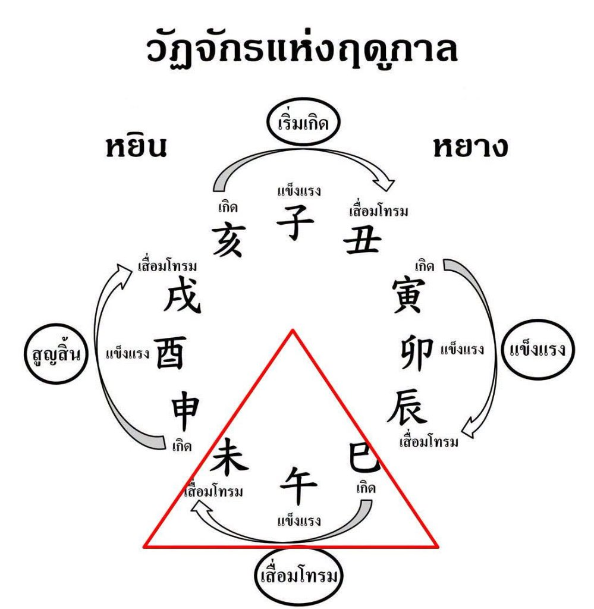

# ทฤษฎีที่ 45: 三會 “ซาหวย” กระแสแห่งฤดูกาล (巳午未 ฤดูร้อน) — กฎตัวแปรตัวจร (未 ทำให้ไฟดรอป vs 午 เร่งไฟพีค) & ปรัชญา “กฎเป็นของตาย คนเป็นของเป็น”

> **แหล่งที่มา:** เพจ *แม่ไม้ดวงจีน 八字 : Destiny Detective* (โพสต์ทฤษฎี “三會 ซาหวย กระแสแห่งฤดูกาล 巳午未”)  
> **หมวดหมู่:** ทฤษฎีฤดูกาล / 三會 (ซาหวย ฤดูร้อน 巳午未) / พลศาสตร์สามระยะ (ก่อเกิด-แข็งแรง-เสื่อมโทรม) / ฟิสิกส์ตัวแปรตัวจร / ปรัชญากฎเกณฑ์ธรรมชาติ  
> **ภาพประกอบ:** [docs/bazi/images/theory_45_san_hui_fire_cycle.jpg](docs/bazi/images/theory_45_san_hui_fire_cycle.jpg)



---

## 1. นิยามแห่ง 三會 “ซาหวย” (กระแสแห่งฤดูกาล)

* **ความหมายเชิงสังคมและพลังงาน:**
  * หมายถึง **ความเป็นน้ำหนึ่งใจเดียวกัน ความสามัคคี การช่วยเหลือเกื้อกูลกันอย่างเหนียวแน่น** ดั่งกระแสลมและมวลอากาศที่พัดไปในทิศทางเดียวกันทั้งฤดูกาล
* **วัฏจักรการแปรเปลี่ยนของ ๓ ระยะในฤดูกาล:**
  1. **ต้นฤดู (ก่อเกิด - 巳):** การริเริ่ม เริ่มต้น สิ่งใหม่ๆ ร่าเริง แจ่มใส สนุกสนาน เปรียบดังแสงแดดอ่อนในยามเช้า
  2. **กลางฤดู (แข็งแรง - 午):** เติบโต มั่นคง มั่นใจในตนเองสูง ดื้อรั้น เปรียบดังดวงอาทิตย์ยามเที่ยงวันที่แผดเผาเต็มกำลัง
  3. **ปลายฤดู (เสื่อมโทรม - 未):** ดินปลายฤดูที่ความร้อนเริ่มคลายตัว สุกงอม เก็บเกี่ยว เข้าสู่คลัง นิ่งสงบ รอดูท่าทีเพื่อเตรียมส่งต่อสู่ฤดูใบไม้ร่วง

---

## 2. ฟิสิกส์แห่งตัวจร: “ใครจรเข้ามาเป็นตัวปิดท้าย?”

> [!IMPORTANT]
> ในการพยากรณ์ อย่ามองเพียงแค่ว่ามี `巳午未` ครบแล้วจะกลายเป็นไฟมหาศาลเหมือนกันทั้งหมด!  
> จะต้องพิจารณาอย่างลึกซึ้งว่า:
> 1. **ตัวใดสถิตอยู่ในดวงเดิม?**
> 2. **ตัวใดเป็นฝ่ายจร (วัยจร หรือ ปีจร) เข้ามากระทบ?**
>    * ถ้าตัวปลายฤดู (`未`) จรมา $\implies$ **ทำให้ธาตุไฟอ่อนกำลังลง (Drop ลง)**
>    * ถ้าตัวกลางฤดู (`午`) จรมา $\implies$ **เร่งให้ธาตุไฟพุ่งทะยานสู่จุดสูงสุด (Peak แข็งแรงขึ้น)**

---

## 3. กรณีศึกษาที่ ๑: `未` (ดินปลายฤดู) จรเข้ามาหา `巳` + `午` $\rightarrow$ ไฟดรอปลง (Drop)

```
                                          ปีจร
x     丙      x       x                     x
x     午      巳      x        <--          未
```

* **สถานะดวง:** ดิถีไฟหยาง `丙` มี `巳` (ต้นฤดูไฟ) และ `午` (กลางฤดูไฟ) ในดวงเดิม
* **ตัวจร:** `未` (แพะ - ดินปลายฤดูร้อน) จรเข้ามากระทบ
* **ฟิสิกส์ธรรมชาติ:** `未` เป็นดินปลายฤดู **เข้ามาดูดซับและถ่ายเทพลังงานความร้อน ส่งผลให้ “ธาตุไฟอ่อนกำลังลง (Drop ลง)”**
* **บทบาทสิบเทพ:** `未` คือ **傷官 “เซียกัว”** (การแสดงออก, ฝีมือ, ผลงาน, ความสามารถ, การเดินทางโยกย้าย)

```
                  [未 ดินปลายฤดูจรมา ทำให้ไฟ Drop ลง]
                                  |
            +---------------------+---------------------+
            |                                           |
       ถ้าเป็นดวงอ่อน                               ถ้าเป็นดวงแข็ง
   (ไฟอ่อนลง = เสียกำลัง)                       (ไฟอ่อนลง = ได้สมดุล)
            |                                           |
      ⚠️ ผลงานลดลง / ขาดคนช่วย                     ✨ งานสำเร็จ / ชนะคู่แข่ง
   * ผลการดำเนินงานลดลง                        * ธุรกิจการงานสัมฤทธิผล
   * ขาดการสนับสนุนจากเพื่อนร่วมงาน             * ผลงานโดดเด่นทะลุเป้า
   * หุ้นส่วนลดบทบาทความช่วยเหลือ               * มีชัยชนะเหนือคู่แข่ง
```

* **ผลการทำนาย:**
  * **ถ้าเป็นดวงอ่อน (ต้องการไฟค้ำจุน):** ไฟที่ดรอปลงทำให้พลังชีวิตลดลง $\implies$ **ผลการดำเนินงานลดลง ขาดการสนับสนุนช่วยเหลือจากเพื่อนร่วมงานและหุ้นส่วน**
  * **ถ้าเป็นดวงแข็ง (#ดวงแข็งไม่ชอบ印และ比劫):** ไฟที่ร้อนจัดถูกดินระบายกำลังออก $\implies$ **ธุรกิจการงานสัมฤทธิผล เป็นไปตามเป้าหมาย ผลงานดีขึ้น มีชัยชนะเหนือคู่แข่งทั้งปวง!**

---

## 4. กรณีศึกษาที่ ๒: `午` (แม่ธาตุไฟกลางฤดู) จรเข้ามาหา `巳` + `未` $\rightarrow$ ไฟพุ่งพีค (Strengthen)

```
                                          ปีจร
x     丁      x       x                     x
x     巳      未      x        <--          午
```

* **สถานะดวง:** ดิถีไฟหยิน `丁` มี `巳` (ต้นฤดู) และ `未` (ปลายฤดู) ในดวงเดิม
* **ตัวจร:** `午` (ม้า - แม่ธาตุไฟกึ่งกลางฤดูร้อน) จรเข้ามากระทบ
* **ฟิสิกส์ธรรมชาติ:** มวลไฟบริสุทธิ์ `午` พุ่งเข้ามาเติมเชื้อเพลิง **ส่งผลให้ “ธาตุไฟแข็งแรงขึ้น พุ่งสู่จุดสูงสุด (Peak Power)”**
* **บทบาทสิบเทพ:** `午` คือ **比劫 “ปี่เกี๊ยบ”** (พี่น้อง, เพื่อนฝูง, หุ้นส่วน, คู่แข่ง, ศัตรู, เจ้ากรรมนายเวร)

```
                 [午 แม่ธาตุไฟจรมา เร่งให้ไฟแข็งแรงขึ้น]
                                  |
            +---------------------+---------------------+
            |                                           |
       ถ้าเป็นดวงอ่อน                               ถ้าเป็นดวงแข็ง
   (ไฟแข็งแรงขึ้น = ได้พลังหนุน)                 (ไฟแข็งแรงขึ้น = ล้นเกิน)
            |                                           |
      ✨ รวมพลังสามัคคี                             ⚠️ แย่งชิง / ฉ้อโกง
   * พี่น้องเป็นน้ำหนึ่งใจเดียวกัน                * พี่น้อง/หุ้นส่วนให้ร้าย
   * ช่วยเหลือเกื้อกูลเต็มที่                    * เบียดบังผลประโยชน์
   * หุ้นส่วนหนุนหลังอย่างมั่นคง                 * ถูกฉ้อโกง เสียหายหนัก
```

* **ผลการทำนาย:**
  * **ถ้าเป็นดวงอ่อน (ต้องการไฟเสริมกำลัง):** ไฟที่ลุกโชนขึ้นมาชุบชีวิตดิถี $\implies$ **พี่น้องเป็นน้ำหนึ่งใจเดียวกัน ช่วยเหลือเกื้อกูล หุ้นส่วนให้การสนับสนุนอย่างเต็มที่!**
  * **ถ้าเป็นดวงแข็ง (#ดวงแข็งไม่ชอบ印และ比劫):** ไฟที่ล้นเกินกลายเป็นไฟเผาผลาญ $\implies$ **พี่น้องและหุ้นส่วนใส่ร้ายป้ายสี ให้ร้าย เบียดบังผลประโยชน์ และฉ้อโกง ก่อเกิดความเสียหายใหญ่หลวง!**

---

## 5. ปรัชญาสูงสุด: “กฎเกณฑ์เป็นของตาย แต่คนคือของเป็น”

> [!CAUTION]
> *“กฎเกณฑ์นั้น... เป็นของตาย  
> แต่คน... คือของเป็น!  
> การจำชื่อ จำคำแปล หรือจำกฎเกณฑ์ทางตำรา ใครๆ ก็ทำได้  
> **แต่ความเข้าใจที่แท้จริงมิได้อยู่ที่ตัวหนังสือ**  
> การพยากรณ์และการประยุกต์ใช้หลักเกณฑ์ **ต้องสอดคล้องกับธรรมชาติและความเป็นจริงเสมอ**”*
