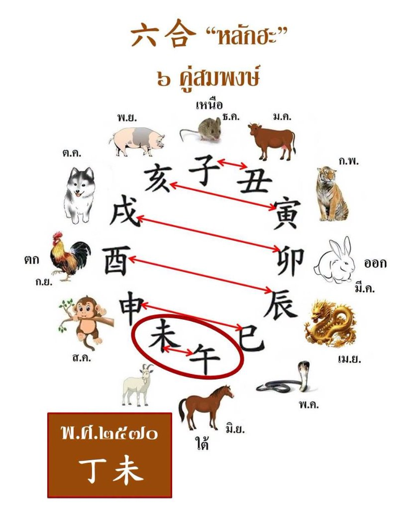

# ทฤษฎีที่ 46: 六合 “หลักฮะ” ปฏิกิริยาเส้นรุ้งแนวระนาบ (แกนโลกเอียง 23.5°) — ปี 丁未 (๒๕๗๐) กับกลไก 未 วิ่งหา 午 “ดินกลบไฟ” (ไม่ฮะ ไม่แปรธาตุ)

> **แหล่งที่มา:** เพจ *แม่ไม้ดวงจีน 八字 : Destiny Detective* (โพสต์ทฤษฎี “六合 หลักฮะ ปี 丁未 ๒๕๗๐ : 未 วิ่งหา 午 ดินกลบไฟ”)  
> **หมวดหมู่:** ทฤษฎีปฏิกิริยาราศีล่าง / 六合 (หลักฮะ ๖ คู่สมพงษ์) / ดาราศาสตร์แกนโลกเอียง 23.5 องศา (เส้นรุ้ง Latitude) / ดินกลบไฟ (未 ➡️ 午) / การทำนายปีจร 丁未 ๒๕๗๐  
> **ภาพประกอบ:** [docs/bazi/images/theory_46_liu_he_latitude_pairs.jpg](docs/bazi/images/theory_46_liu_he_latitude_pairs.jpg)



---

## 1. ดาราศาสตร์และเรขาคณิตจักรวาลแห่ง 六合 (หลักฮะ)

วิชาแม่ไม้ดวงจีนเปิดเผยรากฐานทางวิทยาศาสตร์และดาราศาสตร์ที่แท้จริงของ **六合 (๖ คู่สมพงษ์)**:
* **การหมุนรอบตัวเองของโลก:** ทำให้เกิด **กลางวันและกลางคืน**
* **การโคจรรอบดวงอาทิตย์ของโลก:** ทำให้เกิด **ฤดูกาลทั้ง ๔**
* **แกนโลกเอียงทำมุม 23.5 องศา:** กับแนวตั้งฉากของระนาบวงโคจรสุริยวิถี
* **เรขาคณิตเปรียบเทียบ:**
  * **六害 “หลักไห่”:** เกิดจาก **แนวตั้ง คือ เส้นแวง (Longitude)** $\rightarrow$ ปฏิกิริยาฉับพลันทันทีรวดเร็วดั่งสายฟ้า
  * **六合 “หลักฮะ”:** เกิดจาก **แนวระนาบขนาน คือ เส้นรุ้ง (Latitude)** $\rightarrow$ ปฏิกิริยาสมพงษ์ ผูกพัน ถ่ายเท และแปรสภาพ

```
                       [เส้นรุ้ง ๖ คู่สมพงษ์ (六合)]
                       子  <===========>  丑  (คู่เหนือ)
                       亥  <===========>  寅
                       戌  <===========>  卯
                       酉  <===========>  辰
                       申  <===========>  巳
                       未  <===========>  午  (คู่ใต้: ฤดูร้อน)
```

---

## 2. ทิศทางการอ่านดวง (Reading Flow & Vector Mechanics)

1. **มีอยู่ในดวงเดิม:** ให้อ่านจาก **ซ้ายไปขวา** (ปี $\rightarrow$ เดือน $\rightarrow$ วัน $\rightarrow$ ยาม)
2. **มาจากวัยจร (大運 - ๕ ปี):** วิ่งเข้ามากระทบดวงเดิม ให้อ่านจาก **ขวามาซ้าย**
3. **มาจากปีจร (流年 - ๑ ปี):** พุ่งเข้ามากระแทกดวงเดิม ให้อ่านจาก **ขวามาซ้าย**

---

## 3. ผ่าปรากฏการณ์ปี 丁未 (พ.ศ. ๒๕๗๐): เมื่อ `未` จรเข้าหา `午` $\rightarrow$ “ดินกลบไฟ”

ในตำราทั่วไปมักท่องจำว่า *“午 ฮะกับ 未 กลายเป็นดินหรือไฟ”*  
แต่วิชาแม่ไม้ดวงจีนชี้ชัดตามฟิสิกส์ธรรมชาติว่า **เมื่อ `未` (ดินแห้งปลายร้อน) วิ่งเข้าหา `午` (กองไฟ) จากปีจร:**

> [!IMPORTANT]
> $$\text{ปีจร } 未 \implies \text{ดวงเดิม } 午 \quad \equiv \quad \text{“ดินกลบไฟ”}$$  
> **ไม่เป็นปฏิกิริยา 合 “ฮะ” (ภาคี) ร่วม และ ไม่แปรธาตุ!**  
> มวลกองดินหนา `未` ถูกเทลงมาทับถมกองไฟ `午` จนไฟมอดดับ ไม่ก่อให้เกิดการหลอมรวม

---

## 4. กรณีศึกษาเชิงลึก: ดิถีน้ำหยาง `壬` (มี `午` ในดวง แล้วปีจร `未` เข้ามา)

```
                                          ปีจร (丁未 ๒๕๗๐)
x     壬      x       x                     x
x     午      x       x        <--          未
```

### การถอดรหัสสิบเทพ:
* **ดิถี:** ธาตุน้ำหยาง **`壬`** (น้ำมหาสมุทร)
* **`午` ในดวงเดิม (ธาตุไฟ):** คือ **正財 “เจี่ยไช้”**
  * หมายถึง: เงินทอง, รายได้ประจำ, เงินเดือน, เป้าหมายชีวิต, การตัดสินใจ, แผนการลงทุน
* **`未` ที่จรเข้ามา (ธาตุดิน):** คือ **正官 “เจี่ยกัว”**
  * หมายถึง: ยศ, ตำแหน่ง, ชื่อเสียง, เครดิต, ความรับผิดชอบ, หน้าที่การงาน, กฎหมาย, ระเบียบวินัย, คดีความ, การจองจำ, ติดคุก

---

### บทวิเคราะห์ผลลัพธ์สองขั้ว (用神 vs 忌神):

```
                   [未 ดินปลายฤดูจรเข้ามากลบ 午 กองไฟ]
                                    |
            +-----------------------+-----------------------+
            |                                               |
      ถ้า 未 เป็น 用神 (ธาตุให้คุณ)                   ถ้า 未 เป็น 忌神 (ธาตุให้โทษ)
            |                                               |
      ✨ ดินกลบไฟที่เป็นตัวเสียไว้                      ⚠️ ดินกลบไฟที่เป็นตัวดีไว้
   * ได้เลื่อนยศ ปรับตำแหน่ง                          * เกิดคดีความ ขึ้นโรงขึ้นศาล
   * ได้รับรางวัลประกาศเกียรติคุณ                      * เสียชื่อเสียง เครดิตพังพินาศ
   * หน้าที่การงานเจริญก้าวหน้า                       * สูญเสียเงินทองและทรัพย์สิน
```

#### ๑. ถ้า `未` (ดิน) เป็น 用神 “เอ่งซิ้ง” (ธาตุให้คุณ เสริมดวง):
* **กลไก:** ดินกัวสั่วะที่มีคุณธรรมเข้ามา **“กลบไฟที่กำลังเผาผลาญหรือเป็นตัวเสียเอาไว้”**
* **ผลคำทำนาย:**
  * ✨ ได้รับการเลื่อนขั้น เลื่อนยศ ปรับตำแหน่งหน้าที่การงาน
  * ✨ ได้รับรางวัล ใบประกาศเกียรติคุณ หรือการยกย่องเชิดชูเกียรติ
  * ✨ หน้าที่การงานมั่นคง เจริญก้าวหน้าอย่างยิ่งใหญ่

#### ๒. ถ้า `未` (ดิน) เป็น 忌神 “กี่ซิ้ง” (ธาตุให้โทษ ตัวถ่วงดวง):
* **กลไก:** ดินตัวร้ายโถมเข้ามา **“กลบไฟที่เป็นขุมทรัพย์และตัวให้คุณของดวงเอาไว้จนมอดดับ”**
* **ผลคำทำนาย:**
  * ⚠️ ถูกปิดกั้นช่องทางทำกิน การลงทุนผิดพลาด เสียเงินเสียทองก้อนใหญ่
  * ⚠️ เกิดคดีความ ถูกตรวจสอบ เครดิตความน่าเชื่อถือเสียหาย
  * ⚠️ เสื่อมเสียชื่อเสียง และอาจต้องรับโทษทัณฑ์ทางกฎหมาย

---

## 5. สรุปแม่ไม้ประจำทฤษฎี

1. **六合 คือ ละติจูดเส้นรุ้ง (แกนโลกเอียง 23.5°):** สอดคล้องกับระนาบโคจรและสัจธรรมธรรมชาติ
2. **未 วิ่งหา 午 คือ ดินกลบไฟ:** อย่าด่วนสรุปว่าฮะเป็นไฟหรือดิน เพราะดินกลบไฟย่อมดับไฟ
3. **พิจารณาธาตุโดยสอดคล้องกับธรรมชาติ:** ดินกลบตัวเสีย = เลื่อนยศรุ่งเรือง vs ดินกลบตัวดี = เสียทรัพย์คดีความ
