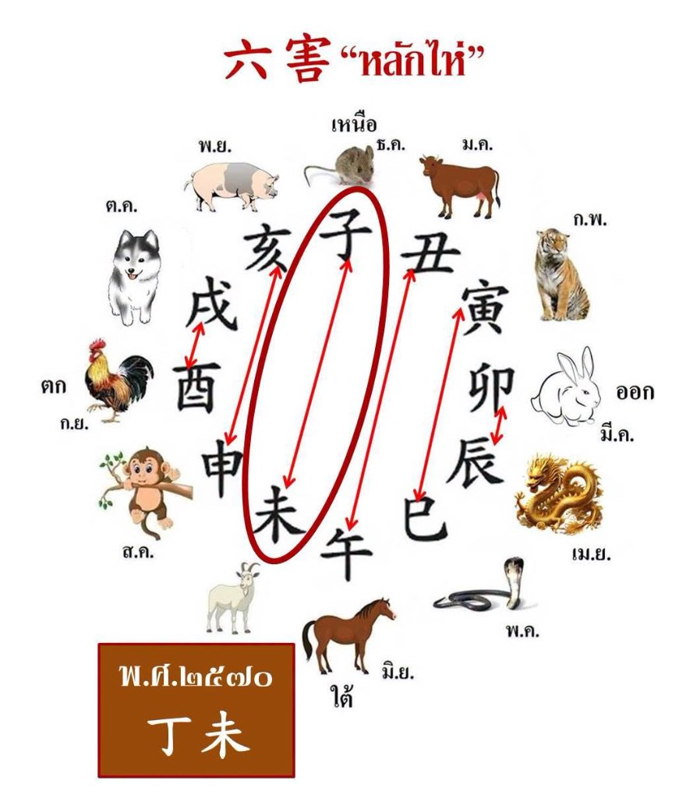

# ทฤษฎีที่ 47: 六害 “หลักไห่” ปฏิกิริยาเส้นแวงแนวตั้ง — ปี 丁未 (๒๕๗๐) กับกลไก 未 วิ่งหา 子 “ดินกลบน้ำ” (ดิถีไม้ 甲, เจี่ยอิ่ง vs เจี่ยไช้, สุขภาพ/ผ่าตัด & เทียนอิกกุ๊ยนั้ง)

> **แหล่งที่มา:** เพจ *แม่ไม้ดวงจีน 八字 : Destiny Detective* (โพสต์ทฤษฎี “六害 หลักไห่ ปี 丁未 ๒๕๗๐ : 未 วิ่งหา 子 ดินกลบน้ำ”)  
> **หมวดหมู่:** ทฤษฎีปฏิกิริยาราศีล่าง / 六害 (หลักไห่ ๖ คู่แนวตั้งเส้นแวง) / ดินกลบน้ำ (未 ➡️ 子) / พยากรณ์ปีจร 丁未 ๒๕๗๐ / 天乙貴人 (เทียนอิกกุ๊ยนั้ง) / การวินิจฉัยสุขภาพและการผ่าตัด  
> **ภาพประกอบ:** [docs/bazi/images/theory_47_liu_hai_vertical_pairs.jpg](docs/bazi/images/theory_47_liu_hai_vertical_pairs.jpg)



---

## 1. ดาราศาสตร์จักรราศี: 六害 “หลักไห่” (ปฏิกิริยาเส้นแวงแนวตั้ง)

ในโครงสร้าง 12 นักษัตรที่สัมพันธ์กับความเอียง 23.5 องศาของแกนโลก:
* **六合 (หลักฮะ):** คือคู่เชื่อมตาม **แนวระนาบแนวนอน (เส้นรุ้ง Latitude)**
* **六害 (หลักไห่):** คือคู่ตัดผ่านตาม **แนวตั้งฉาก (เส้นแวง Longitude)**
  * พลังงานของการตัดผ่านเส้นแวงมีลักษณะ **“ฉับพลัน ทันที เร่งด่วน รวดเร็ว”** เกิดขึ้นแบบสายฟ้าฟาด
* **๖ คู่เส้นแวงหลักไห่ (The 6 Longitude Harms):**
  1. **`子` ⮀ `未`** (คู่ศูนย์กลางหนาว-ร้อน: ฤดูหนาว vs ปลายฤดูร้อน) $\leftarrow$ *ไฮไลต์ปี 丁未 ๒๕๗๐*
  2. **`丑` ⮀ `午`**
  3. **`寅` ⮀ `巳`**
  4. **`卯` ⮀ `辰`**
  5. **`申` ⮀ `亥`**
  6. **`酉` ⮀ `戌`**

---

## 2. นัยยะสองขั้ว: 害 “ไห่” มิได้แปลว่าให้ร้ายเพียงอย่างเดียว!

> [!IMPORTANT]
> ผลลัพธ์ของ 六害 ถูกชี้ขาดด้วย **用神 (ธาตุให้คุณ) vs 忌神 (ธาตุให้โทษ)** อย่างเด็ดขาด:

```
                   [六害 (หลักไห่) ปฏิกิริยาเส้นแวงแนวตั้ง]
                                     |
               +---------------------+---------------------+
               |                                           |
    ถ้าเป็นธาตุที่ให้คุณ (用神)                   ถ้าเป็นธาตุที่ให้โทษ (忌神)
               |                                           |
    ✨ ให้ดี / รักษา / คุ้มครอง                    ⚠️ ให้ร้าย / ทำร้าย / ผ่าตัด
    * รัก, ดูแล, รักษา, เยียวยา, คุ้มครอง         * เกลียด, ให้ร้าย, ทิ่มแทง, กัดกร่อน
    * เปิดโอกาส, เร่งสปีด, เริ่มสิ่งใหม่, อิสระ    * ทำร้าย, ผ่าตัด, สิ้นสุด, คดีความ, ติดคุก
```

---

## 3. ผ่าปรากฏการณ์ปี 丁未 (พ.ศ. ๒๕๗๐): เมื่อ `未` วิ่งเข้าหา `子` $\rightarrow$ “ดินกลบน้ำ”

```
                                          ปีจร (丁未 ๒๕๗๐)
x     甲      x       x                     x
x     子      x       x        <--          未
```

### การถอดรหัสโครงสร้างดวง:
* **ดิถี:** ธาตุไม้หยาง **`甲`** (ต้นไม้ใหญ่/เสาหลัก)
* **`子` ในดวงเดิม (ธาตุน้ำ กลางฤดูหนาว):** คือ **正印 “เจี่ยอิ่ง”**
  * หมายถึง: ความรู้, ความคิด, ความจำ, สติปัญญา, แม่, ผู้ใหญ่, เจ้านาย, หัวหน้า
  * ถิ่นที่อยู่, ที่ทำงาน, ชื่อเสียง, เกียรติยศ, ตำแหน่ง, วาสนา
  * ร่างกาย, สุขภาพ, อาหารการกิน, ยารักษาโรค, สมุนไพร, วิตามินบำรุง
* **`未` ที่จรเข้ามา (ธาตุดิน ปลายฤดูร้อน):** คือ **正財 “เจี่ยไช้”**
  * หมายถึง: เงินทอง, รายได้ประจำ, เงินเดือน, ทรัพย์สิน, เป้าหมายชีวิต, การตัดสินใจ, การลงทุน
  * สำหรับดิถี `甲` ตัว `未` ยังเป็น **天乙貴人 “เทียนอิกกุ๊ยนั้ง”** (ดาวผู้อุปถัมภ์ค้ำจุน) อีกด้วย!
* **ปฏิกิริยาทางฟิสิกส์ธรรมชาติ:**
  $$\text{ปีจร } 未 \implies \text{ดวงเดิม } 子 \quad \equiv \quad \text{“ดินกลบน้ำ”}$$
  * ดินแห้งร้อนผาก `未` พุ่งเข้ามาทับถมกระแสน้ำ `子` จนน้ำซึมหายลงไปในดิน

---

### บทวิเคราะห์ผลลัพธ์เปรียบเทียบสองขั้ว:

```
                  [未 ดินแห้งร้อนจรเข้ามากลบ 子 มวลน้ำ]
                                    |
            +-----------------------+-----------------------+
            |                                               |
      ถ้า 未 เป็น 用神 (ธาตุให้คุณ)                   ถ้า 未 เป็น 忌神 (ธาตุให้โทษ)
            |                                               |
      ✨ ดินกลบน้ำที่เป็นตัวเสียไว้                   ⚠️ ดินกลบน้ำที่เป็นตัวดีไว้
   * กล้าตัดสินใจ ไม่ลังเล ปลอดโปร่ง                * ขาดผู้ใหญ่หนุนหลัง เจ้านายทอดทิ้ง
   * ได้รับเงินทอง รายได้มั่นคง                    * ตัดสินใจผิดพลาด เสียหาย เสียเงินทอง
   * แคล้วคลาดปลอดภัย มีผู้อุปถัมภ์               * สุขภาพทรุดโทรม อาจถึงขั้นต้องผ่าตัด
   * 天乙貴人 ทำงานเต็มพลัง                      * (แนะนำตรวจ Check-up ตั้งแต่เนิ่นๆ)
```

#### ๑. ถ้า `未` (ดิน) เป็น 用神 “เอ่งซิ้ง” (ธาตุให้คุณ เสริมดวง):
* **กลไก:** ดินเจี่ยไช้พุ่งเข้ามา **“กลบน้ำเจี่ยอิ่งที่เป็นตัวเสีย (ตัวที่ทำให้ลังเล วิตกกังวล หรือดวงชื้นแฉะเกินไป) เอาไว้”**
* **ผลคำทำนาย:**
  * ✨ จิตใจปลอดโปร่ง โล่งสบาย กล้าคิด กล้าตัดสินใจ ไม่ลังเลโลเลอีกต่อไป
  * ✨ ได้เงินได้ทอง รายได้ประจำเติบโต การลงทุนให้ผลตอบแทนคุ้มค่า
  * ✨ แคล้วคลาด ปลอดภัยสูง ด้วยอิทธิพลของ **天乙貴人 (เทียนอิกกุ๊ยนั้ง)** ที่ให้คุณ มีผู้ใหญ่และเจ้านายคอยอุปถัมภ์ช่วยเหลืออย่างอบอุ่น

#### ๒. ถ้า `未` (ดิน) เป็น 忌神 “กี่ซิ้ง” (ธาตุให้โทษ ตัวถ่วงดวง):
* **กลไก:** ดินตัวร้ายพุ่งเข้ามา **“กลบน้ำเจี่ยอิ่งที่เป็นร่มโพธิ์ร่มไทร คอยหล่อเลี้ยงชุบชีวิตต้นไม้ 甲 เอาไว้จนแห้งเหือด”**
* **ผลคำทำนาย:**
  * ⚠️ **ขาดการสนับสนุน:** ผู้ใหญ่และเจ้านายที่เคยช่วยเหลือถอยห่าง ถูกทอดทิ้งให้เผชิญปัญหาเพียงลำพัง
  * ⚠️ **การตัดสินใจพังทลาย:** ตัดสินใจลงทุนผิดพลาดอย่างร้ายแรง เสียหาย สูญเสียเงินทองก้อนโต
  * ⚠️ **วิกฤตสุขภาพและการผ่าตัด:** เนื่องจาก `子` คือดาวสุขภาพและยา เมื่อถูกดิน `未` 害 (ไห่) กลบทำลายอย่างฉับพลัน **ร่างกายจะเกิดการเจ็บป่วยอย่างรวดเร็ว และมีเกณฑ์สูงมากที่จะต้องเข้ารับการผ่าตัด!**
  * > [!TIP]
    > **คำแนะนำแก้เคล็ดทางวิทยาศาสตร์การแพทย์:** ผู้ที่มีดวงลักษณะนี้ ควรไปตรวจเช็กร่างกาย (Health Check-up) อย่างละเอียดตั้งแต่เนิ่นๆ เพื่อชิงลงมือก่อนที่โรคจะปะทุฉับพลัน

---

## 4. สรุปแม่ไม้ประจำทฤษฎี

1. **六害 คือ เส้นแวง 90 องศาตัดขนาน:** ส่งผลฉับพลัน รวดเร็ว รุนแรง
2. **未 วิ่งหา 子 คือ ดินกลบน้ำ:** ตัวจรปี 丁未 (๒๕๗๐) เป็นตัวกระตุ้นหลัก
3. **คำทำนายสุขภาพต้องแม่นยำ:** เมื่อ 正印 ถูกไห่ทำลายอย่างรุนแรง พึงระวัง **การเจ็บป่วยเฉียบพลันและการผ่าตัด** เสมอ!
